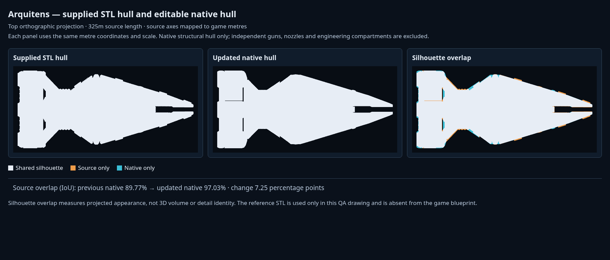
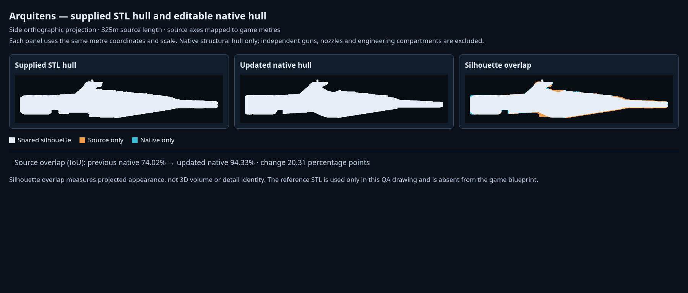
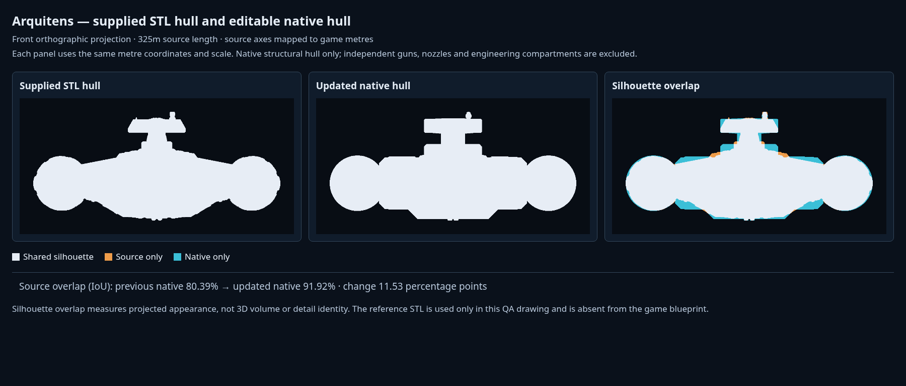

# ゲーム内パーツで組むアーキテンス作例

アーキテンス作例は、ゲームの通常の構造物75個と独立した装備で組み立てる。添付された `arquitens.stl` を実測し、上面・側面・正面を同じ座標で比較して、中央船体の盛り上がり、翼状の艦橋、二股の艦首、機関支持部と短い3基のポッドを作り直した。船体の描画・物理判定・保存に外部船体メッシュを使わない。

[ゲームに読み込める設計図JSON](examples/arquitens-native.blueprint.json) を同梱する。組込作例も同じ `Core.buildDesign('arquitens')` から生成する。各構造物と装備は、通常の編集画面で選択、移動、寸法・断面の変更、複製、削除、Undo、保存ができる。細い横断リブ6本も通常の構造物として保存し、0.9 mの実寸と形状を読込み後まで保持する。

## 元モデルとの比較

座標は艦尾から艦首へ+X、上へ+Y、右舷へ+Z。元STLを全長325 mへ一様に換算し、ネイティブ構造物と同じ座標・正投影・縮尺で比較する。船体の投影輪郭の重なりを、交差面積÷和集合面積（IoU）で測る。

| 比較方向 | 変更前（24構造物） | 変更後（75構造物） |
| --- | ---: | ---: |
| 上面 | 89.77% | 97.03% |
| 側面 | 74.00% | 94.33% |
| 正面 | 80.45% | 91.92% |







比較は元STLの214,690面から一体化された主砲23,420面とノズル内筒6,930面を除いた184,340面を使い、ネイティブ側も独立した武装・ノズルを除いた船体構造物だけを使う。外側のポッド、開口周縁、船体の細部は残す。輪郭一致率は3次元体積や細部表面の一致率ではない。測定条件と各方向の差分を比較画像に残す。

```sh
python3 scripts/analyze-arquitens-reference.py --output-dir /tmp/arquitens-reference
```

この解析は資料の比較専用で、元STLや解析メッシュをゲームの実行時データへ登録しない。

## 船体の組み方

設計範囲は全長325 m・全幅144.27615 m・高さ63.61913 m。構造物は断面ロフト26個、切隅箱22個、曲面板10個、円環7個、楕円体5個、丸断面ロフト3個、輪郭板2個の計75個。船体構造物と内部設備を合わせた保存部品は94個、独立装備は17基。

| 船体の部分 | 再現した形状 |
| --- | --- |
| 主船体 | 幅の広い後部頸部、中央の高い稜線、左右の連続した武装甲板、斜めの外板 |
| 艦首 | 左右の独立した突起、内壁、傾斜上面。X250〜255 m付近から始まる中央の実空間 |
| 背面 | 長い後部スパイン、段のある前部スパイン、3か所の機器ハッチ |
| 艦橋 | 後方へ傾いた支持塔、左右へ張り出して先端が細くなる翼状のヘッド、窓帯とマスト |
| 腹面 | 中央の船殻、2本の長いキール稜材、後部の腹面キール |
| 機関架 | 斜行翼板、上下の曲桁、ポッド間フェアリング、排気環、後部頸部のリブ |
| 推進ポッド | 約55.5 mの短い丸断面外殻、開口した後端リング、点検帯 |
| 舷側 | 中央・前部の丸いブリスター、上縁装甲、横断リブ |

主砲専用の厚い支持台4個は取り除く。上面主砲は連続した側部甲板、下面主砲は船体下面へ直接取り付ける。元STLの単純な外形箱を重ねる方法ではなく、断面と実際の空隙を通常の編集可能な立体で作る。

3基のポッドはY約21.8 m、Z約0.56・±55.9 m。丸断面本体はX14 mから始まり、後端の円環は中心X7 m・外径32.47 m・奥行14 mで内側を開く。標準ISDベル型ノズルの口を塞がない。構造物、エンジン、専用反応炉はそれぞれ独立して編集できる。

## 主砲と装備

| 項目 | 値 |
| --- | --- |
| 武装キー | `quad500` |
| 名称 | 500GT 4連装中型ターボレーザー |
| 1門・一斉射 | 0.5 TT × 4門 = 2 TT |
| 配列 | 左に縦2門、右に縦2門 |
| 通常装備のアセット | `arq_turret_quad500` |
| 全長 × 全高 × 全幅 | 17.8304 × 5.8065 × 14.1041 m |
| 作例への搭載 | 上面2基・下面2基、合計4基16門 |

四連装砲は、先に提供された `Turret-Small-1.fbx` の砲室・円形駆動部を保持した通常のカタログ武装。参考写真に合わせ、長く細い円筒砲身4本、段付きの根元、上下をつなぐ揺架を配置する。砲身中心は取付面から4.0 m・5.1 m、俯仰軸は約3.641 m。砲口には実際のくぼみを持つ。標準寸法は参考STLの主砲に合わせた個別基準で、出力から再縮小しない。[写真基準の四連装砲](photo-reference-turrets.md) を参照。

上面の取付点は `[173.2522,32.18,±28.4337]`、下面は `[238.0963,17.88336,±24.0026]`。通常の甲板レイで表面を求め、4基すべてを砲座高さ0で取り付ける。外部モデルの座面へ押し込む補正量は使わない。


小型両用砲8基、航空機と共通の小型震盪ミサイル発射管4基、下面トラクター1基を搭載する。発射管は1.2×0.45×0.45 mで、船首の二股形状を保つ。発射角・器材面VLSの仕様は [震盪ミサイル発射管](concussion-launchers.md) を参照。

3基の機関はそれぞれ専用炉へ接続する。主反応炉、ハイパードライブ、慣性補償、構造維持、シールド、燃料、艦橋・CIC、貨物を船内へ配置し、設備の包絡箱の全頂点が構造物内に収まることを検証する。兵員100名の搭載設定を保持し、航空隊は追加しない。無要求時の推力は0で、給電に従う通常の推進計算を使う。主砲と小型両用砲の充電設備には [実際の砲室容積](turret-family-and-compartments.md) を利用する。

## 設計図とプロフィールの再生成

```sh
node scripts/export-arquitens-example.cjs /tmp/arquitens-native
```

通常の作例ビルダーと保存APIで、次の3ファイルを出力する。Blenderや元STLの読み込みは不要。

- `arquitens-native.blueprint.json`: ゲームで読み込める通常の設計図。
- `fleet-record.json`: 同じ設計から算出した艦隊プロフィール。
- `build-report.json`: 部品表、実装ソースのハッシュ、質量・価格、生成時間。

組込の `data/fleet.js`、同梱設計図、[生成記録](benchmarks/arquitens-native-build.json) は同じ最終ソースから更新する。構造物と砲室区画の変更に伴う質量・価格・所要時間は生成記録で確認できる。プロフィール版は6、費用モデル版は12。

mainの計算高速化を統合した最終生成記録の質量は438,555.105432 t、建造価格は2,798,328。通常パーツの組立は0.480秒、初回の工学計算は9.268秒だった。重なる構造物の実際の和集合を使う。Nodeの計測時間は、ブラウザや実機のフレームレートを示す値ではない。

船体用の `arq_hull` 登録を実行時データから取り除き、約7.2 MBの不要な登録データを削減した。元STLは `assets/source/arquitens.stl` に形状資料として保持し、SHA-256は `e0c6b655ffe0690dd5ddc835f17fa5caf57e671760307576b20c75792ee8f108`。作者・ライセンス情報は添付データに含まれない。`scripts/import-arquitens.py` と旧計測マニフェストは資料用で、作例の生成経路には含まれない。主砲の変換器 `scripts/build-arquitens-turret.py --check` は通常装備の再現性を確認するために保持する。

## 検証

```sh
node --test tests/arquitens-model.cjs tests/arquitens-turret.cjs \
  tests/weapon-family-models.cjs tests/turret-compartment-volume.cjs \
  tests/weapon-output-sizing.cjs tests/authored-turret-motion.cjs \
  tests/authored-turret-clearance.cjs tests/load-cache.cjs
```

船首中央の空隙、艦橋と背面の高さ、ポッド間の空間、ノズル開口、砲塔の直接接地、内部設備の包絡、実給電と推力、部品の移動・寸法変更・切削による物理形状の変化、保存の反復、組込キャッシュとの一致を対象にする。船体上面の7地点では元STLへレイを当て、同じ地点の高さが2 m以内に収まることを検証する。

```sh
python3 -m http.server 8765 --bind 127.0.0.1
node scripts/browser-arquitens.cjs http://127.0.0.1:8765 \
  docs/examples/arquitens-native.blueprint.json
```

main統合後の最終ブラウザ検証は日本語PC（1440×1000）と英語スマホ幅（390×844）で成功した。PCは通常の作例ボタンから生成し、艦橋の高さ変更・メッシュ更新・Undoによる復元を確認。スマホ幅は公開デバッグAPIから通常設計図を復元し、英語の武装表示と横幅への収まりを確認した。読込み後の初回計算完了までPCは29.589秒、スマホ幅は20.221秒で、両条件ともworkerを使用し、JavaScriptエラーとWebGLエラーは0。[ブラウザ記録](benchmarks/arquitens-browser.json) に実装ソースのハッシュと各条件の結果を残す。

実機スマホ、GPUのフレームレート、継続戦闘中の射撃は対象外。船体輪郭は標準形状による近似で、元STLの細かな凹凸まで一致させるものではない。武装の連射間隔・質量・費用、内部設備の性能はゲーム用仮定。
