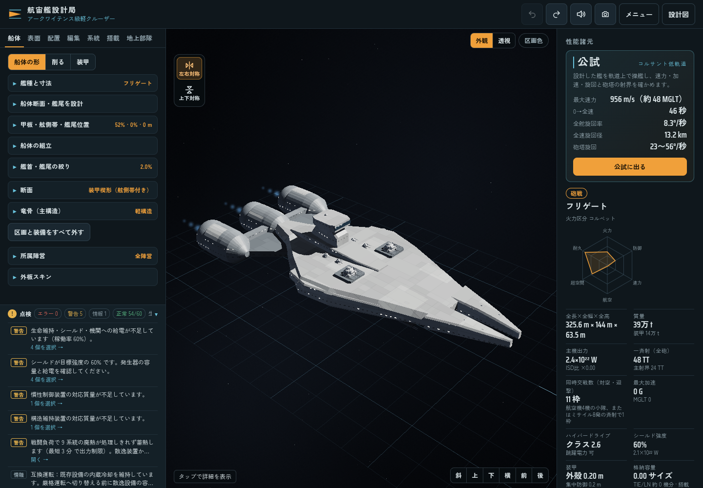
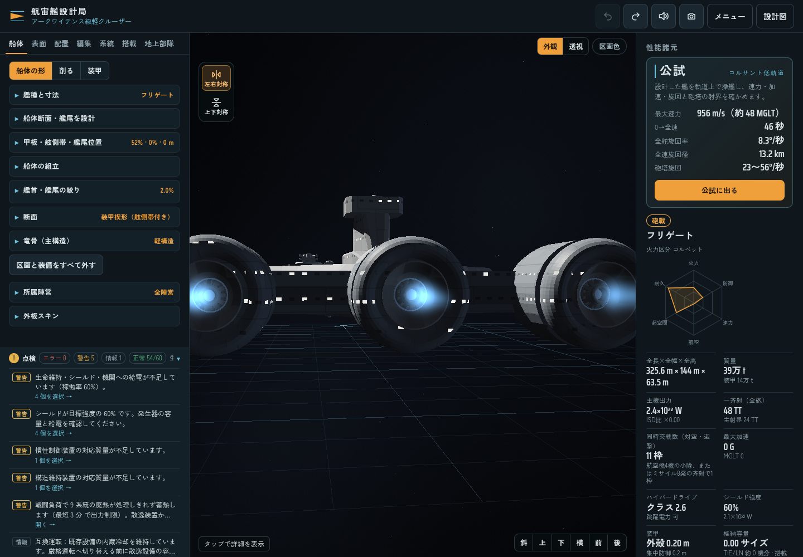
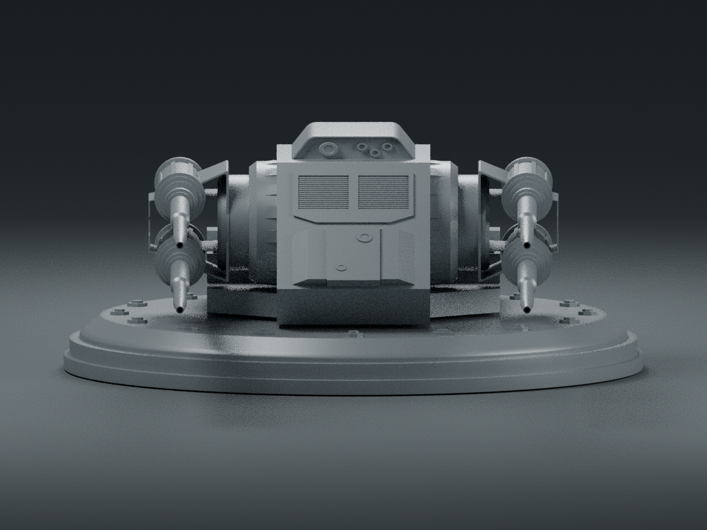
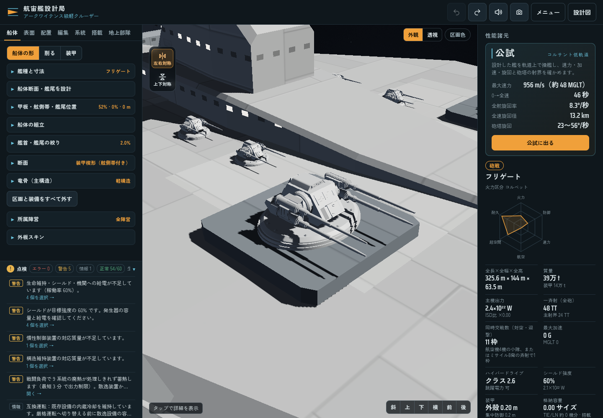

# ゲーム内パーツで組むアーキテンス作例

アーキテンス作例は、ゲームの通常の構造物24個と独立した装備で組み立てる。添付された `arquitens.stl` は輪郭と主砲寸法の参考資料として使う。船体の描画・物理判定・保存に、外部船体メッシュや専用の衝突モデルを使わない。

[ゲームに読み込める設計図JSON](examples/arquitens-native.blueprint.json) を同梱する。組込作例もこの設計図と同じ `Core.buildDesign('arquitens')` から生成する。船体・艦橋・推進ポッド・砲座は、通常の編集画面で選択、移動、寸法・断面の変更、複製、削除、Undo、保存ができる。

## 船体の組み方

組立式船体の設計範囲を全長325 m・全幅144 m・高さ64 mにする。座標は艦尾から艦首へ+X、上へ+Y、右舷へ+Z。各構造物は通常の断面ロフト、丸断面ロフト、切隅箱、輪郭板、円環を使う。形状ごとの数はロフト8・切隅箱8・輪郭板2・丸断面ロフト3・円環3で、合計24個。

| 船体の部分 | 個数 | 標準形状・組み方 |
| --- | ---: | --- |
| 中央船体 | 1 | X50〜266 mを8断面でつなぐロフト。中央付近の幅126 m、高さ20 m |
| 二股の艦首 | 2 | X258〜325 mの左右のロフト。先端の内側はZ±5 m、外側は±9 m |
| 舷側の張出し甲板 | 2 | X126〜220 mのロフトを左右対称配置 |
| 背部中央構造 | 1 | X73〜189 mの低いロフト |
| 艦橋 | 3 | 支持塔のロフト、29×25×7 mの切隅箱、窓帯の切隅箱 |
| 腹部キール | 1 | X55〜151 mの細いロフト |
| 機関支持部 | 4 | 左右の輪郭板と横桁 |
| 推進ポッド | 6 | 丸断面ロフト3個と、開口した後端リング3個 |
| 主砲座 | 4 | 20×20×2 mの切隅箱を上面2個・下面2個 |

中央船体は中心 `[158,22,0]`、部品寸法 `[216,126,20]`（長さ・幅・高さ）。その8断面は以下の物理座標から定義する。保存時は通常の構造物エディターと同じ、部品寸法に対する相対断面値になる。全24部品の寸法・位置・断面値は設計図JSONと [生成記録](benchmarks/arquitens-native-build.json) に含む。別プロセスで2回生成し、設計図と艦隊レコードがそれぞれバイト単位で一致することを確認した。

| X | 左右の外縁Z | 底Y | 上面Y |
| ---: | ---: | ---: | ---: |
| 50 | ±9 | 12 | 32 |
| 80 | ±20 | 12 | 32 |
| 112 | ±44 | 12 | 32 |
| 142 | ±63 | 12 | 32 |
| 174 | ±59 | 12 | 32 |
| 220 | ±43 | 14 | 31 |
| 258 | ±30 | 16 | 29 |
| 266 | ±27 | 17 | 28 |

艦首の左右の突起を別部品にすることで、X266 mより前の中央には実際の空間ができる。隙間を描画だけで隠したり、船全体を一枚の形状へ固めたりしない。

3基のポッド中心はY21.8 m、Z0・±55.4 m。後端の円環は外径33.2 m、内径約20.6 m、奥行14 m、法線−X。丸断面のポッド本体はX14 mから始まり、標準ISDノズルの口を塞がない。エンジン、専用反応炉、ポッド構造物をそれぞれ編集できる。





## 主砲と装備

| 項目 | 値 |
| --- | --- |
| 武装キー | `quad500` |
| 名称 | 500GT 4連装中型ターボレーザー |
| 1門の射撃エネルギー | 500 GT = 0.5 TT |
| 門数・一斉射 | 4門・2 TT |
| 配列 | 左に縦2門、右に縦2門 |
| 通常装備のアセット | `arq_turret_quad500` |
| 全長 × 全高 × 全幅 | 17.8304 × 5.8065 × 14.1041 m |
| 作例への搭載 | 上面2基・下面2基、合計4基16門 |

四連装砲は、先に提供された `Turret-Small-1.fbx` の両用砲から作った通常のカタログ武装である。砲室の全ての面、砲身の円形断面とくぼんだ砲口を保ち、左右それぞれ上下に完全な砲身を配置する。寸法は参考STLの主砲に合わせた個別の基準で、他の武装の出力による寸法補正を変更しない。

上面の砲座表面は `[173.2522,34,±28.4337]`、下面は `[238.0963,14,±24.0026]`。通常の甲板レイで取り付け位置を求め、主砲を選択・移動できる。外部モデルの座面へ押し込む補正量は使わない。





小型両用砲8基、航空機と共通の小型震盪ミサイル発射管4基、下面トラクター1基を搭載する。発射管は1.2×0.45×0.45 mで、船首の二股形状を保つ。発射角・器材面VLSの仕様は [震盪ミサイル発射管](concussion-launchers.md) を参照。

3基の機関はそれぞれ専用炉へ接続する。主反応炉、ハイパードライブ、慣性補償、構造維持、シールド、燃料、艦橋・CIC、貨物を船内へ配置し、設備の包絡箱の全頂点が構造物内に収まることを確認する。兵員100名の搭載設定を保持し、航空隊は追加しない。無要求時の推力は0で、給電に従う通常の推進計算を使う。

## 設計図と艦隊プロフィールの再生成

```sh
node scripts/export-arquitens-example.cjs /tmp/arquitens-native
```

通常の作例ビルダーと保存APIで、次の3ファイルを出力する。Blenderや元STLの読み込みは不要。

- `arquitens-native.blueprint.json`: ゲームで読み込める通常の設計図。
- `fleet-record.json`: 同じ設計から算出した艦隊プロフィール。
- `build-report.json`: 部品表、実装ソースのハッシュ、質量・価格、生成時間。

`data/fleet.js` はアーキテンスの項目だけを更新し、プロフィール版5・質量387,261.354276 t・建造価格2,642,326を保存する。12機種の艦載機カタログはバイト単位で維持し、価格署名 `l4qlh3` と全12項目の有効性を確認した。

船体用の `arq_hull` 登録を実行時データから取り除き、約7.2 MBの不要な登録データを削減した。元STLは `assets/source/arquitens.stl` に形状資料として保持し、SHA-256は `e0c6b655ffe0690dd5ddc835f17fa5caf57e671760307576b20c75792ee8f108`。作者・ライセンス情報は添付データに含まれない。`scripts/import-arquitens.py` と旧計測マニフェストは資料用で、作例の生成経路には含まれない。主砲の変換器 `scripts/build-arquitens-turret.py --check` は通常装備の再現性を確認するために保持する。

## 検証

```sh
node --test tests/arquitens-model.cjs tests/arquitens-turret.cjs \
  tests/load-cache.cjs tests/structural-survey-cache.cjs \
  tests/weapon-output-sizing.cjs tests/surface-embedded-renderer.cjs
```

ネイティブ船体の9件と関連25件、計34件が成功した。実際の船首の空隙、ポッド間の空間、艦橋、ノズル開口、砲座への接地、内部設備の包絡、実給電と推力、部品の移動・寸法変更・切削による物理形状の変化、保存の反復、組込キャッシュとの一致を確認する。

最終Core（SHA-256 `2eaf8790986fb12ab72473e0324ba9d7f881d4529a800b79da63eb4b13f1e2fc`）でブラウザ2条件が成功した。日本語PCは実際の作例ボタン、英語スマホ幅は同梱した通常の設計図から読み込み、両方で最新の形状・統計まで更新されることを確認した。船体の標準パーツ描画、実際の編集画面による艦橋部品の高さ変更とUndo、独立した砲塔4基・小型発射管4基・ノズル3基、開いた船首とノズルを確認した。外部船体・参照構造物の描画数、JavaScriptエラー、WebGLエラー、横方向の画面はみ出しは全て0。記録は [ブラウザ検証](benchmarks/arquitens-browser.json) を参照。

```sh
python3 -m http.server 8765 --bind 127.0.0.1
node scripts/browser-arquitens.cjs http://127.0.0.1:8765 \
  docs/examples/arquitens-native.blueprint.json
```

船体輪郭はゲームの標準形状による近似で、参考STLの細かな凹凸まで一致させるものではない。武装の連射間隔・質量・費用、内部設備の性能はゲーム用仮定。持続戦闘の給電・冷却収支、実機スマホの入力、GPUのFPSはこの船体修正の検証対象に含めない。
