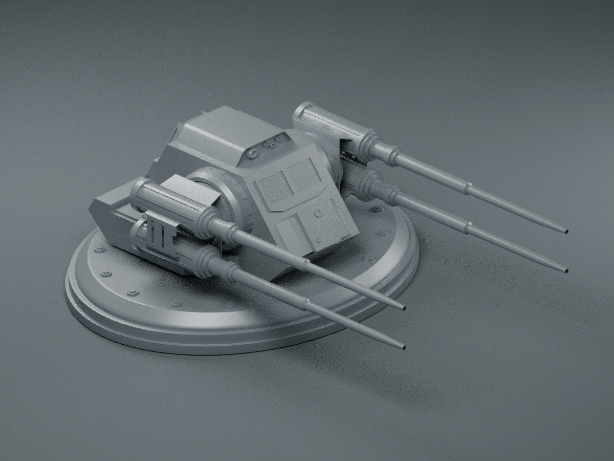

# 添付STL版アーキテンスと500GT四連装砲

GitHub版の `arquitens` 作例を、今回添付された `arquitens.stl` に更新した。以前の `ArquitensClassCruiser.STL` に基づく断面ロフト、古い砲座、三連装中砲の代用配置を置き換える。保存済みのユーザー設計を新作例へ上書きする処理は加えない。

## 船体

全長325 mへ等比変換した寸法は、全幅144.276149 m・全高63.619126 m。座標は艦尾から艦首へ+X、上へ+Y、右舷へ+Zとする。元STLの作者・ライセンス情報は添付データに含まれない。

`assets/source/arquitens.stl` に元ファイルを保持する。SHA-256は `e0c6b655ffe0690dd5ddc835f17fa5caf57e671760307576b20c75792ee8f108`。

描画アセット `arq_hull` は、元214,690三角形から主砲4基分23,420面と、3か所のノズル内部6,930面だけを取り除いた184,340面を使う。船体の細部、艦橋、エンジンカウリングとノズル外周リップを保つ。固定主砲を残したまま新砲塔を重ねない。除去した内部ノズルには、既存部品と同じISDベル型ノズルを配置する。

STLは法線の連続性を定義しないため、30度を境に頂点法線を分け、三角形の座標と接続は保つ。描画形状と別に、0.55 mボクセルから閉じた15,000面の衝突形状を作る。非多様体辺は0で、艦首のスリットと3基の推進ポッドを判定で検証する。細かい凹凸の物理判定はこの近似形状に従う。

作例は組立式船体に通常の選択・移動・寸法変更ができる参照構造物を1つ持つ。二重の主船体や外観だけの重ね描きは使わない。内蔵設備、砲塔、ノズルは独立した通常の装備である。大きな参照構造物の取り付けレイは三角形バッファに対応するBVHを再利用し、構造物の移動や切削によってバッファが変われば再構築する。

## 主砲

| 項目 | 値 |
| --- | --- |
| 武装キー | `quad500` |
| 名称 | 500GT 4連装中型ターボレーザー |
| 1門の射撃エネルギー | 500 GT = 0.5 TT |
| 門数・一斉射 | 4門・2 TT |
| 配列 | 左に縦2門、右に縦2門 |
| 砲塔アセット | `arq_turret_quad500` |
| 全長 × 全高 × 全幅 | 17.8304 × 5.8065 × 14.1041 m |
| 取付原点・姿勢 | `[0,0,0]`、砲身+X、上+Y |
| 作例への搭載 | 上面2基・下面2基、合計4基16門 |

500GTは既存の `quad200` と同様、1門あたりの値とする。寸法は添付STLの主砲から測った値を採用し、この砲に限り出力に基づく通常の寸法補正を重ねない。既存のDBY-827・8連装砲の基準や、他の武装のサイズは変更しない。

先に提供された `Turret-Small-1.fbx` の両用砲を元に、砲室の全ての面を保ち、完全な砲身を左右それぞれ上下に複製した。砲口のくぼみと円形断面を保ち、砲身は既存の側面支持部へ接続する。砲塔の選択包絡、プレビュー、試験航行、艦隊描画は同じ参照モデルを使う。




連射間隔0.2秒、質量2,250 t、乗員10名、基礎費用200,000はゲーム用仮定。砲塔サイズから威力や費用を逆算しない。既存の小型両用ターボレーザーの性能は変更しない。

## 作例とキャッシュ

主砲はSTLで実測した旋回台の位置と上下の向きを保持する。上面は `[173.2522,30.928757,±28.4337]`、下面は `[238.0963,17.883359,±24.0026]`。新しい船体に合わせて両用砲8基、外付けミサイル4基、下面トラクター1基を配置する。元の主砲面と新しい回転砲塔が重複しない。

3基の推進ポッドには専用反応炉を置く。主反応炉、ハイパードライブ、慣性補償、構造維持、シールド、燃料、艦橋・CIC、貨物区画を新しい物理船体の内部へ配置する。通常の実給電ベースの推進計算を使い、無要求時の推力は0とする。兵員100名の任意搭載設定を保持し、航空隊は追加しない。

`data/fleet.js` はアーキテンスのプロフィールだけを実設計から再計算し、版4・4基の四連装砲・3基の有効機関・新しい質量と価格を保存する。武装追加によって共通価格署名が変わるため、12機種の艦載機カタログも再生成した。旧版との完全比較では、署名13か所だけが変わり、価格、費用内訳、システム、熱、推進プロフィールは全て同じだった。

## 再生成と検証

```sh
blender --background --threads 4 --python scripts/import-arquitens.py -- \
  assets/source/arquitens.stl /tmp/arquitens-asset.json \
  --metadata-output /tmp/arquitens-manifest.json
python scripts/build-arquitens-turret.py --check
node --test tests/arquitens-model.cjs tests/arquitens-turret.cjs
```

STL変換器は中間JSONを出力する。登録済みの `arq_hull` と生成されたJSONの描画バイト列・面数・閉じた物理形状を比較できる。砲塔変換器の `--write-registration` は `data/reference.js` の該当する登録だけを更新する。

回帰テストでは元STLのハッシュ、固定砲とノズル内部の除去、砲身4本の実接続形状、左右の縦配列、取付原点と寸法、6方向・傾斜時の選択と描画の一致、艦首の空洞、機関給電、無動力時のゼロ推力、保存の反復、組込艦隊プロフィールを確認する。参照構造物を移動・切削した後のレイ判定も検証する。
