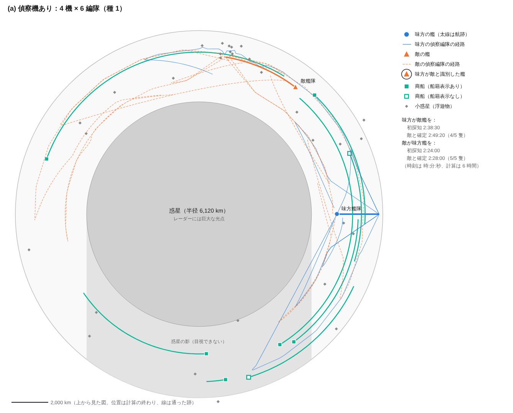
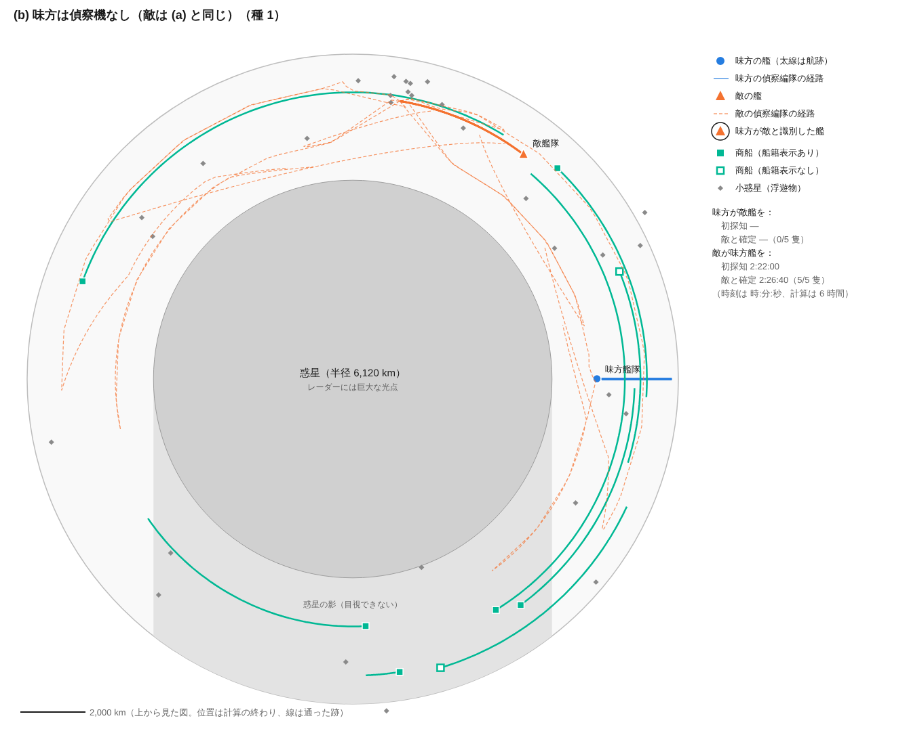
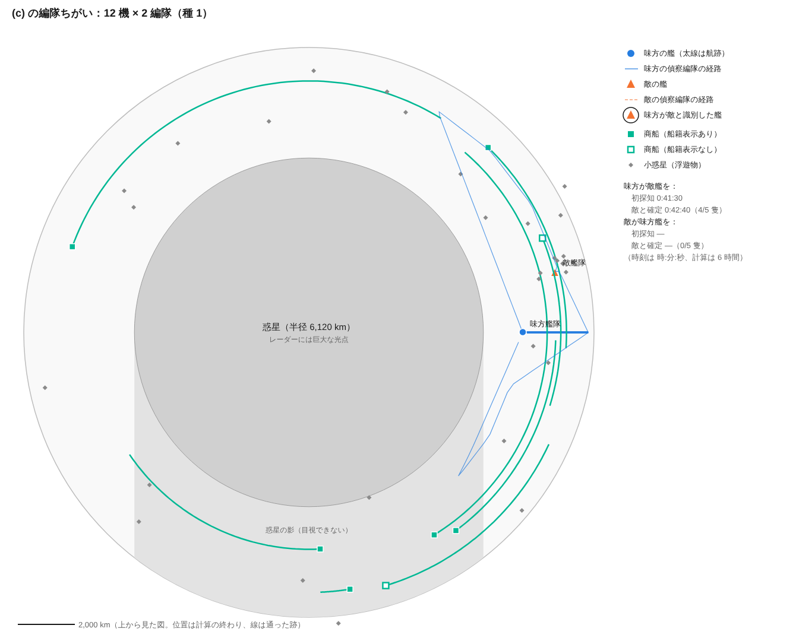

# 索敵の検証（計算だけ、2026-11-25）

ユーザーの指示（原文：[../../handoff-2026-11-25/sensing-trial-request-2026-11-25.md](../../handoff-2026-11-25/sensing-trial-request-2026-11-25.md)）を、ゲームに組み込まずにスクリプトだけで試した記録です。

- **ゲーム本体（`js/`、`data/`、`tests/`）は変えていません。** ここに書いた式や数値は、ゲームの中ではまだ働きません。
- 「★」は、ユーザーの指示にも既存の実装にも無く、**こちらで選んだ**値や規則です。すべて `scripts/sim-sensing-trial.cjs` の先頭の `K` に 1 か所でまとめてあり、変えて計算し直せます。
- レビュー担当（physics-reviewer など）の確認は受けていません。数値は「この仮の規則だとこうなる」という見本で、調整済みの値ではありません。

## 1. 先に結論

1. **この広さでは、偵察を出さないと誰も相手を見つけられない。** 双方とも偵察機なし（場面 d）は、6 時間たっても 5 回とも互いを見つけませんでした。艦のセンサーが届くのは大型艦どうしで 1,000〜1,700 km、マップは直径 20,000 km です。
2. **偵察を出した側だけが見つける。** 味方だけ偵察機なし（場面 b）は、5 回とも敵だけが味方を識別しました（1 時間 45 分〜2 時間 54 分後）。
3. **双方が偵察を出すと（場面 a）、今の仮の規則では敵（帝国）が先に確定した。** 敵が先 4 回、どちらもなし 1 回。差は 12〜21 分。理由は 3 つ：敵は全周に 8 編隊を出している（味方は 6）、ISD のセンサーの開口が大きい、A ウイングの航続が短く（下の表）遠い敵まで届かない。
4. **機関を絞った小型艦は、広い横一列でないと見つからない（場面 c）。** 4 機 × 6 編隊と 2 機 × 12 編隊は 5 回とも見逃し。12 機 × 2 編隊（横幅 1,100 km）は 5 回中 3 回見つけ、最初の探知から約 1 分で識別しました。低放射の CR90・ゴザンティは熱がほぼ映らず（数 km〜数十 km）、レーダーの光点（100〜150 km）としてしか出ません。
5. **追跡枠は今回の場面では足りた。** 同時に使ったのは最大 5〜8 枠。ただし性能表では MC75・MC80・ネビュロン B・CR90 の同時交戦数が 0 で（ISD は 12）、★ 最低 1 とみなして 1 隻 2 枠にしています。艦だけなら味方 10 枠、敵 54 枠です。
6. **誤認は少なかった。** 小惑星を不審（＝推定で敵）とした例は 0。船籍表示のない商船 2 隻は、追跡できた回には「不審」になりました（場面 a 系で合計 9 回）。なぜ出していないか（敵・怪しい・出し忘れ）は、近づいて識別するまで区別できません。

数値はすべて [results.md](results.md)（スクリプトの出力そのまま）にあります。

## 2. マップ

| 項目 | 値 | 出どころ |
| --- | --- | --- |
| 形 | 戦場の中心の惑星を中心にした円盤 | ユーザー |
| 大きさ | 半径 10,000 km（「2万キロ」を直径と読んだ） | ユーザー（直径か半径かは未確認 → §10） |
| 高さ | 上へ 5,000 km、下へ 5,000 km | ユーザー |
| 惑星の半径 | 6,120 km ★ | 既存の `scripts/sim-fleet-air.cjs` の惑星と同じ |
| 恒星の光 | 図の上（+z）から下へ ★。惑星の裏は影で、目視できない | こちらで選んだ |

惑星が半径 6,120 km なので、動ける場所は幅 3,880 km の輪です。惑星は見通しを遮ります（レーダー・赤外・目視・船籍表示）。ニュートリノと重力波は遮られません ★。

今回の配置は、高さ方向を ±500 km しか使っていません（★。上下 5,000 km 全体に散らすと、さらに見つかりにくくなります）。

## 3. 5 つの手段の式

艦・航空機・商船・小惑星を、すべて同じ「特性」（§4）にして同じ式へ通します。種別による分岐はありません（小惑星は「反応炉もセンサーもない船」）。

| 手段 | 式 | しきい値 | 惑星に遮られるか | 出どころ |
| --- | --- | --- | --- | --- |
| レーダー | SNR ＝ 観測側のレーダー開口 × 反射断面積 ÷ 距離⁴（基準：開口 1 が 1,000 m² を 120 km で SNR 1） | 1 で光点、3 で追跡、20 で像（識別） | 遮られる | **既存の `Core.sensSNR`・`Core.SENS` をそのまま** |
| ニュートリノ・熱 | SNR ＝ 放射 W × 開口 ÷ 距離²（基準：10²² W を開口 1 で、ニュートリノ 300 km・赤外 150 km で SNR 1）。放射 ＝ 排熱 × 排熱装置の種類ごとの割合（`Core.EMIT.band`） | 1 で光点、赤外 40 で像（識別） | ニュートリノは遮られない、赤外は遮られる | 式は既存。排熱 ＝ 反応炉出力 × 0.05 ★ |
| 重力波 | 源の強さ Q ＝ 質量 ×（9.8 m/s² ＋ 今の加速度）。SNR ＝ (Q ÷ 5×10¹¹ N) × (2,000 km ÷ 距離)² × 開口 ÷ 惑星の雑音 | 1 | 遮られない | **すべて ★** |
| 目視 | 点として見える距離 ＝ 最大寸法 × 300 × √開口。艦種と所属が分かる距離 ＝ 最大寸法 × 150 × √開口 | 距離だけ | 遮られる。影の中は見えない | **すべて ★** |
| 船籍表示 | 出している船は 5,000 km 以内・見通しありで即座に「商船・非敵対」と分かる。届くはずの所で 60 秒受けられなければ「船籍表示なし」 | — | 遮られる | 規則はユーザー。距離と時間は ★ |

補足：

- **雑音** ★：測った SNR ＝ 真の SNR × exp(正規乱数 × 0.3)。しきい値を 2 回続けて超えたら映り、0.7 倍を 3 回続けて下回ったら消えます。
- **小型艦が分かりにくい**：式の結果です。CR90 の排熱は ISD の約 1/780、反射断面積は約 1/200。MC80 から見て、ISD のニュートリノは約 1,000 km、CR90 は 36 km、低放射の CR90 は 11 km（[results.md](results.md)「手段ごとの映る距離」）。
- **低放射**（機関を絞る）：既存の `Core.EMCON.low`（排熱の放出 0.1 倍、レーダー停止）を使いました。
- **重力波の航跡波** ★：動いている艦は 120 秒ごとに「その時の源の強さ」を通った場所に残し、900 秒で 1/e に薄れ、2,700 秒で消えます。観測側は本体と航跡波のうち強い方を拾い、位置はその点になります。航空機（10⁷ kg 未満）は残しません。
- **重力波と惑星** ★：惑星は桁違いに大きな値（縁にいる MC80 から見て約 1.3×10¹²。同じ単位で、2,000 km 先の ISD が約 0.29）で常に映ります。艦を探すときは、観測者が惑星に近いほど雑音が増えます（×(1 ＋ 3 ×(惑星半径 ÷ 距離)²)）。
- **重力波の開口** ★：性能表に重力波用の開口が無いので、ニュートリノの開口（`p.sens.nu`）を使いました。
- **惑星のレーダー像**：断面積 π×6,120 km² で、縁にいる MC80 から見た SNR は約 7.5×10⁴（しきい値 1）。マップのどこからでも巨大な光点です。
- **受動だけの位置** ：ニュートリノ・重力波だけで映っているときの位置は、距離 × 0.25 ÷ √SNR の誤差つき（既存の `Core.SENS.errK`）。レーダー・目視・船籍表示があれば正確とみなします ★。
- **熱源の取り違え** ★：受動だけで映った熱源の誤差の範囲に、別の未識別のレーダー光点があると、その光点を「動力あり」と読み違えます（300 秒残る）。

### ★ の一覧（`K` の中身）

`results.md` の末尾に、実行時の値をそのまま出しています。主なもの：

| 定数 | 値 | 意味 |
| --- | --- | --- |
| `PLANET_RADIUS` | 6,120 km | 惑星の半径 |
| `DT`／`LIMIT` | 10 秒／6 時間 | 時間刻み、1 回の長さ |
| `DET_SNR`／`FIX_SNR` | 1／3 | 光点／追跡できる |
| `NOISE_SIGMA` | 0.3 | 雑音 |
| `WASTE_SHARE` | 0.05 | 排熱 ＝ 反応炉出力 × これ |
| `VIS_SEE_K`／`VIS_ID_K` | 300／150 | 目視の距離の係数 |
| `GRAV_QREF`／`GRAV_RREF` | 5×10¹¹ N／2,000 km | 重力波の基準（等速の ISD が開口 1 に 2,000 km で映る） |
| `GRAV_STANDING_G` | 9.8 m/s² | 常に制御している人工重力 |
| `WAKE_EVERY`／`WAKE_TAU`／`WAKE_MAX_AGE` | 120／900／2,700 秒 | 航跡波 |
| `XPDR_RANGE`／`XPDR_WAIT` | 5,000 km／60 秒 | 船籍表示 |
| `QUIET_*` | 120 秒、4.6×10¹⁶ W/m²、0.3、SNR 2 | 「熱が無い＝浮遊物」と言える条件 |
| `MOVE_SPEED` | 100 m/s | 追跡中の光点がこれより速ければ「動力あり」 |
| `ENGAGE_FLOOR` | 1 | 同時交戦数が 0 の艦の最低値 |
| `RECON_SPACING` | 100 km | 編隊の機体の間隔（横一列） |
| `RECON_LANES` | 7,300 km、9,000 km | 偵察が沿って飛ぶ帯の半径 |
| `RECON_DIVERT` | 600 km | この距離までの未識別の光点は見に行く |
| `RECON_LOAD` | 0.5 | 航続の見積もりに使う出力の割合 |
| `FLEET_SPEED_SHARE`／`PATROL_SPEED_SHARE` | 0.7／0.3 | 艦隊の速さ（一番遅い艦の最高速度に対して） |

## 4. 使った艦・機体の特性

既存の性能表（`data/fleet.js` の `YardFleetData.designs[key].p`）と、航空機は作例の設計から `Core.buildDesign` → `computeStats` → `fleetProfile` で作った性能表を読みました。実行時の値は [results.md](results.md)「使った特性」。

| 特性 | 読んだ場所 | 何に使ったか |
| --- | --- | --- |
| 全長・幅・高さ | `p.len`、`p.width`、`p.height` | 目視の距離（最大寸法） |
| 反射断面積 | `p.sigma`（無ければ既存の `unitSigma` と同じ式） | レーダー |
| 反応炉出力 | `p.grid.P` | 排熱（× 0.05 ★）、航続の見積もり |
| 排熱装置の種類と容量 | `p.heat.dis[].k`、`.cap` | ニュートリノと赤外の割合（`Core.EMIT.band`）、排熱の上限 |
| 質量 | `p.propulsion.massKg`（航空機は `computeStats` の `mass`） | 重力波の源 |
| センサーの開口 | `p.sens.nu`／`.ir`／`.rad` | 各手段の感度（重力波は `nu`、目視は `ir`） |
| 同時交戦数 | `Core.shipTrackSlots`（＝ `p.aaCh`。センサーの船外容積 5,000 m³ あたり 1）。航空機は `p.aaCh` | 同時追跡数 ＝ × 2 |
| 最高速度 | `p.maxSpeed` | 動き。巡航は × 0.7（`Core.CRUISE_SPEED_TARGET`） |
| 燃料 | `p.fuel.capacityJ` | 偵察機の航続 |
| 搭載機 | `designs[key].air` | 偵察に出せる機数の上限 |

読んだが使っていないもの：リパルサーリフト（`p.systems.landingSupport`）、慣性補償（`p.propulsion.inertialFactor`、どの艦も 1）、`p.grid.cooling`、電磁（受動）の開口 `p.sens.em`。「重力制御を行う大型艦」は、今は質量だけで決まります（§10）。

### 偵察機（ユーザーの追加の指示：既存の航空機を使う、2〜12 機の編隊）

偵察専用の機体は作っていません。母艦が積んでいる機体をそのまま出し、積んでいる数を超えません。1 機では出しません。

| 機体 | 巡航 | 滞空 ★ | 航続 ★ | 積んでいる艦 |
| --- | --- | --- | --- | --- |
| RZ-1 A ウイング | 1,320 m/s | 3 時間 8 分 | 14,915 km | MC80 に 12 |
| T-65B X ウイング | 1,063 m/s | 9 時間 50 分 | 37,626 km | MC75 に 12、MC80 に 12 |
| TIE/ln | 1,252 m/s | 8 時間 11 分 | 36,910 km | ISD 1 隻に 48 |

- 味方は A ウイング 12 機 ＋ X ウイング 12 機 ＝ 24 機を、「2 機 × 12」「4 機 × 6」「12 機 × 2」に分けて比べました。敵は TIE/ln 4 機 × 8 編隊（全周）で固定です。
- 編隊は横一列（間隔 100 km ★）で、観測するときは 1 機ずつ、相手から見た目標としては編隊で 1 つです（既存の「航空機 4 機で 1 枠」に合わせました）。
- 航続は ★ の見積もり（燃料 ÷ 反応炉出力の半分）で、既存の燃料消費の計算は通していません。レーザーガスは使っていません（撃ち合いを計算しないため）。

## 5. 分類の段階

光点は「何か分からない接触」から始まり、情報がそろうと進みます。

| 段階 | 必要な情報 | 追跡枠が要るか |
| --- | --- | --- |
| 0 未探知 | — | — |
| 1 不明の光点 | レーダーか目視で映った（熱・重力波・船籍はまだ） | 不要 |
| 2 浮遊物（推定） | 追跡中に、この大きさの船なら映るはずの熱が 120 秒見えない ★ | **要る** |
| 3 動力のある船 | ニュートリノ・熱か重力波が映った。または追跡中の光点が 100 m/s より速い ★ | 熱・重力波は不要、速さは要る |
| 4 商船・非敵対 | 船籍表示を受けた（そのまま信じる ★） | 不要 |
| 5 不審 | 動力があり、届くはずの所で船籍表示が無い | 不要 |
| 6 識別済（艦種・敵味方） | 目視で近づく（枠は不要）、または追跡中にレーダーの像（SNR 20）か赤外の像（SNR 40） | 目視は不要、像は要る |

- 「敵」の印：**確定**は段階 6 で敵と分かったとき。**推定**を許すなら段階 5（不審）も敵とみなせます。推定を許すかどうかはユーザーに決めてもらう点です（§10）。結果の表には両方を出しています。
- 段階 5 では、敵・怪しい商船・出し忘れを区別できません。

## 6. 追跡枠

- 同時追跡数 ＝ 同時交戦数 × 2（ユーザー）。同時交戦数は性能表の値（`Core.shipTrackSlots`）。**0 の艦は 1 とみなす ★**。
- 航空機も同じ式（編隊は機数ぶん）。相手の編隊を追うには 4 機で 1 枠。
- 艦隊で共有：接触の一覧は陣営で 1 つ。枠を出すのは、その接触を位置が使える形（レーダーか赤外の SNR 3 以上、または目視）で映している艦・編隊です。
- 足りないときに落とす順 ★（上が先に枠をもらう）：識別済の敵艦 → 不審 → 動力のある船 → 不明の光点 → 敵機の編隊 → 浮遊物（推定） → 商船。識別済の小惑星・商船は枠を返します。
- 目標にできる条件 ★：枠を持って追跡中で、敵と印が付いている。

| | 同時交戦数（性能表） | 同時追跡数 |
| --- | --- | --- |
| ISD | 12 | 24 |
| MC75、MC80、ネビュロン B、CR90、アークワイテンス、ゴザンティ | 0 | 2（★ 最低 1 × 2） |
| X ウイング | 3 | 6 |
| A ウイング、TIE/ln | 2 | 4 |

今回は一度も枠が足りませんでした（最大使用 5〜8）。枠が足りない状況の規則は、**書いたが試せていません**。

## 7. 場面

共通：味方（MC75、MC80 リバティ、ネビュロン B × 2、CR90）は +x の縁から入り、惑星へ向かって半径 7,500 km まで進んで止まる。商船 8 隻（GR-75 × 4、共和国輸送艦 × 2、ゴザンティ、ルクレハルク級貨物船）のうち 2 隻は船籍表示なし（出し忘れ 1、怪しい商船 1）で、味方の偵察が通る帯の近くに置く ★。小惑星 30 個（30〜400 m、うち 8 個は敵の近く）。双方の軍艦は船籍表示を出さない ★。乱数の種 1〜5。

| 場面 | 敵 | 味方の偵察 | 敵の偵察 |
| --- | --- | --- | --- |
| a | ISD × 2、アークワイテンス、ゴザンティ × 2。惑星の中心から見て 40〜110° 離れた所を哨戒 | 4 機 × 6 編隊、左右 120° の扇 | TIE/ln 4 機 × 8、全周 |
| a2x12 | 同じ | 12 機 × 2 編隊 | 同じ |
| a12x2 | 同じ | 2 機 × 12 編隊 | 同じ |
| b | 同じ | なし | 同じ |
| c | CR90 × 2、ゴザンティ × 3。味方の入口から 5〜20° の所で、小惑星 8 個のそばに止まり、低放射・レーダー停止 | 4 機 × 6 編隊、左右 60° | なし（搭載機が無い） |
| c2 | 同じ | 同じ。「浮遊物（推定）」も見に行く | なし |
| c2x12 | 同じ | 12 機 × 2 編隊 | なし |
| c12x2 | 同じ | 2 機 × 12 編隊 | なし |
| d | a と同じ | なし | なし |

偵察の飛び方 ★：編隊ごとに方位を等間隔に割り振り、惑星を回り込む帯（半径 7,300 km と 9,000 km を交互）に沿って割り振られた方位まで進み、母艦へ戻る。途中、600 km 以内の未識別の光点（船籍表示なし）へ寄り道して識別する。不審 → 動力あり → 不明の順、近い順。

## 8. 結果

時刻は開始からの 時:分:秒。「確定」は識別して敵と分かった時刻。各 5 回。

| 場面 | 味方が敵艦を初探知（回数、中央値） | 味方が敵と確定（回数、中央値） | 識別した敵艦（合計） | 敵が味方を確定（回数、中央値） | 先に確定した側 |
| --- | --- | --- | --- | --- | --- |
| a（4 機 × 6） | 3/5、2:16:20 | 3/5、2:25:50 | 12/25 | 4/5、2:04:50 | 味方 0・敵 4・なし 1 |
| a2x12（12 機 × 2） | 2/5、2:16:20 | 2/5、2:28:50 | 8/25 | 4/5、2:03:50 | 味方 0・敵 4・なし 1 |
| a12x2（2 機 × 12） | 5/5、2:40:20 | 3/5、2:27:10 | 11/25 | 5/5、2:27:50 | 味方 0・敵 5・なし 0 |
| b（味方は偵察なし） | 0/5 | 0/5 | 0/25 | 5/5、2:26:40 | 味方 0・敵 5・なし 0 |
| c（4 機 × 6） | 0/5 | 0/5 | 0/25 | 0/5 | なし 5 |
| c2（浮遊物も見に行く） | 0/5 | 0/5 | 0/25 | 0/5 | なし 5 |
| c2x12（12 機 × 2） | 3/5、0:41:30 | 3/5、0:42:40 | 12/25 | 0/5 | 味方 3・なし 2 |
| c12x2（2 機 × 12） | 0/5 | 0/5 | 0/25 | 0/5 | なし 5 |
| d（双方偵察なし） | 0/5 | 0/5 | 0/25 | 0/5 | なし 5 |

場面 a（4 機 × 6）の 1 回ごと：

| 種 | 味方：初探知（手段・距離） | 不審 | 確定（手段・距離） | 敵：初探知 | 確定 | 先に確定 | 確定したときの自艦隊からの距離（味方／敵） | 攻撃隊が届く時刻 ★（味方／敵） |
| --- | --- | --- | --- | --- | --- | --- | --- | --- |
| 1 | 2:38:30（ニュートリノ・熱、913 km） | 2:39:30 | 2:49:20（レーダー、247 km） | 2:24:00（レーダー、386 km） | 2:28:00 | 敵（21 分） | 9,021 km／9,223 km | 5:10:48／4:30:44 |
| 2 | — | — | — | — | — | なし | — | — |
| 3 | 2:16:20（ニュートリノ・熱、772 km） | 2:17:20 | 2:25:50（レーダー、252 km） | 2:01:10（レーダー＋熱、377 km） | 2:04:50 | 敵（21 分） | 7,640 km／7,846 km | 4:25:38／3:49:15 |
| 4 | — | — | — | 2:34:30（レーダー、376 km） | 2:37:30 | 敵 | —／9,684 km | —／4:46:22 |
| 5 | 1:45:40（ニュートリノ・熱、999 km） | 1:49:10 | 1:59:20（レーダー、256 km） | 1:44:40（レーダー、345 km） | 1:47:30 | 敵（12 分） | 6,455 km／6,578 km | 3:40:33／3:15:03 |

「攻撃隊が届く時刻」★ は、確定した時刻 ＋ 距離 ÷ 巡航速度（味方は X ウイング、敵は TIE/ln）の目安です。攻撃隊の発進・編成・戦闘は計算していません。

そのほか（場面 a 系 15 回の合計、味方側）：

- 敵艦の初探知の手段：どの回もニュートリノ・熱が最初（772〜1,047 km）。確定はすべてレーダーの像（約 240〜270 km）。目視で確定した例は無し（★ の目視の識別距離が、レーダーの像の距離より短いため）。
- 小惑星：映ったもののほとんどをレーダーの像で識別。不審扱い 0。「浮遊物（推定）」になった例も 0（熱が無いと言える距離まで近づく前に、像で識別できてしまう）。このため c と c2 は同じ結果です。
- 商船：船籍表示のある 6 隻は、届く範囲に入ればすぐ「商船・非敵対」。船籍表示のない 2 隻は、追跡できた回に「不審」になりました（a で 4、a2x12 で 3、a12x2 で 2）。
- 熱源の取り違え：1 回の計算に 0〜2 回起きましたが、取り違えられた光点が「不審」まで進んだ小惑星は 0。
- 重力波：敵艦では、ニュートリノ・熱とほぼ同じ距離で映りました（ISD で約 1,000 km）。重力波が映ったとき、強かったのが本体ではなく航跡波だった例が 1 場面あたり 2〜6 件あります（多くはルクレハルク級貨物船）。**航跡波だけが手がかりになって敵を見つけた例は無し。**
- 敵艦を浮遊物と誤判定：0。

接触ごとの時系列（初探知の時刻・手段・距離、分類が進んだ時刻、識別、追跡した時間）は [timelines/](timelines/) に場面ごと（種 1、双方の視点）。

### 図（上から見た図、種 1）

| 場面 | 図 |
| --- | --- |
| a（4 機 × 6） |  |
| b（味方は偵察なし） |  |
| c2x12（小型艦、12 機 × 2） |  |

ほかの場面：[map-a2x12.png](map-a2x12.png)、[map-a12x2.png](map-a12x2.png)、[map-c.png](map-c.png)、[map-c2.png](map-c2.png)、[map-c12x2.png](map-c12x2.png)、[map-d.png](map-d.png)。編隊の線は編隊の中心で、12 機の横一列は左右 550 km に広がっています。

## 9. 既存の実装との違い

読んだ場所：`js/core.js` の `SENS`・`EMIT`・`EMCON`・`sensSNR`・`sensStageCap`・`sensorSuite`（125603 行付近〜）、`sensorTick`・`unitSig`・`unitSigma`・`unitSens`・`contactStage`・`detect`・`noteContact`（127240 行付近〜）、`shipTrackSlots`・`shipTrackKeep`・`SHIP_MSL_GUIDE`・`AA_CHANNELS`（119974 行付近、118136 行）。

今ある規則の要約：

- **戦術センサー（`sensorTick`）**：陣営ごとに、敵艦 1 隻につき接触 1 つ。ニュートリノ・赤外・電磁（受動）・能動レーダーの 4 帯域の SNR を、近い観測者 12 隻まで足し合わせ、7 段階（未探知 → 微弱反応 → 放射源検知 → 概略位置 → 追跡 → 識別 → 射撃諸元）を 1 段ずつ上がる。放射は実際の排熱の流れ（`u.ht.band`）・推進の噴射・自分のレーダーの発信から。ニュートリノだけでは「概略位置」まで。識別はレーダー SNR 20 か赤外 40。距離の桁は数十〜数百 km。
- **戦略の探知（`detect`）**：同じ星系にいれば見える、長距離センサーで近くの星系も見える、という単位。`noteContact` は隻数・強さを真値から写す（`docs/dev-status-2026-11.md` の評価どおり）。
- **追跡枠**：`shipTrackSlots` ＝ センサーの船外容積 ÷ 5,000 m³。対空の交戦枠と同じもので、レーダー誘導ミサイルの誘導にも使う。
- 艦隊戦の計算スクリプト（`scripts/sim-fleet-air.cjs` など）は、敵艦の一覧をそのまま `fleetTargetCandidates` に渡していて、索敵は通っていません。

今回の検証との違い：

| 項目 | 既存 | 今回の検証 |
| --- | --- | --- |
| レーダー・ニュートリノ・赤外の式と基準 | `Core.sensSNR`、`Core.SENS` | 同じものを呼ぶ（変えていない） |
| 観測者の足し合わせ | 近い 12 隻の SNR を足す | 一番よく映している 1 つ ★ |
| 排熱 | 熱の計算の実際の流れ | 反応炉出力 × 0.05 の固定 ★（熱の計算は回していない） |
| 推進の噴射、電磁（受動）で相手のレーダーを聞く | あり | **なし**（ユーザーの 5 つに無いので外した。入れると、レーダーを出している側が先に見つかる） |
| 重力波、航跡波、目視、船籍表示 | なし | あり（★） |
| 惑星による遮り、影 | なし（`sensorTick` の中には無い） | あり |
| 接触の相手 | 敵艦だけ | 敵艦・商船・小惑星・相手の編隊 |
| 段階 | SNR で 7 段階 | 情報の種類で 7 段階（§5） |
| 追跡枠 | 対空・誘導の枠 | × 2 を接触の追跡に使う |
| 距離の桁 | 数十〜数百 km | 数百〜数千 km（式は同じで、マップが広い） |

## 10. ユーザーに決めてもらう点

1. **「2万キロ」は直径か半径か。** 直径だと、半径 6,120 km の惑星のまわりに幅 3,880 km の輪しか残りません。惑星の半径も決めてください。
2. **各手段の届く距離の桁。** 今は既存の基準のままで、ISD が 1,000〜1,700 km、CR90 が数十〜150 km。マップ（20,000 km）に対して短く、偵察なしでは何も見つかりません。これでよいか、伸ばすか。
3. **偵察機の速度と航続。** 巡航 1.1〜1.3 km/s だと、敵を見つけるまで約 2 時間、攻撃隊が届くまでさらに約 2 時間です。A ウイングは航続 約 15,000 km で、遠い敵に届きません。ゲームの時間として長すぎないか。
4. **小型艦の見えにくさの度合い。** 低放射の CR90・ゴザンティは、熱で 3〜37 km、レーダーで 100〜230 km。4 機編隊では見つからず、12 機の横一列で 5 回中 3 回でした。
5. **誤認を許すか。** 「不審（動力があり船籍表示なし）」を推定で敵とみなして攻撃してよいか、識別するまで待つか。許すと、船籍表示のない商船が敵扱いになります。
6. **目視の位置づけ。** 今は目視の識別距離（ISD で約 100〜200 km）がレーダーの像（約 250 km）より短く、偵察機が目で確かめる場面がありません。「偵察機の目視で艦種と敵味方が分かる」を主役にするなら、レーダーの像では艦種までにして所属は目視だけ、などの線引きが要ります。
7. **重力波の源。** 今は「質量 ×（人工重力 ＋ 加速度）」で、大型艦なら必ず映ります。「重力制御を行う」を、リパルサーリフトや慣性補償の装備・使用量で決めるか。止められるか（止めたら乗員や機動に何が起きるか）。
8. **航跡波の残る時間**（今は 15 分で 1/e）と、航空機にも残すか。
9. **船籍表示。** 敵が偽の表示を出せるか。味方の軍艦は出すか（今は双方とも出さない）。届く距離。
10. **追跡枠。** 同時交戦数が 0 の艦（MC75・MC80 など、センサードームが船外に無い作例）をどうするか。航空機の枠（X ウイング 1 機で 6）を艦隊の枠に数えるか。足りないときの優先順（§6）。
11. **同じ艦種が両陣営にいるとき**（場面 c の敵は CR90）。今は識別すれば所属まで分かるとしています。
12. **偵察の飛び方。** 今は決まった帯を往復するだけです。編隊の間隔、帯の本数、見つけたあと張り付くか戻るか。

## 11. ゲームへ組み込むときに触る場所の見当

実装の約束ではなく、読んだ範囲での見当です。

- 式と定数：`SENS`、`sensSNR`、`sensStageCap`（重力波・目視・船籍表示の追加、段階の決め方）、`EMIT`、`EMCON`。
- 性能表：`fleetProfile`（`p.sens`、`p.sigma` を出している所。重力波の開口と源、船籍表示の有無を足すならここ）、`sensorSuite`。
- 接触の更新：`sensorTick`、`unitSig`、`unitSigma`、`unitSens`、`contactOf`、`contactStage`（敵艦以外の接触、惑星の遮り、航跡波の記録）。
- 戦略側：`detect`、`noteContact`（真値の写しをやめる所）。
- 追跡枠：`shipTrackSlots`、`shipTrackKeep`、`SHIP_MSL_GUIDE`、`AA_CHANNELS`。
- 目標の選び方：`fleetTargetCandidates`（接触だけを候補にする）。
- 偵察の任務：`FLEET_AIR`、`fleetAirSetup`、`fleetAirStep`（偵察の編隊という役を足す）。
- 惑星：`planetGravity`、`GRAVITY`。

このスクリプトの式は、`sensingTraits`、`emission`、`gravSource`、`gravSNR`、`bandSNR`、`visualRanges`、`occulted`、`inShadow`、`holdStep`、`quietJudgeable`、`classify`、`trackPriority`、`trackSlots`、`targetable` という副作用のない関数にまとめてあります。

## 12. 実行のしかた

```sh
node scripts/sim-sensing-trial.cjs <出力先フォルダ> [場面=all] [回数=5]
# 例：node scripts/sim-sensing-trial.cjs /tmp/ks-verify/$(date +%Y%m%dT%H%M%S)-sensing all 5
# 場面：a | a2x12 | a12x2 | b | c | c2 | c2x12 | c12x2 | d | all（コンマで複数）。図を作らないときは KS_NOFIG=1
```

- 出力：`summary.md`（このフォルダの `results.md` はその写し）、`<場面>/run-<種>.json`（接触ごとの記録。大きいのでここには置いていない）、`<場面>/timeline-seed1.md`、`map-<場面>.png`。
- 図も同じスクリプトが描きます（SVG を Playwright の Chromium で PNG に）。図だけを作る別のスクリプトはありません。
- 所要時間：全 9 場面 × 5 回で約 1 分 55 秒（うち約 15〜25 秒は航空機 3 機種の性能表を作例から作る時間）。ほかの重い処理と並行した実測です。
- 同じ種なら同じ結果になります（b・d・c2x12 を 2 回実行して、JSON と表が一致することを確認）。

## 13. 未実装・未確認

- ゲーム本体への組み込み、UI、Worker、保存：すべて未実装。
- テストの追加なし。レビュー担当の確認なし。ブラウザでの確認なし（組み込んでいないため対象外）。
- ★ の数値は調整していません。感度の比較（値を変えて結果がどう動くか）は未実行。
- 追跡枠が足りない状況は起きず、落とす順の規則は未確認。
- 「浮遊物（推定）」の判定は一度も成立せず、その誤判定（機関を絞った艦を浮遊物と読む）は未確認。
- 熱源の取り違えから誤認に至る例は起きず、頻度は未確認。
- 撃ち合い、攻撃隊の発進と飛行、偵察機が撃たれること、偵察機の再発進：計算していません。
- 排熱は固定の割合で、熱の計算（`u.ht.band`）、推進の噴射、放射管制の切り替えの判断は通していません。
- 電磁（受動）で相手のレーダーを聞くこと、妨害、偽の光点（雑音だけで出る接触）：ありません。
- 観測者どうしの情報の合成（複数の艦の SNR を足す、三角測量）：ありません。
- 高さ方向は ±500 km しか使っていません。
- 小惑星は性能表に無いので、直径だけから作った仮の特性です（反射断面積 ＝ 直径²、熱なし）。
- 性能表は実行時の `data/fleet.js`（版 28）を読みました。作例の作り直しが並行していたので、作り直しの後は数値が変わるかもしれません。
- 回数は各 5 回で、割合を言うには少ない数です。
