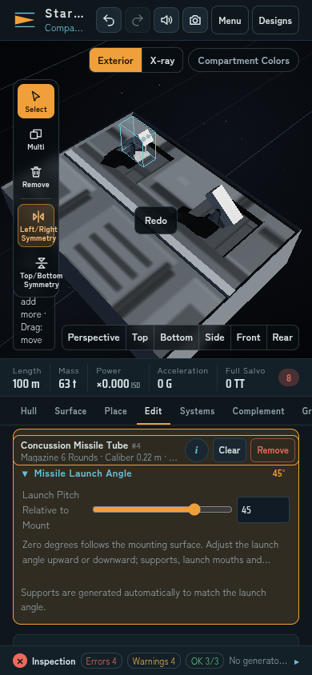
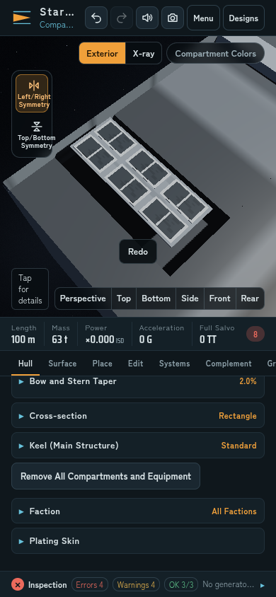

# 震盪ミサイル発射管の共通化

艦艇用の大きな震盪ミサイル発射装置を廃止し、航空機用の小型発射管 `cmsl` に統合する。艦艇・航空機で同じ1.2 × 0.45 × 0.45 mの本体を使う。アーキテンス作例も船首の4基をこの発射管へ置き換える。

| 項目 | 共通仕様 |
| --- | --- |
| 弾頭 | 1発25 TT |
| 発射間隔 | 1.2秒、1回1発 |
| 弾数 | 1基6発。航空機の搭載量設定がこれより少なければ、その設定を上限にする |
| 電子機器負荷 | 1基1 PW。実際の固定負荷への給電が必要 |
| 本体寸法 | 全長1.2 m・全高0.45 m・全幅0.45 m |
| 発射角 | 取付面から上下−90〜+90度 |

これは外観だけの縮小ではない。旧艦艇用発射装置の60発・120発の弾庫、8発一斉射などは共通発射管の仕様に置き換わる。イオン魚雷発射管 `itl` の8発・20秒間隔の動作は保持する。

## 外付けと支持台

武装パレットの「震盪ミサイル発射管」を使う。発射角0度では取付面に沿う。選択中の発射管の「発射角（取付面から上下）」を変えると、本体が上下へ傾き、取付板・左右の支持板・横軸が自動で現れる。支持高は本体の前後が取付面へ食い込まない値にする。砲塔用の手動かさ上げ量とは別の設定である。

上面・下面・舷側・傾斜面でも同じ取付面基準で動く。描画、選択範囲、プレビュー、保存、複製、対称配置、Undo/Redoは同じ角度を使う。ミサイルは実際の発射口からその角度へ射出され、最初の離脱区間の後に目標へ誘導される。



## 器材面のVLS

VLSは器材面の武装設定から「震盪ミサイルVLS（器材面）」を選ぶ。独立した大型の箱を外付けする方式は使わない。同じ6発の発射装置を面の内部へ収め、外には6つの低いハッチを描く。発射方向は面の法線で固定し、外付け用の発射角や支持台は表示しない。

1基の面内寸法は1.2 × 0.45 m、必要深さは1.2 m、必要容積は0.648 m³。確保できた弾庫容量に従って実際の弾数を決める。器材面の配置・内部空間・給電の通常の制約を受ける。



## 旧設計と戦闘状態

旧 `msl` は保存の読込時に `cmsl` へ移行する。外付けは位置・ID・対称関係を保って小型発射管になり、旧VLSは取付面を分割して器材面のVLSになる。面が消えている、他の設備と競合する、面数上限に達している場合は、元の装置を非稼働の保存済み装備として保持する。再読込や再取付で自動発射可能にせず、ユーザーによる再配置を必要とする。

艦隊戦と操縦画面は同じ残弾を消費する。操縦画面への再入場で補充せず、発射管ごとの装填時間を保持する。停電、給電断、装置の破損時は発射を止め、残弾を消費しない。

艦隊プロフィールは版5、艦載機の価格署名は `l4qlh3`。12機種の価格・費用内訳・乗員数・推進プロフィールを維持し、発射管を持つ5機種・9基の電子機器負荷を更新した。比較は [カタログ検証記録](benchmarks/missile-catalog-comparison.json) を参照。

## 検証

新規回帰50件は、取付姿勢と選択範囲、支持台の接続、器材面VLS、旧設計と上限時の移行、有限弾庫、発射間隔、停電、実際の射出方向、操縦画面の残弾、対称配置、Undo/Redoを確認する。

```sh
node --test tests/missile-launcher-*.cjs
```

Chromiumの日本語PC・英語スマホ幅でアーキテンスの小型発射管4基を確認した。別の英語スマホ幅の画面では、ネイティブUIで0→45度の編集、Undoで0度、Redoで45度へ戻ることを確認した。実描画の支持台と取付面の空隙、−35度の別装置、6つのVLSハッチ、6発の弾庫、面法線への発射方向を検証した。JavaScriptエラー・WebGLエラー・横方向の画面はみ出しは0だった。

発射角・VLSの小さな検証台は機関や発電機を持たないため、画面の工程検査には設備不足のエラー・警告が表示される。アプリのJavaScript・WebGLエラーとは区別する。

記録は [アーキテンス](benchmarks/arquitens-browser.json) と [発射角・VLS](benchmarks/missile-launcher-browser.json)。ブラウザ検証では実戦中の連続発射、実機スマホの入力、GPUのフレームレート、器材面設定の全操作経路は検証していない。

```sh
node scripts/browser-missile-launcher.cjs http://127.0.0.1:8765
```
