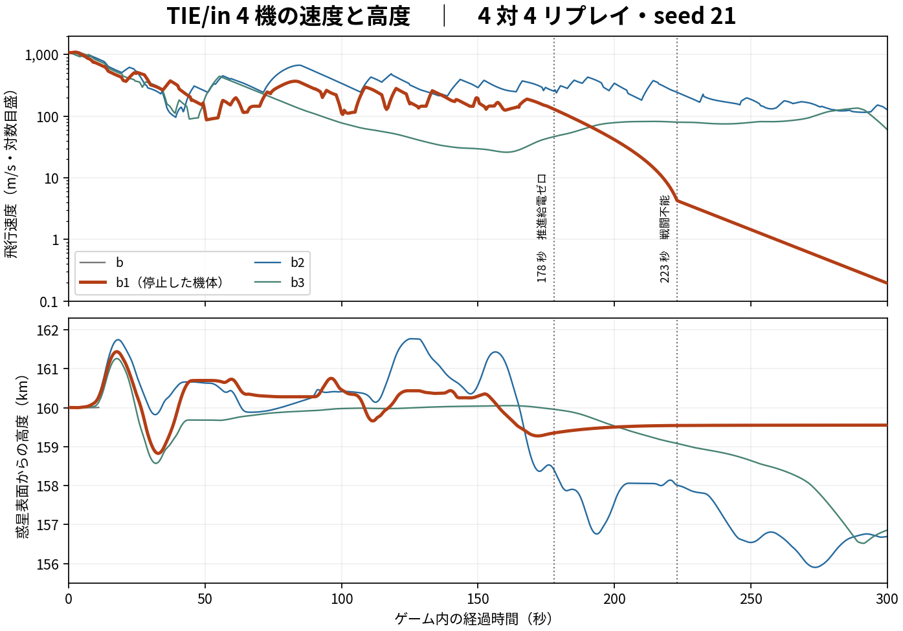

# KUAT SHIPWRIGHT 航空戦の射程・旋回試験

基準ソース `1d647078ed9a9771b7bef90288d23c22dc18b192`。作業ブランチ `test/dogfight-ranges-20261123-b`。共有コードのコミット `ea7cb7c0884c66152b4b1bc771a857e2bfb59269`。ゲームの設定を変えて走らせた各段階の結果をまとめた。基準版の再試験は行っていない。

## ブランチで読める試験記録

- [条件別の勝敗](decision-final/per-scenario.csv)と[試行別の得点・機体喪失](decision-final/per-run.csv)
- [最終の試験設定で実行した既存テストの出力](torpedo-final-tests/result.tap)
- [交差直後の速度と上下位置（3 条件）](merge-seed21/first20s.csv)、[停止した b1 の速度・高度・推進給電・推力](altitude-seed21/b1.csv)

本文中の `logs/` は、別途共有した全記録 ZIP の収録パスを表す。以下の時刻はゲーム内の経過秒。

## 映像で見える TIE/in の上下動と停止

映像と同じ seed 21、X 対 TIE/in、4 対 4、惑星あり。計測を追加した再生で、元の飛行記録と全 1,200 フレームが一致した。

最初のすれ違いは TIE/in 各機で 3.50–4.25 秒。8 秒になると、両軍に軌跡確認用の High yo-yo が入り、20 秒まで上向き・下向きの指令が出る。TIE/in の生存 3 機では、各機 4.25 秒分の再加速時の方向指令をこの軌跡が上書きした。同じ seed でこの軌跡だけを無効にすると、3 機とも速度が残った。

| 機体 ID | 8 秒の速度 | 20 秒・全軌跡オン | 20 秒・High のみオフ | 全オンで 8–20 秒に進んだ水平距離（道のり） |
| --- | ---: | ---: | ---: | ---: |
| b1 | 833 m/s | 380 m/s | 661 m/s | 6.82 km |
| b2 | 946 m/s | 528 m/s | 752 m/s | 8.21 km |
| b3 | 967 m/s | 446 m/s | 803 m/s | 7.79 km |

この区間には大きな減速がある。3 機とも High を切ったほうが高くまで上昇しており、上昇による速度交換だけでは差を説明できない。共通 12 seed の最初の 20 秒に失われた機体は、全オン、High のみオフ、全オフのいずれも同じ 4 機で、喪失時刻も一致した。序盤の損失がこの機動で増えたという結果は得られていない。

映像の終盤に停止して見える機体は b1。178 秒に推進給電と推力がゼロになり、223 秒に電源喪失で戦闘不能になった。300 秒時点の速度は 0.195 m/s、惑星表面からの高度は 159.552 km。その機体は戦闘不能後も画面に表示される。この停止に高度上限の作動を示す記録はなかった。



## 結論

**航空機全体の旋回上限を直前の修正版から 25% 上げた。** 同じコーナー速度からの半周半径は X が 399→324 m、TIE/in が 358→290 m。追加軌跡オフ、対向 8 km・500 m・4 対 4 の X 対 TIE/ln は 16 勝 4 敗。TIE/in の周期をずらした場合、X 対 TIE/in は 12 勝・TIE 勝ち 0・未決 8。全滅勝ちだけを数えると X の勝ち数は減ったが、「X がわずかに優勢」という両軍に勝ち目のある状態には達していない。追加軌跡オフの単独 ISD は船体撃破 0/9、対艦投下 0 発。5 種の軌跡をすべてオンにした同一 seed 21–32 の 4 対 4 では X の 8 勝が 1 勝に、未決が 4 回から 11 回に変わった。TIE/in の勝利は両条件とも 0 回。

判定を含めると、上記の共通 12 seed は軌跡の全オン・オフとも X の 11 勝・TIE/in の 0 勝・1 分。航空魚雷の現在位置追尾を追加した標準艦隊戦 5 回では、対艦魚雷の命中相当率は 15.8% から 16.5% に変化した。航空ミサイルは既存の飛翔処理。

## 全滅勝ちと時間切れの判定勝ち

300 秒に達した空戦は、敵機の喪失 1 機を 1 点として両陣営を比較した。点の多い側が判定勝ち。同点は「双方に損失あり」「双方無損失」を分け、全滅決着と相撃ちも別に記録した。機数の異なる編隊にも絶対数を適用した。相手の直接射撃による撃墜、区画喪失・誘爆、電源やリフトを失った後の落下がこの得点に含まれる。撃墜者の個人戦果は推定していない。

### X 対 TIE/in、4 対 4、共通 seed 21–32

| 条件 | n | 全滅 X/TIE/相撃 | 判定勝 X/TIE | 点数同じ 損失有/無 | 最終 X/TIE/分 |
| --- | --- | --- | --- | --- | --- |
| 惑星あり 5 種オフ | 12 | 8/0/0 | 3/0 | 1/0 | 11/0/1 |
| 惑星あり 5 種オン | 12 | 1/0/0 | 10/0 | 1/0 | 11/0/1 |
| 惑星あり High だけオフ | 12 | 2/0/0 | 10/0 | 0/0 | 12/0/0 |
| 惑星あり Low だけオフ | 12 | 0/0/0 | 12/0 | 0/0 | 12/0/0 |
| 惑星あり Flat だけオフ | 12 | 4/0/0 | 8/0 | 0/0 | 12/0/0 |
| 惑星あり Rolling だけオフ | 12 | 2/0/0 | 10/0 | 0/0 | 12/0/0 |
| 惑星あり Spiral だけオフ | 12 | 2/0/0 | 10/0 | 0/0 | 12/0/0 |
| 惑星なし 5 種オフ | 12 | 9/0/0 | 3/0 | 0/0 | 12/0/0 |
| 惑星なし 5 種オン | 12 | 4/0/0 | 7/0 | 0/1 | 11/0/1 |
| 惑星なし High だけオフ | 12 | 5/0/0 | 6/0 | 1/0 | 11/0/1 |
| 惑星なし Low だけオフ | 12 | 6/0/0 | 6/0 | 0/0 | 12/0/0 |
| 惑星なし Flat だけオフ | 12 | 6/0/0 | 5/0 | 1/0 | 11/0/1 |
| 惑星なし Rolling だけオフ | 12 | 4/0/0 | 7/0 | 0/1 | 11/0/1 |
| 惑星なし Spiral だけオフ | 12 | 4/0/0 | 7/0 | 0/1 | 11/0/1 |

惑星ありの全オンでは未決だった 11 戦で TIE/in が延べ 15 機、X が延べ 2 機失われた（6 機が落下、5 機が反応物誘爆、4 機が船体破断、2 機が炉心誘爆）。オフの未決 4 戦は TIE/in 8 機、X 2 機。判定を含めると両条件とも 11 勝 0 敗 1 分で、全オンは TIE/in の優勢化よりも、X が全機を落とし切れない試行の増加として現れた。

| 全オン seed | X–TIE 得点 | 失った X | 失った TIE/in | 300 秒判定 |
| --- | --- | --- | --- | --- |
| 21 | 1–0 | なし | b 11.25 s 反応物誘爆 | X 判定勝ち |
| 22 | 1–0 | なし | b 184 s 落下 | X 判定勝ち |
| 23 | 1–0 | なし | b 3.75 s 炉心誘爆 | X 判定勝ち |
| 24 | 2–0 | なし | b 184 s 落下、b2 295.25 s 船体破断 | X 判定勝ち |
| 25 | 1–0 | なし | b 3.75 s 炉心誘爆 | X 判定勝ち |
| 27 | 2–0 | なし | b 184 s 落下、b1 198.75 s 船体破断 | X 判定勝ち |
| 28 | 2–0 | なし | b 184 s 落下、b2 195.75 s 船体破断 | X 判定勝ち |
| 29 | 1–1 | a3 85 s 反応物誘爆 | b1 177.5 s 反応物誘爆 | 引き分け |
| 30 | 2–1 | a1 198 s 反応物誘爆 | b 4.25 s 反応物誘爆、b3 216.75 s 船体破断 | X 判定勝ち |
| 31 | 1–0 | なし | b 184 s 落下 | X 判定勝ち |
| 32 | 1–0 | なし | b 184 s 落下 | X 判定勝ち |

全オン・オフ各 12 戦について、原因の記録を追加して修正版を同じ seed で再生した。全 24 戦で、最終損失・全滅判定・終了時刻・各機の喪失時刻が元の結果と一致した。

### その他の対戦、500 m・惑星あり

| 対戦 | n | 全滅 左/右/相撃 | 判定勝 左/右 | 同点 損失有/無 | 最終 左/右/分 |
| --- | --- | --- | --- | --- | --- |
| X:TIE/ln 1:1 5 種オフ | 20 | 16/2/2 | 0/0 | 0/0 | 16/2/2 |
| X:TIE/ln 1:1 5 種オン | 20 | 4/0/0 | 0/0 | 0/16 | 4/0/16 |
| X:TIE/in 1:1 5 種オフ | 20 | 20/0/0 | 0/0 | 0/0 | 20/0/0 |
| X:TIE/in 1:1 5 種オン | 20 | 17/0/0 | 0/0 | 0/3 | 17/0/3 |
| A:TIE/in 1:1 5 種オフ | 20 | 20/0/0 | 0/0 | 0/0 | 20/0/0 |
| A:TIE/in 1:1 5 種オン | 20 | 0/0/0 | 0/0 | 0/20 | 0/0/20 |
| X:TIE/ln 4:4 5 種オフ | 20 | 16/4/0 | 0/0 | 0/0 | 16/4/0 |
| X:TIE/in 4:4 5 種オフ（20戦） | 20 | 12/0/0 | 7/0 | 1/0 | 19/0/1 |
| X:TIE/ln 1:2 5 種オフ | 10 | 3/7/0 | 0/0 | 0/0 | 3/7/0 |
| X:TIE/ln 2:4 5 種オフ | 6 | 3/3/0 | 0/0 | 0/0 | 3/3/0 |
| X:TIE/ln 4:8 5 種オフ | 6 | 1/4/0 | 1/0 | 0/0 | 2/4/0 |

8 km 対向。1 対 1 でどちらも 300 秒生存した試行は常に 0–0。各設定の全 seed、喪失機種・機体 ID・時刻・得点は `logs/decision-final/per-run.csv`、条件別集計は `per-scenario.csv`。旧出力の「未決」欄は時間切れになった試行数を表示している。採点後の結果は本節と CSV を参照。再試行や診断用実行は別フォルダのまま保持し、同じ母集団に合算していない。

## 航空魚雷とミサイルの飛翔・命中判定

航空機と飛翔体は別の配列を使う。航空機の `isCraft` 相当は `p.cls.craft`。ミサイルは `b.missiles` に登録され、`fleetMissilesFly` が寿命・移動・旋回の上限・点防御・着弾を処理する。分類フラグの変更だけでは航空 AI も比例追尾も動かない。

航空魚雷は試験設定 `KS_CRAFT_TORPEDO_PATH=current` で、飛翔中の目標を現在位置マーカーに固定した。試験コード 6449fdd。航空ミサイルは既存の飛翔処理を使う。**実在ミサイルの比例航法は未実装。** 直前の要望で試した `KS_CRAFT_MISSILE_ANGLE=arcade` は到着後のゲーム用採点で、誘導を行わない。魚雷の現在位置追尾を比較したときはその採点をオフにした。設定なしは両方とも従来値。

| 試験設定 | 戦 | 航空発射弾 | 目標 | 発射数 | 命中相当 | 命中率 | PD相当 | PD率 |
| --- | --- | --- | --- | --- | --- | --- | --- | --- |
| 両方オフ | 5 | 魚雷 | 艦 | 388 | 61.3 | 15.8% | 312.2 | 80.5% |
| 両方オフ | 5 | ミサイル | 艦 | 271 | 113.6 | 41.9% | 157.4 | 58.1% |
| 両方オフ | 5 | ミサイル | 航空機 | 529 | 175.1 | 33.1% | 8.1 | 1.5% |
| 魚雷 現在位置追尾のみ | 5 | 魚雷 | 艦 | 358 | 59.1 | 16.5% | 285.3 | 79.7% |
| 魚雷 現在位置追尾のみ | 5 | ミサイル | 艦 | 265 | 112.1 | 42.3% | 152.9 | 57.7% |
| 魚雷 現在位置追尾のみ | 5 | ミサイル | 航空機 | 543 | 171.7 | 31.6% | 5.1 | 0.9% |
| ミサイル 到着後採点のみ | 5 | 魚雷 | 艦 | 403 | 61.3 | 15.2% | 327.2 | 81.2% |
| ミサイル 到着後採点のみ | 5 | ミサイル | 艦 | 279 | 113.6 | 40.7% | 165.4 | 59.3% |
| ミサイル 到着後採点のみ | 5 | ミサイル | 航空機 | 587 | 184.6 | 31.5% | 6.4 | 1.1% |

ISD I×2 対反乱艦隊の標準編成。各設定で 5 種の飛行軌跡を有効にし、乱数の種・配置を共通にした。すべての投射物を飛翔処理の前に記録した `rounds[]` から数えた。命中数と PD 数は一斉射の端数を含む期待相当値。以後の損害や交戦時刻が変わると発射数自体も変わり得る。独立 ISD の 9 戦は魚雷の追加変更前に実施し、対艦発射 0 のため飛翔方式による差は測れない。

航空魚雷の現在位置追尾フラグは 358 発相当、少なくとも一度その方向で飛翔を更新したのは 358 発相当。非魚雷に同フラグを記録した例は 0。点防御・弾速・寿命・旋回上限はコード上同じ。

| 採点帯 | 到達した射群数 | PD後の残弾相当 | 採点による減算 | 命中相当 |
| --- | --- | --- | --- | --- |
| slow | 247 | 280.3 | 0 | 280.3 |
| medium | 24 | 24 | 6 | 18 |
| fast | 0 | 0 | 0 | 0 |
| unresolved | 0 | 0 | 0 | 0 |

採点は発射地点を固定したゲームマップ（水平面）で、目標の表示方位の変化を各刻みで読んだ。毎秒 15 度未満は全量、15 度以上 60 度未満は 75%、60 度以上は 50% を採点。真上など表示方位が解けない場合は減点しない。しきい値は本試験で決めたゲーム用の値。飛翔中の目標方位を誘導に戻す処理はない。

seed 7919 の観測専用モードでは、観測項目を除いた全航空弾の記録と最終結果が従前の修正版に一致した。

現在位置追尾を有効にした指定 7 テストは全 45 件、成功 43・失敗 2。詳細は `torpedo-final-tests/stdout`。

再現例は `KS_CRAFT_GUN_M=500 KS_CRAFT_TORPEDO_PATH=current KS_CRAFT_MISSILE_ANGLE=off KS_BFM=hiyoyo,loyoyo,flat,rolling,spiral KS_IN_PHASE=stagger KS_EVIDENCE=/tmp/ks-verify/new-current node scripts/sim-fleet-air.cjs 5`。

### 標準と制圧なし、seed 7919 の出撃記録

| 条件 | 3 s の使用枠 反/帝 と 管制枠 反・帝 | 後に迎撃任務の機数 | 敵初消費以前に迎撃割当¹ | 爆撃機出撃 | 残弾ありで帰艦指令 | 艦と機の接触件数 | 攻撃対象ISDのセンサー初喪失 s² | 追跡値 初→終 |
| --- | --- | --- | --- | --- | --- | --- | --- | --- |
| 標準 | 3/0 / 7・6 | 44 | 38 | 18 | 0 | 19 | 141 | 1 → 0 |
| 制圧なし | 3/0 / 7・6 | 58 | 52 | 26 | 0 | 74 | 141 | 1 → 0.4 |

¹ 対象機が実際に弾を消費した例だけを数えた。² 3 秒刻みで、ISD I 先頭艦のセンサーモジュール破壊を初めて観測した時刻。値の低下を特定の制圧機による撃破とまでは認定できない。接触は延べ件数。各爆撃機の経路番号・3 秒間隔の座標・任務段階・最初の急降下・帰艦・損失、個艦の部位損害の時系列は `figures-observe-*-r2/sorties.json` に収録。

## 5 種の追加軌跡を含めた試験

5 種に試験時計で指令を与え、既存の姿勢制御・運動積分・高度と速度の交換を通して飛ばした。既定および `KS_BFM=none` で全種オフ。`KS_BFM=hiyoyo,loyoyo,flat,rolling,spiral` では列挙した軌跡だけを有効にする。両シミュレーターが同じ実装を使う。敵との角度・距離・接近率による起動、状況に応じた戦術的な優位／不利の認定は対象外。

開始 8 秒から各種に固定の 16 秒枠を順に割り当てる。各枠の最初の 12 秒だけ、既に空戦に入った機体へ、その機体自身の局所座標系で方向を指示する。途中から空戦に入れば残りの時間だけ飛ぶ。時刻・振幅・順番は軌跡比較用に本試験で決めた。味方／敵の機種は同じルールで処理した。無効にした枠には既存 AI が操縦を続ける。

| 軌跡 | 発動 機×枠 惑星あり | 同 なし | 形状判定合致/完走枠 あり¹ | 同 なし¹ | 区間高度幅の中央値 (m)〔注2〕 | 区間 Δ速 中央値 (m/s)〔注2〕 |
| --- | --- | --- | --- | --- | --- | --- |
| High yo-yo | 301 | 223 | 5/15 | 5/11 | 758.5 | -47.9 |
| Low yo-yo | 292 | 232 | 6/13 | 9/16 | 721.7 | -55.5 |
| Flat scissors | 283 | 239 | 9/15 | 15/19 | 132 | -31 |
| Rolling scissors | 283 | 0 | 4/4 | 対象なし | 301.2 | -39.8 |
| Defensive spiral | 215 | 0 | 5/9 | 対象なし | 819.6 | -52.7 |

¹ 発動は全 12 戦で同一機・同一時刻枠を一度だけ数えた。形状判定は座標を毎刻み保存した seed 21 のみ。12 秒連続して指令を受けた機体で、High／Low は前半と後半の高度変化が逆向きに各 1 m を超過、Flat は左右速度の半区間平均が反転、Rolling は前進軸に直交する速度成分が 0.8 周以上回転、Spiral は水平速度が 0.8 周以上回転しかつ全体で 1 m 超下降したケース。これらは実飛行を集計する独自の指標。軌跡の全手順やロール姿勢の完全一致は測っていない。² 全 12 戦・惑星あり、目標の変更で区間を分割した値。

各発動区間に開始・終了時刻、座標・速度・高度、開始時の目標との角度／距離／接近率／速度差、終了時の双方生存・喪失を記録した。AOT は相手の機首を基に算出した機尾からの 3D 角。位置と速度を取得できない場合は null。開始の判定条件は時刻・惑星・操縦状態。結果ファイルは `logs/figures-group-p{0,1}-all/seed-*/summary.json` の `figures`、実軌跡は `trace.json`、個別判定は `geometry.json`。惑星ありの `measured-paths.png` は各機動の最初の連続 12 秒を選んだ平面図・側面図。

### X 対 TIE/in、4 対 4・惑星あり

| 有効設定 | n | X勝/TIE勝/相撃/未決 | 決着のみ中央値 s | 損失平均 X/TIE | 全オンと結果が違う seed 数 |
| --- | --- | --- | --- | --- | --- |
| すべてオフ | 12 | 8/0/0/4 | 232 | 0.2/3.3 | 7 |
| すべてオン | 12 | 1/0/0/11 | 184 | 0.2/1.6 | 0 |
| High yo-yo だけオフ | 12 | 2/0/0/10 | 224.1 | 0.2/2.5 | 1 |
| Low yo-yo だけオフ | 12 | 0/0/0/12 | — | 0/1.5 | 1 |
| Flat scissors だけオフ | 12 | 4/0/0/8 | 259.5 | 0.1/2.8 | 5 |
| Rolling scissors だけオフ | 12 | 2/0/0/10 | 231.8 | 0.1/2.4 | 3 |
| Defensive spiral だけオフ | 12 | 2/0/0/10 | 267.8 | 0.1/2.6 | 1 |

各設定 seed 21–32、レーザー 500 m、編隊の速度回復周期は分散 12 秒。記録から照合した時刻枠・選択名・惑星条件の違反は 0 区間。未決は 300 秒打ち切り。決着時間の分母は決着した試行だけ。

### X 対 TIE/in、4 対 4・惑星なし

| 有効設定 | n | X勝/TIE勝/相撃/未決 | 決着のみ中央値 s | 損失平均 X/TIE | 全オンと結果が違う seed 数 |
| --- | --- | --- | --- | --- | --- |
| すべてオフ | 12 | 9/0/0/3 | 205.2 | 0.4/3.5 | 5 |
| すべてオン | 12 | 4/0/0/8 | 233.1 | 0/2.6 | 0 |
| High yo-yo だけオフ | 12 | 5/0/0/7 | 232.5 | 0.7/3.2 | 5 |
| Low yo-yo だけオフ | 12 | 6/0/0/6 | 233 | 0.2/3.2 | 8 |
| Flat scissors だけオフ | 12 | 6/0/0/6 | 214.2 | 0.2/2.8 | 4 |
| Rolling scissors だけオフ | 12 | 4/0/0/8 | 233.1 | 0/2.6 | 0 |
| Defensive spiral だけオフ | 12 | 4/0/0/8 | 233.1 | 0/2.6 | 0 |

各設定 seed 21–32、レーザー 500 m、編隊の速度回復周期は分散 12 秒。記録から照合した時刻枠・選択名・惑星条件の違反は 0 区間。未決は 300 秒打ち切り。決着時間の分母は決着した試行だけ。

### 1 対 1、レーザー 500 m、各条件 20 回

| 機種 左 / 右 | 惑星あり 全オフ | 全オン | 全オン 決着 s | 惑星なし 全オフ | 全オン | 全オン 決着 s |
| --- | --- | --- | --- | --- | --- | --- |
| xwing / tie_ln | 16/2/2/0 | 4/0/0/16 | 280.2 | 17/2/1/0 | 15/4/0/1 | 148.8 |
| xwing / tie_in | 20/0/0/0 | 17/0/0/3 | 184 | 20/0/0/0 | 19/0/0/1 | 144.5 |
| awing / tie_in | 20/0/0/0 | 0/0/0/20 | — | 14/6/0/0 | 17/1/1/1 | 222.5 |

### 標準艦隊戦でも同じ切替を確認

| 設定 | n | 発動 機×枠（上表の順） | 帝国勝 | 終了中央値 s | 対艦投下 | PD迎撃相当 |
| --- | --- | --- | --- | --- | --- | --- |
| 全オフ | 5 | 0,0,0,0,0 | 5 | 620.2 | 814 | 616.6 |
| 全オン | 5 | 862,887,920,1079,925 | 5 | 641.8 | 921 | 727.8 |

5 種有効で指定の既存 7 ファイルも実行。全 45 件、成功 43、失敗 2。詳細は `logs/figures-tests-p1-all/stdout`。

5 種をオフにして走らせた共通 seed の全 JSON は、追加前の修正版と惑星あり・なし合計 24/24 戦で一致した。方向指令が既存の角速度・推力・運動積分を通ること、惑星なしで 2 種が停止すること、未設定で既存経路を使うことは独立レビューでも確認した。数値を読んだ対象はゲームの戦闘シミュレーターで、ブラウザ版への導入試験はしていない。

既存録画スクリプトの Chromium 起動は環境のソケット制限で失敗した（figures-replay/stdout）。同じ録画スクリプトの描画関数と seed 21 の記録を使い、別の Canvas 実装で 6 倍速の MP4 を作成した。実際に記録した枠にだけ機動名を表示する。ZIP 内の decision-replay/ に得点と最終判定を重ねた動画と単体再生用 HTML を収録。

数値試験では全種類を同時に使うと時間切れが増えた。試験時計のままゲームへ採用することは勧めない。高度交換の単独評価には High／Low の軌跡と高度・速度ログを使える。追加の zoom climb／dive、gravity assist、energy fight を導入する判断は保留する。


```sh
KS_CRAFT_GUN_M=500 KS_CRAFT_TURN_GAIN=1.25 KS_IN_PHASE=stagger KS_FIRST_SEED=21 KS_BFM=hiyoyo,loyoyo,flat,rolling,spiral KS_TRACE=/tmp/ks-verify/new-figure-trace.json KS_EVIDENCE=/tmp/ks-verify/new-figures node scripts/sim-dogfight.cjs craft_xwing craft_tie_in 12 4 4
```

### 全軌跡オンの交戦・初撃墜・武器・速度

| 惑星 | 対戦 | n | 格闘開始 m | 初射撃 m | 喪失あり n | 初の機体喪失 s | 全滅決着 s |
| --- | --- | --- | --- | --- | --- | --- | --- |
| あり | xwing/tie_ln | 20 | 886.2 (886.2–886.2) | 299.5 (299.5–299.5) | 4 | 280.2 (168–281) | 280.2 (168–281) |
| あり | xwing/tie_in | 20 | 597.9 (597.9–597.9) | 34.4 (34.4–34.4) | 17 | 184 (3.8–281) | 184 (3.8–281) |
| あり | awing/tie_in | 20 | 573.5 (573.5–573.5) | 396.3 (396.3–396.3) | 0 | — | — |
| あり | 4xwing/4tie_in | 12 | 597.9 (597.9–597.9) | 31.4 (31.4–31.4) | 12 | 152 (3.8–184) | 184 (184–184) |
| なし | xwing/tie_ln | 20 | 886.3 (886.3–886.3) | 299.6 (299.6–299.6) | 19 | 148.8 (73.8–200.2) | 148.8 (73.8–200.2) |
| なし | xwing/tie_in | 20 | 597.9 (597.9–597.9) | 34.4 (34.4–34.4) | 19 | 144.5 (3.8–238) | 144.5 (3.8–238) |
| なし | awing/tie_in | 20 | 573.5 (573.5–573.5) | 348.5 (348.5–348.5) | 19 | 222.5 (137.8–245.5) | 222.5 (137.8–245.5) |
| なし | 4xwing/4tie_in | 12 | 597.9 (597.9–597.9) | 31.5 (31.5–31.5) | 11 | 139.2 (3.8–181) | 233.1 (192–244.2) |

距離と時刻は中央値（最小–最大）。初喪失は原因を問わず `kills` に記録された最初の刻み終了時。初射撃は砲が通電し、機首制限・射程を満たしたときの最初の斜距離。決着は全滅または相撃ちの試行に限る。

| 惑星 | 機種・兵器 | 発射機×刻み | 照射 MT | 命中相当 MT | エネルギー命中率 | 最遠射撃 m |
| --- | --- | --- | --- | --- | --- | --- |
| あり | craft_xwing/laser | 498 | 13.4 | 2.7 | 20.2% | 499.1 |
| あり | craft_tie_ln/laser | 111 | 1.8 | 0.4 | 23.3% | 496.8 |
| あり | craft_tie_in/laser | 201 | 6.3 | 1.6 | 25.9% | 497.8 |
| あり | craft_awing/laser | 38 | 0.6 | 0 | 8.1% | 475.5 |
| なし | craft_xwing/laser | 748 | 20.3 | 5.6 | 27.3% | 498.9 |
| なし | craft_tie_ln/laser | 144 | 2.5 | 1 | 39.7% | 498.5 |
| なし | craft_tie_in/laser | 223 | 7.1 | 1.9 | 27% | 498.4 |
| なし | craft_awing/laser | 484 | 6.8 | 0.9 | 12.6% | 499.5 |

各惑星条件の 1 対 1 計 60 戦と 4 対 4 の 12 戦を合算。砲は連続照射モデルのため個々の弾数は定義されない。魚雷・ミサイルは艦隊戦の表で個別に計数した。

| 惑星 | 対戦 | 初期面からの交戦高度差 m | 10 s 速度 | 30 s 速度 | 60 s 速度 | 120 s 速度 | 上昇最大減速/刻み | 降下最大加速/刻み |
| --- | --- | --- | --- | --- | --- | --- | --- | --- |
| あり | xwing/tie_ln | -4,677.4–3,477 | 828.8 | 159.6 | 226.8 | 235.5 | 2.8 | 2.3 |
| あり | xwing/tie_in | -47,906.8–2,037.6 | 952.6 | 689.5 | 630.5 | 800.2 | 2.3 | 2.3 |
| あり | awing/tie_in | -3,588.4–3,090.6 | 819.5 | 275.1 | 250.2 | 128.7 | 2.3 | 2.3 |
| あり | 4xwing/4tie_in | -47,608.6–3,763.2 | 831.3 | 361.2 | 348.8 | 336.6 | 2.4 | 2.4 |
| なし | xwing/tie_ln | -2,152.9–4,749.1 | 837 | 131 | 503.1 | 320.6 | — | — |
| なし | xwing/tie_in | -607.9–6,676.1 | 838.9 | 345.3 | 271.5 | 113.7 | — | — |
| なし | awing/tie_in | 0–6,093.6 | 826.4 | 133.6 | 516.5 | 143.2 | — | — |
| なし | 4xwing/4tie_in | -9,159.1–9,837.3 | 809.5 | 251.8 | 438.2 | 280.2 | — | — |

速度は m/s。時系列は該当時刻に格闘戦中だった生存機の平均を試行ごとに取り、試行間の中央値を表示した。高度起因の速度変化は、対象機種が飛行中に受けた全時間の 0.25 秒当たりの最大絶対値（上昇は減速）。惑星なしは高度交換処理が呼ばれない。

### 5 種すべてを有効にした艦隊戦と単独 ISD 戦

| 艦隊戦条件 | n | 帝国勝 | 終了中央値 s | 航空搭載合計 | 対艦投下 | 爆撃機損失範囲 | 戦闘機損失範囲 |
| --- | --- | --- | --- | --- | --- | --- | --- |
| 標準 | 5 | 5 | 641.8 | 2112 | 921 | 2–13 | 90–126 |
| 航空機なし | 5 | 5 | 496.5 | 0 | 0 | 0–0 | 0–0 |
| 制圧なし | 5 | 5 | 593.5 | 1920 | 832 | 1–10 | 75–105 |
| 急降下なし | 5 | 4 | 719.2 | 2530 | 1,036 | 0–28 | 120–131 |
| 艦近傍はPD | 5 | 5 | 635.8 | 2088 | 806 | 2–25 | 86–136 |

| 艦隊戦条件 | 反乱 任務最大数 | 帝国 任務最大数 | 直掩距離平均 m | 初出現時に迎撃任務だった機の最寄り敵距離 m | 急降下開始の対目標高度 m |
| --- | --- | --- | --- | --- | --- |
| 標準 | 27/16/8/1/18 | 59/36/8/0/8 | 6,584.9 | — | 6,403.8–7,448.4 |
| 航空機なし | 0/0/0/0/0 | 0/0/0/0/0 | — | — | — |
| 制圧なし | 24/14/9/0/18 | 61/36/7/0/8 | 4,886.4 | — | 6,571.8–7,440 |
| 急降下なし | 26/22/8/1/18 | 36/36/11/0/20 | 5,357.7 | — | — |
| 艦近傍はPD | 27/16/8/1/18 | 59/36/5/0/8 | 5,328.3 | — | 6,403.8–7,448.4 |

任務数は制空／迎撃／直掩／制圧／攻撃の順、最大値は任務ごとに別の時刻を取り得る。直掩距離と高度は両陣営合算。初出現時に敵のいなかった機と、その後の任務変更は発進時の敵距離から除外した。追加軌跡をオフにした同条件の比較結果は次節の「艦隊・ISD・回帰」。

| 艦隊戦条件 | 対艦弾種 | 発射数 | 発射斜距離 m | 命中相当 | 命中率 | PD相当 | PD率 |
| --- | --- | --- | --- | --- | --- | --- | --- |
| 標準 | itorp | 388 | 1,819.7–1,998.7 | 61.3 | 15.8% | 312.2 | 80.5% |
| 標準 | cmsl | 271 | 1,324.4–1,498.6 | 113.6 | 41.9% | 157.4 | 58.1% |
| 標準 | bomb | 262 | 1,285.4–2,997.6 | 0 | 0% | 258.3 | 98.6% |
| 制圧なし | itorp | 337 | 1,799.3–1,999.4 | 52.9 | 15.7% | 268.9 | 79.8% |
| 制圧なし | cmsl | 251 | 1,375.3–1,499.8 | 106.4 | 42.4% | 144.6 | 57.6% |
| 制圧なし | bomb | 244 | 2,852.4–2,999 | 0 | 0% | 242.5 | 99.4% |
| 急降下なし | itorp | 447 | 942.6–1,999.1 | 121 | 27.1% | 326 | 72.9% |
| 急降下なし | cmsl | 309 | 942.6–1,499.8 | 105.7 | 34.2% | 203.3 | 65.8% |
| 急降下なし | bomb | 280 | 1,170.7–1,499.8 | 85.3 | 30.5% | 194.7 | 69.5% |
| 艦近傍はPD | itorp | 325 | 1,808–1,998.7 | 60.8 | 18.7% | 247.1 | 76% |
| 艦近傍はPD | cmsl | 241 | 1,380–1,498.6 | 114.3 | 47.4% | 126.7 | 52.6% |
| 艦近傍はPD | bomb | 240 | 1,282.5–2,997.6 | 0 | 0% | 239.1 | 99.6% |

| 単独 ISD 進路 | n | 撃破 | 艦橋損傷あり | 搭載合計 | 対艦投下 | 命中 | PD相当 | 護衛損失 各戦 | 爆撃機損失 | 迎撃機損失 | 終了時刻 s |
| --- | --- | --- | --- | --- | --- | --- | --- | --- | --- | --- | --- |
| 1 | 3 | 0 | 0 | 864 | 0 | 0 | 0 | 24/24/24 | 12/12/12 | 4/1/12 | 900/900/900 |
| 2 | 3 | 0 | 0 | 864 | 0 | 0 | 0 | 24/24/24 | 12/12/12 | 5/6/6 | 900/900/900 |
| 3 | 3 | 0 | 0 | 864 | 0 | 0 | 0 | 24/24/24 | 12/12/12 | 3/5/4 | 900/900/900 |

いずれも護衛 24・爆撃機 12・迎撃機 12。投下ゼロの条件では、PD 率を数えていない。

## 最新版　航空機全体の基本旋回性能をさらに 25% 引き上げた結果

最新の要望は航空機全体に適用した。前の修正版では機首角速度上限が 0.432 rad/s。今回は **0.540 rad/s**、その刻みのエンジン状態から得られる横加速度上限を **1.25 倍**にした。前進推力、最高速度、武器威力、艦艇の旋回上限は維持する。試験値の有効化は `KS_CRAFT_GUN_M=500` などで行う。新しい既定値は `KS_CRAFT_TURN_GAIN=1.25`、直前の修正版は `=1` で再現できる。

実装は `js/core.js` の `trialTurnGain`、`fleetUnit`、`cornerSpeed`、`fleetTick`。機首速度と横加速度を同じ倍率にしたので、コーナー速度の指令値は同じ。実際の横加速度に必要なエンジン負担は `side / gain` として計上し、同じ推進予算から残る前進分を算出する。旋回時に航空機の方向を変えやすくするゲーム用係数で、推力が同じ実機の運動を再現する物理値ではない。

| 機種 | コーナー初速 m/s | 半周平均半径 m 旧修正→最新 | 初速300 m/s 同左 | 巡航初速 同左 | 最新コーナー半周 s |
| --- | --- | --- | --- | --- | --- |
| xwing | 161 | 399 → 324 | 800 → 707 | 6,088 → 5,719 | 6.50 |
| tie_ln | 157 | 383 → 309 | 815 → 716 | 6,238 → 5,894 | 6.50 |
| tie_in | 146 | 358 → 290 | 847 → 755 | 5,734 → 5,370 | 6.50 |
| awing | 183 | 446 → 360 | 739 → 643 | 7,254 → 6,853 | 6.50 |
| btlb | 110 | 280 → 229 | 1,006 → 897 | 3,975 → 3,710 | 6.75 |
| tie_sa | 130 | 324 → 264 | 908 → 811 | 4,874 → 4,535 | 6.50 |

### 4 対 4 の結果

| 500 m、X – TIE/in | n | 旧修正 X/TIE/相撃/未決 | 最新 X/TIE/相撃/未決 | 最新損失 X/TIE | 決着中央値 s | 回復 Δv m/s | 対目標 Δ距離 m |
| --- | --- | --- | --- | --- | --- | --- | --- |
| 周期なし | 20 | 18/0/0/2 | 19/0/0/1 | 0.60 / 3.95 | 184 | — | — |
| 全機同期 | 20 | 16/0/0/4 | 14/0/0/6 | 0.45 / 3.40 | 249.5 | 147.7 | 351 |
| 機体ごとに分散 | 20 | 13/0/0/7 | 12/0/0/8 | 0.25 / 3.25 | 248.4 | 121 | 384 |

X 対 TIE/ln、惑星ありの 4 対 4 は 20 戦。旧修正 12/7/0/1 → 最新 16/4/0/0（左勝／右勝／相撃／時間切れ）。

A 対 TIE/in、分散、惑星ありの 4 対 4 は 10 戦。旧修正 4/0/0/6 → 最新 6/0/0/4（左勝／右勝／相撃／時間切れ）。

X 対 TIE/in、分散、惑星なしの 4 対 4 は 20 戦。旧修正 14/0/0/6 → 最新 16/0/0/4（左勝／右勝／相撃／時間切れ）。

最新の分散 20 戦では、同一機・同一目標で 1 秒以上続いた回復区間 816 件中、速度と対目標距離がともに増えたのは 492 件。その終了後 10 秒以内に同じ機体の再射撃があったのは 19 件。機動の発生と勝率は別々に評価した。 seed 21 の単一試行では、実際に別の機体が近づく一方で他機が離れながら加速した時間は 2.75 秒。速度図は `logs/turn125-trace21/formation-speed.png`。

### 1 対 1 の射程・惑星感度（最新の旋回値）

| 砲 m | 対戦 | 各 n | 惑星あり 勝敗 | 決着 s（範囲） | 惑星なし 勝敗 | 決着 s | 初射撃 m | 高度差 m |
| --- | --- | --- | --- | --- | --- | --- | --- | --- |
| 300 | X – TIE/ln | 20 | 14/6/0/0 | 82.9 (47–227) | 19/0/1/0 | 83.9 | 300 | -31,869–10,566 |
| 300 | X – TIE/in | 20 | 20/0/0/0 | 184 (4–184) | 20/0/0/0 | 104.2 | 34 | -47,907–12,126 |
| 300 | A – TIE/in | 20 | 15/4/0/1 | 117.2 (42–261) | 15/5/0/0 | 88.4 | 56 | -33,372–12,078 |
| 500 | X – TIE/ln | 20 | 16/2/2/0 | 91.9 (47–129) | 17/2/1/0 | 96 | 300 | 1–10,472 |
| 500 | X – TIE/in | 20 | 20/0/0/0 | 184 (4–234) | 20/0/0/0 | 103.5 | 34 | -47,907–12,126 |
| 500 | A – TIE/in | 20 | 20/0/0/0 | 135 (42–286) | 14/6/0/0 | 101.2 | 395 | -40,337–12,862 |
| 800 | X – TIE/ln | 20 | 16/3/1/0 | 93.6 (47–258) | 17/3/0/0 | 108.4 | 300 | -36,086–10,456 |
| 800 | X – TIE/in | 20 | 20/0/0/0 | 184 (4–184) | 20/0/0/0 | 108.1 | 598 | -47,907–13,605 |
| 800 | A – TIE/in | 20 | 14/6/0/0 | 100.8 (43–151) | 13/7/0/0 | 88.8 | 573 | 1–10,517 |

### 艦隊・ISD・回帰

| 最新 500 m | n | 帝国勝 | 決着中央値 s | 航空総搭載 | 航空対艦投下 | 魚雷 発射/命中/PD | ミサイル 発射/命中/PD |
| --- | --- | --- | --- | --- | --- | --- | --- |
| 標準 | 5 | 5 | 620.2 | 2408 | 814 | 331 / 67.9 / 251.3 | 246 / 111.4 / 134.6 |
| 航空機なし | 5 | 5 | 496.5 | 0 | 0 | 0 / — / — | 0 / — / — |
| 制圧なし | 5 | 5 | 592 | 2418 | 907 | 374 / 51.4 / 307.2 | 275 / 106.3 / 168.7 |
| 急降下なし | 5 | 4 | 606.5 | 2742 | 807 | 330 / 81.6 / 235.3 | 232 / 72 / 160 |
| TIE=zone | 5 | 5 | 612 | 2502 | 836 | 343 / 67 / 264.2 | 252 / 110.9 / 141.1 |

| ISD 進路設定 | n | 船体撃破 | 艦橋損傷あり | 対艦投下 | 命中 | PD相当 | 損失 X/Y/TIE |
| --- | --- | --- | --- | --- | --- | --- | --- |
| 1 | 3 | 0 | 0 | 0 | 0 | 0 | 24–24/12–12/2–4 |
| 2 | 3 | 0 | 0 | 0 | 0 | 0 | 24–24/12–12/4–7 |
| 3 | 3 | 0 | 0 | 0 | 0 | 0 | 24–24/12–12/2–5 |

試行時間は上限まで含む。発射 0 の場面の PD 率は算出できない。出撃機・弾種・対象・距離・命中・PD と、各艦の部位別損害・脱落時刻の全記録は各 seed の JSON に収録した。

### 数的不均衡と再現確認

| X:TIE/ln | 保存済み旧結果 | 最新・惑星あり | 最新・惑星なし |
|---|---|---|---|
| 1:2 | 1/9/0/0（10回） | 3/7/0/0（10回） | 6/4/0/0（10回） |
| 2:4 | 2/2/0/2（6回） | 3/3/0/0（6回） | 1/4/0/1（6回） |
| 4:8 | 2/1/0/3（6回） | 1/4/0/1（6回） | 1/3/0/2（6回） |

各列は X 勝／TIE/ln 勝／相撃／未決。同じ機数・同じ開始距離でも、旧資料と今回の指定コミットは異なる。

コード上の主要な位置は、基準コミットの `js/core.js:87686`（GUN_BANDS）、87754（fitBand）、88883（missileRange）、89868（高度交換）、90108（CRAFT_PASS）、90134・90150（姿勢／バレル）、90217（角速度）、90390（FLEET_AIR）、90645（従来の旋回減速）。作成した差分では同じ関数名を検索できる。最新の試験ブランチで手順を再現する例を示す。

```sh
KS_CRAFT_GUN_M=500 KS_CRAFT_TURN_GAIN=1.25 KS_IN_PHASE=stagger KS_IN_PERIOD=12 KS_FIRST_SEED=21 KS_EVIDENCE=/tmp/ks-verify/newest-group node scripts/sim-dogfight.cjs craft_xwing craft_tie_in 20 4 4
KS_CRAFT_GUN_M=500 KS_CRAFT_TURN_GAIN=1.25 node scripts/measure-craft-turn.cjs
```

最新の 25% 増・分散周期を有効にした 7 ファイルの回帰試験は 45 件中 43 成功、2 失敗。失敗は直前版と同じ発艦関連の 2 件（詳細は第 9 節）。ログは `turn125-tests/tests.tap`。

ISD I、MC80 Liberty、CR90 の前進加速度・最高速度・旋回率・砲／発射管の射程・PD 射程について、直前修正版と最新修正版の取得値が全項目で一致した。証拠は `turn125-isolation/{previous,current}.json`。

最新の標準艦隊戦では、航空機から艦へ実際に放たれた魚雷の PD 迎撃相当率は 75.9%、震盪ミサイルは 54.7%。艦の PD 射程はそのまま。

### 外部コードの確認

kouhei1970/missile_navigation の master、d03ed2135c17427f13a16dbb09cca64249cdbbdb で確認。収録物はタイトルだけの README.md と Python 3 ノートブック prop_naviation.ipynb。依存は NumPy と Matplotlib。軌跡表示を見比べる資料としては読めるが、KUAT のブラウザ用 JavaScript に直接組み込める配布物はない。ツリーにライセンスファイルはなく、ノートブックのソースにも明示的な利用許諾を確認できなかった。試験版に第三者コードを取り込んでいない。 [対象リポジトリ](https://github.com/kouhei1970/missile_navigation) ・ [GitHub のライセンス説明](https://docs.github.com/en/repositories/managing-your-repositorys-settings-and-features/customizing-your-repository/licensing-a-repository)

## 1　比較方法と再現条件

以降の第 2〜9 節は旋回を 25% 上げる前に測った、射程・編隊・航空団の比較記録。両段階を再現する場合は KS_CRAFT_TURN_GAIN を明示する。

追加指示に従い、本試験は修正版だけで行った。2026-11-18 の保存結果は歴史的な比較欄に明示した。指定コミットとの同一 seed の因果差をその旧記録からは算出できない。数値修正案どうしでは同じ開始配置・同じ seed を使用した。初歩確認のため追加指示の前に走り始めた基準側の格闘戦 1 回、艦隊戦の最初の 10 秒、既存テストは別フォルダにある。

Node v24.22.3。既存の `sim-dogfight.cjs`、`sim-fleet-air.cjs`、`sim-strike.cjs` と `Core.fleetTick` が計算本体。刻みは 0.25 秒。格闘戦は対向 8 km のみ、上限 300 秒。1:1 は組み合わせ・射程・惑星設定ごとに seed 1–20。艦隊戦 900 秒、各条件 5 回、seed は 7919 × 1–5。単独 ISD 戦の seed は 7919 × 1–3。惑星ありは半径 6,120 km、開始高度 160 km。機体キーは `data/examples/craft_{xwing,tie_ln,tie_in,awing,btlb,tie_sa}/` で確認。航空団の Y-wing は BTL-B に対応する。

## 2　コードで確認した基準値と変更式

| 項目 | 指定コミットの動作 | 修正版の動作・箇所 |
| --- | --- | --- |
| 航空レーザー | 対象戦闘機の実測プロファイルの最長砲射程は 9,000 m。fitBand は明示帯、砲弾威力等から帯を選ぶ | `fleetFire/fleetReach` で航空機だけ中心間 300／500／800 m に制限。航空機のイオン砲も同じ上限。命中散布の較正距離は元の帯のまま。 |
| 発射管 | `missileRange` は数値→明示上限→種類別の順。震盪系 10 km、旧式の艦魚雷 60 km。航空機なら何でも一律 10 km という実装ではない | `fleetUnit/missileMaxRange/fleetTick` が航空機の魚雷 2,000 m、ミサイル 1,500 m を既存プロファイルにも適用する。 |
| 航空団・単独対艦試験 | `FLEET_AIR.kinds` の魚雷は飛翔 8 km／投下 4 km、ミサイル 10 km／6 km、対空発射しきい値 4 km。単独試験は別の配列で同じ値を持つ | `fleetAirRelease/fleetAirStep`、`sim-strike.cjs` の発射条件と飛翔上限の両方を制限。短射程の最終ゲートは中心間斜距離。従来の艦半長を引いた投下判定も通過する必要がある。爆弾上限・艦の兵装・PD は維持。 |
| 格闘戦開始 | 3,000 m は `craftBaseSpeed` の減速距離。実際の `dogfightAim` 分岐は 8 km の開始直後から入る | 航空機同士が初めて 3D 距離 1,000 m 以下になった tick で開始。同じ相手には離れても継続。小型艦は従来の減速距離。 |
| 追尾と砲防御 | `CRAFT_DOGFIGHT.gun` は 914 m。実装上の判断距離は水平投影 | 追尾・防御で共有する値を試験レーザー射程と合わせた。水平距離と斜距離の違いは残り、上下に離れたときは早めに切り替わる。 |
| 旋回 | 設計上の角速度と `a/v` の小さい方。旋回角に応じてすでに `v × exp(−0.2 |Δθ|)` に減速する | 航空機の機首角速度上限を 1.8 倍（対象機 0.24→0.432 rad/s）。エンジンが供給する横加速度上限を維持。`craftAttitudeStep/craftBarrelStep` の実行結果を使う。 |
| 旋回損失と高度 | `craftEnergyStep` が高度変化で速度を補正。基準の格闘戦専用速度指令には eV の加算がなかった | 負荷 L=min(1, v|Δθ|/(dt·a₀))、損失 Δv=min(v,0.035·a₀·L²·dt)。従来の指数損失を航空機だけ置換。即時に速度から引き、同量を eV に記帳。格闘戦速度指令にも eV を加算し下限 40 m/s。大気の有無を問わず台帳を時定数 30 秒で減衰させ、上下限は最高速の ±40%。重力分は移動後に加算。台帳の単位は m/s。 |
| 真正面の特異点 | すれ違ってちょうど真後ろに来ると、旋回面を求めるベクトルがゼロになり、そのまま直進する | `craftAttitudeStep` の候補版だけ既存の機体上向き軸を使用。数値変更以外に加えた修正。`KS_ANTIPODE=0` でこの修正だけ外せる。 |
| 航空団の指揮と艦の点防御 | intercept 40 km、engage 3 km、airShot 4 km、runIn 15 km、bombRel 3 km、handoff 3.5 km、diveAlt 8 km。PD 5 km＋艦半長 | これらの戦術定数を保ったまま武器側の実射程で制限した。航空機なし条件も走らせた。 |

ソースの目印は `js/core.js` の `trialStoreRange`、`craftFightRange`、`fleetTick`、`craftEnergyStep`。観測は `scripts/craft-trial.cjs`、単機旋回は `scripts/measure-craft-turn.cjs`。環境変数を設定しないゲーム本体では実験値を有効にしない。作例・性能表・テスト期待値の差分はない。

## 3　対向 8 km の格闘戦

勝敗欄は左側勝／右側勝／相撃ち／300 秒未決。決着時間は未決を除いた中央値（最短–最長）。初射撃は判定時の移動前斜距離で、発砲のあった試行の中央値。時刻は秒、距離は m。以下の表では TIE/in の追加速度設定を 0 とし、射程案どうしを比較した。追加の速度試験は次節に示す。

| 砲 m | 1:1 | 各 n | 惑星あり 勝敗 | 決着 s | 格闘開始 m | 初射撃 m | 惑星なし 勝敗 | 決着 s |
| --- | --- | --- | --- | --- | --- | --- | --- | --- |
| 300 | X – TIE/ln | 20 | 16/3/1/0 | 119.2 (80.8–273) | 886 | 300 | 18/2/0/0 | 132.5 (80.2–212.8) |
| 300 | X – TIE/in | 20 | 20/0/0/0 | 184 (3.8–184) | 598 | 34 | 19/0/0/1 | 112 (3.8–143.5) |
| 300 | A – TIE/in | 20 | 13/7/0/0 | 133.4 (93.2–185.5) | 573 | 195 | 19/1/0/0 | 150.1 (48.5–217.8) |
| 500 | X – TIE/ln | 20 | 19/1/0/0 | 124.5 (52.2–185.5) | 886 | 300 | 16/3/0/1 | 124.5 (80.5–149.2) |
| 500 | X – TIE/in | 20 | 20/0/0/0 | 184 (3.8–184) | 598 | 34 | 20/0/0/0 | 111.5 (3.8–148) |
| 500 | A – TIE/in | 20 | 17/3/0/0 | 126.1 (81–179.5) | 573 | 195 | 20/0/0/0 | 151.6 (48.5–223.5) |
| 800 | X – TIE/ln | 20 | 13/7/0/0 | 109.8 (52.2–145) | 886 | 300 | 18/2/0/0 | 124.4 (91.5–140.5) |
| 800 | X – TIE/in | 20 | 20/0/0/0 | 184 (3.8–239) | 598 | 598 | 20/0/0/0 | 115.5 (3.8–138.5) |
| 800 | A – TIE/in | 20 | 8/11/1/0 | 48.5 (48.2–299.2) | 573 | 573 | 19/1/0/0 | 137.1 (49.2–163.8) |

### 数的不均衡・編隊戦（500 m）

| 編成 | 11/18 保存結果 | 修正・惑星あり | 全滅決着 s | 最初の喪失 s | 平均喪失 左/右 | 修正・惑星なし |
| --- | --- | --- | --- | --- | --- | --- |
| X – TIE/ln 1:2 | 1/9/0/0（10回） | 3/6/0/1 | 160.5 (134.8–247) | 115 (79.5–175.2) | 0.6/1 | 5/5/0/0 |
| X – TIE/ln 2:4 | 2/2/0/2（6回） | 2/2/0/1 | 191.1 (156.2–203) | 95 (91.5–178.8) | 1.2/2.8 | 0/5/0/0 |
| X – TIE/ln 4:4 | 6/0/0/0（6回） | 4/1/0/0 | 202 (131.2–281) | 104 (83.2–114.5) | 1.4/3.6 | 4/0/0/1 |
| X – TIE/ln 4:8 | 2/1/0/3（6回） | 2/0/0/3 | 266 (239–293) | 97.2 (71–115) | 2.6/6.6 | 0/3/0/2 |

旧記録は `docs/benchmarks/craft-as-ships-2026-11-18/dogfight/` と `docs/handoff-2026-11-19/README.md` §3。1:2 では TIE 優位が残る。2:4 と 4:8 は未決を含み、少数標本で優劣を確定しにくい。

### 砲の使用量（惑星あり、全 1:1 の合計）

| 砲 m | 機体 | 系統 | 発射 tick | 発射 MT相当 | 命中期待 MT相当 | 期待量比 | 最遠 m |
| --- | --- | --- | --- | --- | --- | --- | --- |
| 300 | A | laser | 202 | 2.2141 | 1.1791 | 53.3% | 299.4 |
| 300 | TIE/in | laser | 103 | 3.3207 | 1.3047 | 39.3% | 266.1 |
| 300 | TIE/ln | laser | 129 | 2.3029 | 1.0206 | 44.3% | 299.5 |
| 300 | X | laser | 213 | 5.7717 | 2.7188 | 47.1% | 299.5 |
| 500 | A | laser | 559 | 6.4548 | 1.4449 | 22.4% | 499.4 |
| 500 | TIE/in | laser | 139 | 4.4163 | 1.0153 | 23% | 495.5 |
| 500 | TIE/ln | laser | 223 | 3.0220 | 0.9005 | 29.8% | 498.5 |
| 500 | X | laser | 446 | 12.2236 | 2.8380 | 23.2% | 499.8 |
| 800 | A | laser | 298 | 3.5406 | 0.4866 | 13.7% | 798.2 |
| 800 | TIE/in | laser | 140 | 4.4878 | 1.2253 | 27.3% | 798.2 |
| 800 | TIE/ln | laser | 415 | 5.9904 | 0.9512 | 15.9% | 793.4 |
| 800 | X | laser | 556 | 15.0828 | 2.6397 | 17.5% | 799.7 |

換算は 1 TT = 10⁶ MT。通常の fleetTick は砲を連続的な出力と命中期待量で扱う。1 tick は 1 発を意味せず、発射何発・実命中何発という値はこのモデルから得られない。機数・対戦回数が異なるため機種別の合計は単機性能を直接表さない。空戦専用シミュレーターの対戦機は航空団の外部ストアを受け取らず、この 1:1 表には航空魚雷やミサイルの発射は含まれない。

## 4　TIE/in の速度設定と目標勝率

TIE/in の巡航指令は機体固有の推進計算から約 1,095 m/s。X は約 1,183 m/s、TIE/ln は約 1,188 m/s。このコミットでは TIE/in に直線速度の機種間優位が初めから与えられていない。以下の実験は機体の設計・武器威力・装甲・最大推力を保ったまま、同じ編隊内に一時的な速度差を作った。

**1 対 1 の対照試験。** 巡航速度の 20／35／50／70% を速度指令の下限にして、レーザー 300／500 m × 各 12 seed を試した。さらに進入で全速を要求し、設定速度を下回ったとき機首の旋回への配分を一部下げる案を試した。300 m・75% 案では 20 回すべて 300 秒未決。短時間の離脱で速度が上がっても、試合の勝利につながるとは限らない。

**4 対 4 の比較。** 全 8 機を最初から展開した。1,000 m 以内に入り既存の格闘戦に移った TIE/in に、ゲーム専用の「追尾」と「推進回復」の周期を設定。回復中は現在の進行方向に推進し、通常の最大速を指令する。無効群・全機同期群・編隊番号で周期をずらした群を比べた。無効群を含め各機の射撃判定・機体性能・敵の選択は共通である。機体ごとの開始・終了時刻、速度、相手との距離は `drive[]`。

| 砲 m | 周期 | 秒 | n | X/TIE/相撃/未決 | 平均損失 X/TIE | 決着中央値 s | TIEの発射tick/戦 | 回復 Δv m/s | 対目標 Δ距離 m |
| --- | --- | --- | --- | --- | --- | --- | --- | --- | --- |
| 300 | 無効 | — | 12 | 8/0/0/4 | 1.25/3.50 | 221.6 | 18.2 | — | — |
| 300 | 同期 | 12 | 12 | 1/0/0/11 | 0.17/2.17 | 271 | 6.8 | 165.8 | 233 |
| 300 | 分散 | 6 | 12 | 1/0/0/11 | 0.08/1.50 | 264.8 | 3.2 | 85.7 | 124 |
| 300 | 分散 | 12 | 12 | 2/0/0/10 | 0.33/2.25 | 242.9 | 4.9 | 120.4 | 364 |
| 300 | 分散 | 20 | 12 | 1/0/0/11 | 0.33/2.17 | 247.8 | 7 | 168.5 | 494 |
| 500 | 無効 | — | 12 | 12/0/0/0 | 0.92/4.00 | 184 | 25.3 | — | — |
| 500 | 分散 | 12 | 12 | 6/0/0/6 | 0.67/3.17 | 257.9 | 15.3 | 125.4 | 731 |
| 800 | 無効 | — | 12 | 12/0/0/0 | 0.42/4.00 | 184 | 28.6 | — | — |
| 800 | 分散 | 12 | 12 | 8/0/0/4 | 0.17/3.50 | 240.9 | 18.2 | 127.3 | 980 |

回復量は同一機・同一目標で 1 秒以上連続した回復区間の始点と終点の差の中央値。発射 tick は射撃機 1 機の 0.25 秒枠ごとの使用記録。決着中央値から時間切れは除いた。

速度が巡航の所定割合に達したら回復を打ち切る条件も試した。

| 砲 m | 打切速度 | n | X/TIE/相撃/未決 | 平均損失 X/TIE | 決着中央値 s | TIEの発射tick/戦 |
| --- | --- | --- | --- | --- | --- | --- |
| 500 | 35% | 12 | 9/0/0/3 | 0.33/3.75 | 196.2 | 12.3 |
| 800 | 35% | 12 | 12/0/0/0 | 0.17/4.00 | 184 | 21 |
| 500 | 55% | 12 | 7/0/0/5 | 0.58/3.42 | 243.2 | 13.9 |
| 800 | 55% | 12 | 10/0/0/2 | 0.33/3.83 | 202.8 | 19.4 |

**追加の seed 21–40。** 探索に使った 1–12 と区別した。全機同行の周期と分散周期を同じ条件で比較。「操舵」は回復中の目標方向に、既存の追尾指令を混ぜる割合。

| 500 m、惑星あり | n | X/TIE/相撃/未決 | 平均損失 X/TIE | 決着中央値 s | TIEの発射tick/戦 | 回復 Δv m/s | 対目標 Δ距離 m |
| --- | --- | --- | --- | --- | --- | --- | --- |
| 無効 | 20 | 18/0/0/2 | 0.90/3.90 | 184 | 20.4 | — | — |
| 同期 | 20 | 16/0/0/4 | 0.30/3.55 | 211 | 10.7 | 139 | 397 |
| 分散・直進 | 20 | 13/0/0/7 | 0.30/3.65 | 260.5 | 12.3 | 117.4 | 988 |
| 分散・操舵50% | 20 | 18/0/0/2 | 0.75/3.85 | 184.5 | 21.3 | -6.2 | 318 |
| 分散・操舵85% | 20 | 19/0/0/1 | 1.00/3.95 | 197.5 | 26.6 | -9.4 | 367 |

500 m 分散・直進では同じ時刻に追尾機と回復機がいた時間は試行中央値 133.8 秒。回復区間 662 件中、加速と目標からの距離増加を同時に記録したのは 415 件。回復終了から 10 秒以内に当該機が再射撃した区間は 9 件。異なる相手への射撃も含む。

**TIE/ln 対照群。** 同じ 8 km 対向で X 4 機対 TIE/ln 4 機、各 20 戦。TIE/in 専用制御は作動しない。

| 砲 m | n | X/TIE/相撃/未決 | 平均損失 X/TIE | 決着中央値 s |
| --- | --- | --- | --- | --- |
| 300 | 20 | 2/0/0/18 | 1.70/2.20 | 217 |
| 500 | 20 | 12/7/0/1 | 2.15/3.20 | 202 |
| 800 | 20 | 13/4/0/3 | 2.30/3.35 | 194.8 |

500 m 分散・惑星なし X 対 TIE/in、4:4 は 20 戦で 14/0/0/6（左勝／右勝／相撃／未決）。

500 m 分散・惑星あり A 対 TIE/in、4:4 は 10 戦で 4/0/0/6（左勝／右勝／相撃／未決）。

実装は `js/core.js` の `interceptorDrivePhase` と `fleetTick` 内の姿勢・速度指令。`KS_IN_PHASE=off|sync|stagger`、`KS_IN_PERIOD`、`KS_IN_RECOVER_CAP`、`KS_IN_GLIDE_STEER` は試験用。既定は無効。単機の速度下限は `KS_IN_CRUISE_FLOOR`、全速進入は `KS_IN_FAST=1`。追加の周期・割合はゲーム用仮定で、実在教範の手順・推奨値を使っていない。

## 5　旋回半径・速度・高度

同じ fleetTick で単機に水平全力旋回を指令した。初速 3 種、惑星・敵なし。速度の向きが初めて 180° を超えた刻みまでに飛んだ弧長を、実際に回ったラジアンで割った平均半径。初速と終速は m/s。

| 機体 | コーナー 半径 m | 速度 | 初速300 半径 m | 速度 | 巡航 半径 m | 速度 |
| --- | --- | --- | --- | --- | --- | --- |
| X | 399 | 161→159 | 800 | 300→169 | 6,088 | 1,183→331 |
| TIE/ln | 383 | 157→156 | 815 | 300→171 | 6,238 | 1,188→334 |
| TIE/in | 358 | 146→145 | 847 | 300→165 | 5,734 | 1,095→309 |
| A | 446 | 183→182 | 739 | 300→181 | 7,254 | 1,381→388 |
| BTL-B | 280 | 110→109 | 1,006 | 300→142 | 3,975 | 787→218 |
| TIE/sa | 324 | 130→129 | 908 | 300→155 | 4,874 | 950→266 |

対戦で使える半径は初速と旋回に費やせる時間次第。例として X–TIE/ln、500 m、seed 1 の対戦中の瞬間最小半径は X 1,063 m／TIE 1,140 m。X–TIE/in の同じ seed では X に 373–393 m の高旋回率サンプルが 9 刻み出た。低速の単機試験値を巡航中の格闘戦に転用できない。

| 500 m、1:1 | 惑星 | 高度差 m | 全速度 m/s | 10/30/60 秒の速度 m/s | 1刻み最大上昇損失 m/s | 最大降下増分 m/s |
| --- | --- | --- | --- | --- | --- | --- |
| X – TIE/ln | あり | -5,467–8,802 | 21–1,179 | 857 / 284.3 / 414.4 | -2.49 | 2.33 |
| X – TIE/ln | なし | 0–10,789 | 0–1,170 | 864.3 / 356.8 / 378.4 | 0 | 0 |
| X – TIE/in | あり | -47,907–9,709 | 0–1,331 | 958.1 / 677.4 / 1,034.2 | -2.35 | 2.11 |
| X – TIE/in | なし | -63–10,131 | 11–1,178 | 844.2 / 374.2 / 525 | 0 | 0 |
| A – TIE/in | あり | 2–11,131 | 0–1,353 | 906.9 / 287.7 / 396.1 | -2.33 | 2.43 |
| A – TIE/in | なし | 0–16,406 | 2–1,353 | 912.9 / 379 / 449.5 | 0 | 0 |

惑星ありは球中心からの高度から 160,000 m を引いた値、なしは初期平面からの y 座標。速度は交戦中に観測した生存機、時刻別はその時刻に観測できた試行内の平均を取った後の試行間中央値。重力の Δv は高度計算自体が返した値であり、同一刻みの推進・旋回・抵抗による速度変化は含めない。惑星はリパルサー喪失時の落下判定にも影響する。X–TIE/in の 500 m seed 1 は電源とリパルサーを失った TIE/in が 184 秒で喪失しており、惑星あり／なしの勝敗差全体を位置エネルギーだけには帰属できない。

## 6　ISD I 単艦への攻撃

旧記録は BTL-B 1 機 13 発、今回の指定コミットの単独試験では 10 発。艦の損害を短射程化の因果効果と断定できない。500 m 案、X 護衛 24／BTL-B 12／TIE/ln 12、既存の回避あり。全実行を分母に含めた。

| 進路数 | 旧記録 | 試行 | 船体撃破 | 艦橋損傷あり | 対艦発射 | 対艦命中 | PD率 | 損失 X/Y/TIE |
| --- | --- | --- | --- | --- | --- | --- | --- | --- |
| 1 | 艦橋喪失1/3 | 3 | 0 | 0 | 0 | 0 | — | 24–24/12–12/3–8 |
| 2 | 艦橋喪失3/3 | 3 | 0 | 0 | 0 | 0 | — | 24–24/12–12/6–7 |
| 3 | 艦橋喪失3/3 | 3 | 0 | 0 | 0 | 0 | — | 24–24/12–12/3–9 |

各試行の搭載数は計 288 発、全 9 回で ISD に向けた投下は 0 発。艦橋・エンジン・主砲・センサーの喪失も 0。900 秒の上限に達した。護衛による対空ミサイルの発射は対艦分から除いた。対艦 PD 率は分母がなく算出不能。「投下の機会はあるがまれに船体撃破」という目標の根拠にはならない。

## 7　航空団を含む艦隊戦

ISD I ×2 対 MC75／MC80 Liberty／ネビュロンB ×2／CR90。開始 80 km。以下の 5 条件はレーザー 500 m の修正版で実行。戦闘機の追加速度試験は別実験。結果 JSON では、艦発射分を合算する既存 stdout とは別に、発射元が実際に航空機だった弾を飛翔処理直前に数えた。艦載弾と航空弾はこの表で混在しない。

| 500 m条件 | n | 帝国勝 | 決着 s | 航空搭載計 | 対艦投下 | 対空発射 | 対艦命中相当 | 対艦PD相当 | 爆撃機損失/戦 | 戦闘機損失/戦 |
| --- | --- | --- | --- | --- | --- | --- | --- | --- | --- | --- |
| 標準 | 5 | 5 | 614.8 (602.2–676.5) | 2384 | 834 | 427 | 197.6 | 588 | 3–27 | 95–150 |
| 航空機なし | 5 | 5 | 496.5 (496.5–496.8) | 0 | 0 | 0 | 0 | 0 | 0–0 | 0–0 |
| センサー制圧なし | 5 | 5 | 602.5 (569.5–623.2) | 2268 | 676 | 414 | 125.6 | 531.6 | 8–22 | 96–148 |
| 急降下なし | 5 | 5 | 743.8 (625.8–841.2) | 2790 | 1122 | 458 | 196.5 | 922.9 | 13–33 | 139–156 |
| TIE=zone | 5 | 5 | 618 (600.5–657.2) | 2504 | 866 | 440 | 196.2 | 622.5 | 3–27 | 98–151 |

搭載は各出撃機の搭載数の合計。損失は既存の終了時 `result.craft` 集計を用いたため、帰艦して戦場リストから消えた機体はこの内訳の分母に残らない。飛翔物の発射・命中・PD は全経過を追跡した。PD と命中の小数は一斉射に割り当てられた期待弾数である。

| 条件 | 対艦に使った弾種 | 投下数 | 実投下距離 m | 命中相当 | 命中率 | PD相当 | PD率 |
| --- | --- | --- | --- | --- | --- | --- | --- |
| 標準 | itorp | 347 | 1,806–1,999 | 119.3 | 34.4% | 227.7 | 65.6% |
| 標準 | cmsl | 250 | 1,311–1,499 | 78.3 | 31.3% | 171.7 | 68.7% |
| 標準 | bomb | 237 | 1,267–2,998 | 0 | 0% | 188.5 | 79.6% |
| センサー制圧なし | itorp | 283 | 1,839–1,999 | 73.9 | 26.1% | 209.1 | 73.9% |
| センサー制圧なし | cmsl | 204 | 1,327–1,498 | 51.7 | 25.4% | 152.3 | 74.6% |
| センサー制圧なし | bomb | 189 | 1,296–2,998 | 0 | 0% | 170.2 | 90.1% |
| 急降下なし | itorp | 509 | 539–2,000 | 64 | 12.6% | 442.4 | 86.9% |
| 急降下なし | cmsl | 318 | 539–1,497 | 83.2 | 26.2% | 234.8 | 73.8% |
| 急降下なし | bomb | 295 | 1,161–1,499 | 49.3 | 16.7% | 245.7 | 83.3% |
| TIE=zone | itorp | 368 | 1,806–1,997 | 118.5 | 32.2% | 249.5 | 67.8% |
| TIE=zone | cmsl | 258 | 1,307–1,499 | 77.7 | 30.1% | 180.3 | 69.9% |
| TIE=zone | bomb | 240 | 1,265–2,998 | 0 | 0% | 192.7 | 80.3% |

独立 ISD 戦では投下に至らず、艦隊戦では魚雷・ミサイルに PD が作用した。旧記録の「全実行 0 発」と同じ意味で現在も迎撃不能とはいえない。個艦の艦橋・火器・機関・センサー損傷と時刻は各 `seed-*/summary.json → result.ships`、最初の発射時刻は各弾の `rounds[].t` で確認できる。

| 条件 | 陣営 | 制空/迎撃/直掩/制圧/攻撃の各最大機数 | 直掩距離平均 m（両軍合算） | 急降下開始の対艦高度 m（両軍） |
| --- | --- | --- | --- | --- |
| 標準 | 反乱 | 24/16/8/1/18 | 5888 | 6,546–7,431 |
| 標準 | 帝国 | 55/36/8/0/11 | — | — |
| 航空機なし | 反乱 | 0/0/0/0/0 | — | — |
| 航空機なし | 帝国 | 0/0/0/0/0 | — | — |
| センサー制圧なし | 反乱 | 24/13/9/0/18 | 6283 | 6,543–7,420 |
| センサー制圧なし | 帝国 | 56/36/10/0/10 | — | — |
| 急降下なし | 反乱 | 20/16/8/1/18 | 6018 | — |
| 急降下なし | 帝国 | 40/36/7/0/19 | — | — |
| TIE=zone | 反乱 | 27/12/8/1/18 | 5378 | 6,544–7,431 |
| TIE=zone | 帝国 | 55/36/8/0/11 | — | — |

任務数は 3 秒ごとの各任務の最大値で、同時発生を意味しない。全時系列は `jobs`。直掩距離は直掩に割り当てられている間の機体と被護衛機の距離を全刻みで重みづけした。センサー制圧の go は「出撃許可」で、センサー破壊の成功を意味しない。

標準 seed 7919（詳細観測）。開始 3 秒で有効管制枠は反乱 7／帝国 6、使用中は 3／0、艦内の戦闘機のみの未発進隊は 3／10。後に迎撃を割り当てられた 52 機のうち、敵機が既に存在した発艦時の最寄り敵機距離は 39,148–79,343 m。最初の迎撃対象が後に弾を消費し、その消費以前に割り当てられた例は 37 機。割当時刻から撃墜への寄与は推定していない。爆撃機 26 出撃のうち弾を残して dock 指令を受けた例は 0。艦と航空機の衝突イベントは 72 件、最初は 41.5 秒。これは延べ接触で、衝突撃墜数ではない。両軍の単機別航路番号・進入段階・初回投下・喪失・帰艦は `fleet-observe/sorties.json`。

## 8　既存 AI の観測・追加機動の範囲

500 m、X 対 TIE/ln の seed 1。数はその判断を返した機体×刻み。1サークルを選んだときの専用指令と、2サークルの状態フラグは別物。真後ろから撃たれた防御側のバレルロールはコメントに登場するが、実行可能なバレル開始分岐は接近超過側だけだった。

| 既存判断 | 惑星あり 1:1 | 惑星あり 4:4 | 惑星なし 1:1 | 惑星なし 4:4 |
| --- | --- | --- | --- | --- |
| リードターン | 0 | 148 | 0 | 232 |
| 1サークル指令 | 0 | 263 | 2 | 535 |
| 2サークル状態 | 247 | 1042 | 225 | 2434 |
| ラグ追尾 | 241 | 129 | 359 | 487 |
| リード追尾 | 6 | 129 | 6 | 437 |
| 速度合わせ | 5 | 150 | 144 | 290 |
| 旋回面を外す開始 | 0 | 1 | 0 | 8 |
| jink 開始 | 0 | 7 | 0 | 5 |
| バレル開始 | 0 | 1 | 1 | 1 |
| 交戦機状態 | 0 | 1373 | 0 | 2530 |
| 支援機状態 | 0 | 1201 | 0 | 2170 |
| ブラケット | 0 | 411 | 0 | 633 |

格闘戦の開始判定は 3D、追尾や速度合わせの角度判定は主に水平面に基づく。支援機の発砲を役割ごとに完全照合する測定と、各判断の全状況での正しさは未確認。

この節は追加軌跡を無効にした状態の観測。5 種を有効にした試験の起動規則、実飛行、勝敗・損失は冒頭の「5 種の追加軌跡を含めた試験」に示す。

## 9　既存テスト・再試行・再現

| テスト .cjs | 取得済み基準 成功/失敗 | 修正版 500 m 成功/失敗 |
| --- | --- | --- |
| fighter-air-superiority | 8/0 | 8/0 |
| fleet-air-restraint | 11/2 | 11/2 |
| fleet-air-strike-flown | 4/0 | 4/0 |
| fighter-dogfight-arcs | 5/0 | 5/0 |
| fleet-air-copy-orders | 8/0 | 8/0 |
| air-control-stated | 3/0 | 3/0 |
| point-defense-toggle-aircraft | 4/0 | 4/0 |

修正版の再試行は 45 件中 43 成功・2 失敗。2 件とも `fleet-air-restraint.cjs` の「格納庫からの出現」と「ISD の 12 機発艦」で、追加指示前に得ていた基準ログでも同じ 2 件が失敗。期待値・許容差は無変更。初回の多重並列実行は SIGKILL で中断したファイルがあり、数を絞って回復した。最終判定のログは `corrected-tests-r2/tests.tap`。

再現は ZIP の README と各フォルダの command.json に従う。次は書き込み先を新しくして行う例。

```sh
KS_CRAFT_TURN_GAIN=1 KS_CRAFT_GUN_M=500 KS_PLANET=1 KS_EVIDENCE=/tmp/ks-verify/new-dog-500 node scripts/sim-dogfight.cjs craft_xwing craft_tie_ln 20 1 1
KS_CRAFT_TURN_GAIN=1 KS_CRAFT_GUN_M=500 KS_ANTIPODE=0 KS_EVIDENCE=/tmp/ks-verify/new-axis-off node scripts/sim-dogfight.cjs craft_xwing craft_tie_ln 2 1 1
KS_CRAFT_TURN_GAIN=1 KS_CRAFT_GUN_M=500 KS_EVIDENCE=/tmp/ks-verify/new-fleet node scripts/sim-fleet-air.cjs 5
KS_CRAFT_TURN_GAIN=1 KS_CRAFT_GUN_M=500 AXES=1 KS_EVIDENCE=/tmp/ks-verify/new-strike node scripts/sim-strike.cjs 3 imperial 24 12 12
KS_CRAFT_TURN_GAIN=1 KS_CRAFT_GUN_M=500 node scripts/measure-craft-turn.cjs
```

### 再現できた問題と解釈の限界

- 真後ろ特異点。短射程化した 500 m のまま `KS_ANTIPODE=0` の 2 seed はともに 300 秒未決。補正を有効にした同条件と区別した。
- 武器の通常 stdout は観測位置により初刻みで撃墜・命中したサルボを漏らし得る。航空機なしでも艦のミサイルが「rounds」として数えられる。表の航空投下数・PD率は発射元で選別し、飛翔処理前の初期数を保存した値。
- 急降下・横すべりの映像確認、地表とのすべての交差判定、弾を残した全機の周回の自動判別は未実施。衝突は専用イベントで確認し、半径の極小値や 900 秒未決から原因を推定しなかった。
- 元の進路 1・2・3 条件で ISD が撃破されないとき、投下が 0 なら防御成功確率は測れない。旧保存結果と今回では搭載量も異なる。
- 物理レビューで見つかった小型艦の速度指令への波及と旧形式航空機の発射上限は `22e01b3` で修正。初期の感度試験と zone の先行試行には `09745a4` を使用した。これらの対戦機は対象となった旧形式プロファイルを使わない。後の試行では最終の数値実装を使用し、速度案の変更は指定時だけ有効。

### 未検証の範囲と共有方法

実在教範の交戦条件に応じた新機動の選択、比例航法による誘導、直接射撃した機体ごとの撃墜者特定は未実装または未検証。3D ゲーム画面への反映・配備は試験の範囲外。計測に使った修正版のコミット履歴は、先に共有したコード・記録 ZIP の Git bundle に収録した。

### 推奨値

**数値試験の起点には、砲 500 m・格闘開始 1,000 m・旋回係数 1.25 を推す。** 固定した初速で旋回半径を実際に縮め、X 対 TIE/ln の 4 対 4 は 20 戦すべて決着した。TIE/in の 12 秒の分散周期は加減速の演出・比較用に残す。勝ち負けの調整としての本体採用は見送る。射程内復帰・射撃の再現を確認することが次の判定材料になる。魚雷 2,000 m・ミサイル 1,500 m は艦隊戦で投下と PD を観測できたが、単独 ISD 戦は投下機会から失われている。現状の証拠から艦の PD、FLEET_AIR の迎撃距離・直掩距離、爆弾投下距離の変更値を選ぶことはできない。
