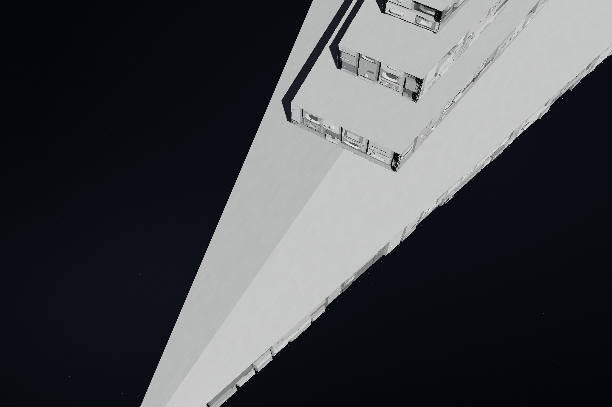
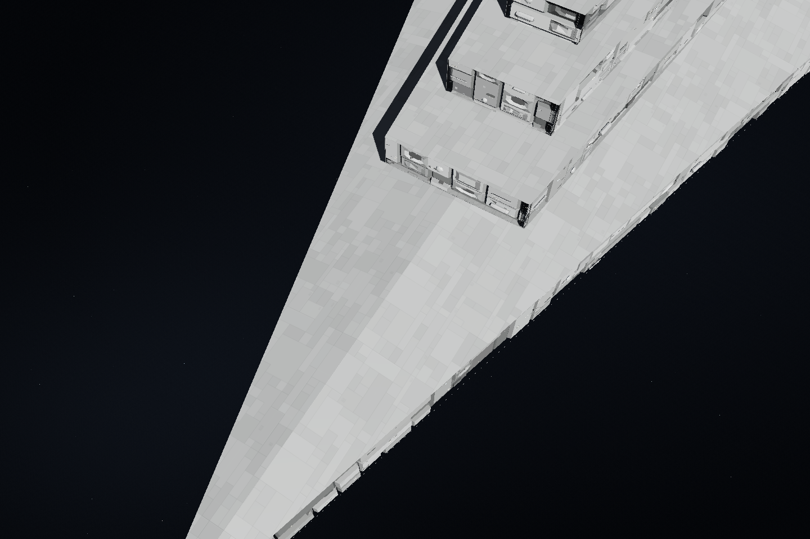
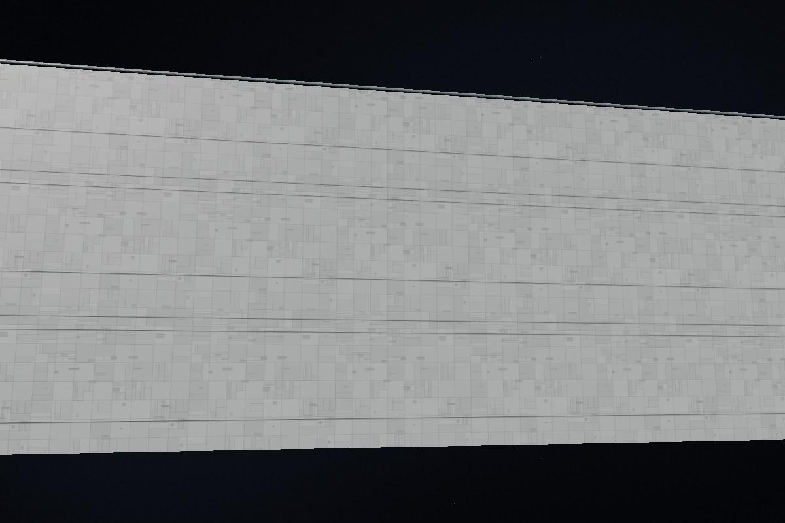
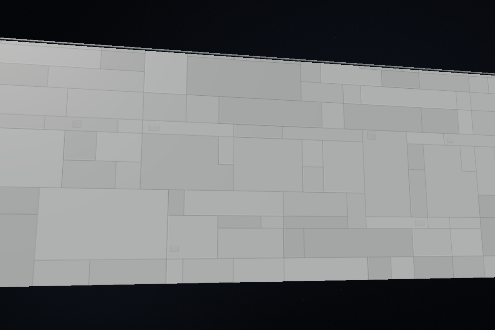
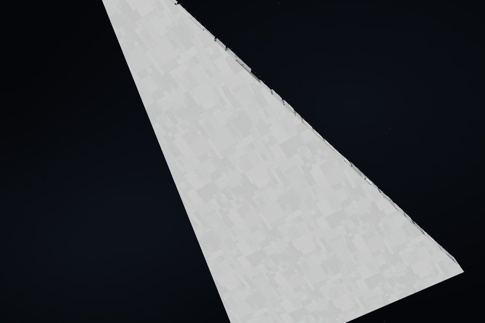
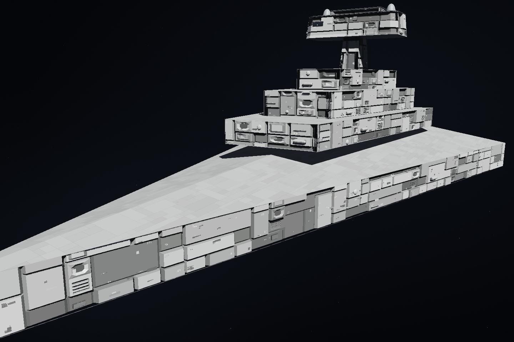

# Imperator Redux を参考にした装甲板スキン

[Fractalsponge の Imperator-class Star Destroyer Redux](https://fractalsponge.net/imperator-class-star-destroyer-redux/) の甲板・外板を参考に、装甲面のスキンを変更しました。[広い下面の板割り](https://fractalsponge.net/wp/wp-content/uploads/2018/05/isd2_145.jpg)、[甲板](https://fractalsponge.net/wp/wp-content/uploads/2018/05/isd2_141.jpg)、[傾斜面](https://fractalsponge.net/wp/wp-content/uploads/2018/05/isd2_137.jpg) を確認しています。

大小の板、L字や段違いの噛み合う継ぎ目、控えめな縁取り、少数の点検蓋を組み合わせています。灰色の明暗と細い溝・明るい縁で、浅い段差や部分的な重なりを表現します。母材の色を残した控えめな明暗にしています。

これは装甲材質のスキンの変更です。物理形状・装甲厚・重量・費用・当たり判定・保存データは維持し、三角形を追加していません。機材面の背板、丸い器材と通路、ソーラーパネル、計器、色分け表示、参照モデルの材質はそれぞれの経路を保ちます。個別塗装の色も引き継ぎます。

## 描画方法

スキンは独立した乱数から起動時に一度生成した装甲用アトラスです。ほかのテクスチャの生成乱数は変えません。甲板・下面・斜面・側面に適用し、遠距離や浅い角度ではmipmapと画素の範囲に応じて細部のコントラストを抑えます。操作中の面計算や装甲パーツの増殖を伴いません。

## 比較画像

同じ検証用モデル・同じカメラで比較します。下面は板割りを確認できるよう、変更前後とも同じ下向きの主光源を使っています。

|変更前|変更後|
|---|---|
|||
|||

## 検証

Nodeの関連44テスト、実WebGLの3テスト、互換描画・撮影の追加13テスト、翻訳と遅延読み込みの8テストが成功しました。実WebGLでは、アトラス内の大小・長い板・段違い・噛み合う領域、塗装色、三角形の分け方や面分割・回転・艦隊描画での模様の安定性を確認しています。微分拡張のない環境でも描画を確認しました。

[実ブラウザーの記録](benchmarks/imperator-armor-skin-browser.json) に、描画されたソース・画像・設計・描画バッファのSHA256と、材質・斜面・解像度・操作の確認を記録しています。同じ9構造物・27機材面・9装甲面で三角形総数111,407は変わらず、座標・法線・インデックス・UVも一致しました。

2解像度と微分拡張あり／なしの4条件で、シェーダーのコンパイルと浅い角度の表示を確認しました。GLエラー・JavaScriptエラーは0件です。機材面の比較領域、太陽電池面、参照テクスチャは同じ表示を保持し、選んだ塗装色と色分け表示の色相も維持しました。

32構造物・32機材面の最終操作確認では、入力処理中央値はスライダー0.9ms、ドラッグ0.4msで、操作中の50ms超の停止はありませんでした。音声初回起動を事前に済ませた各1回の測定です。ChromiumとSwiftShaderでの結果であり、実機FPSや表示までの遅延を保証する値ではありません。
