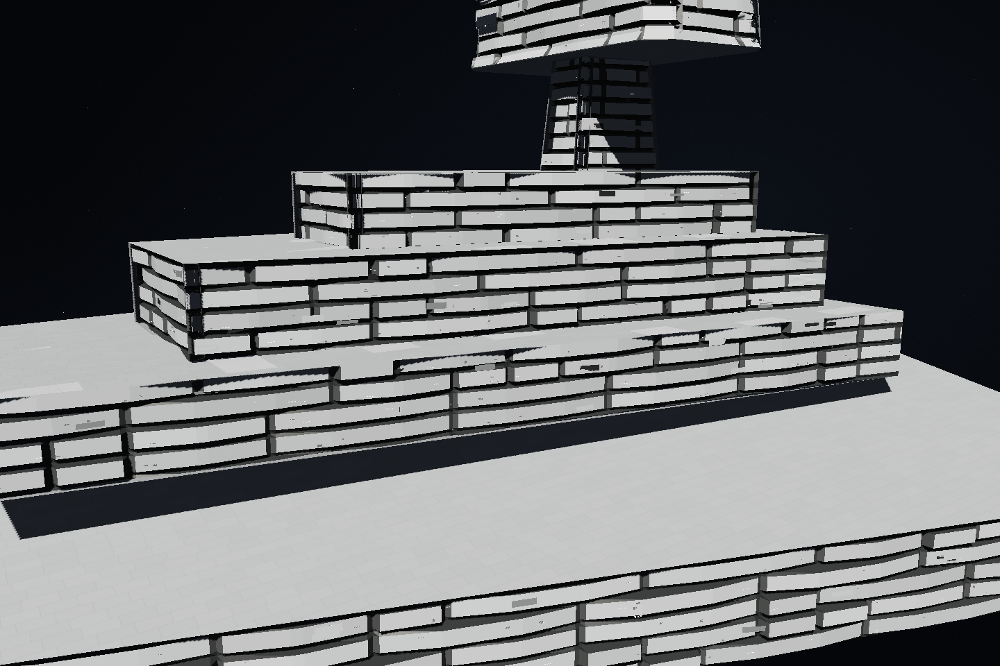
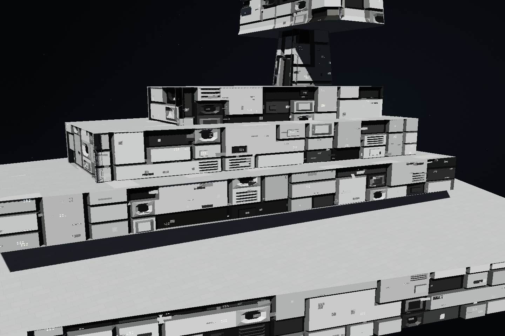
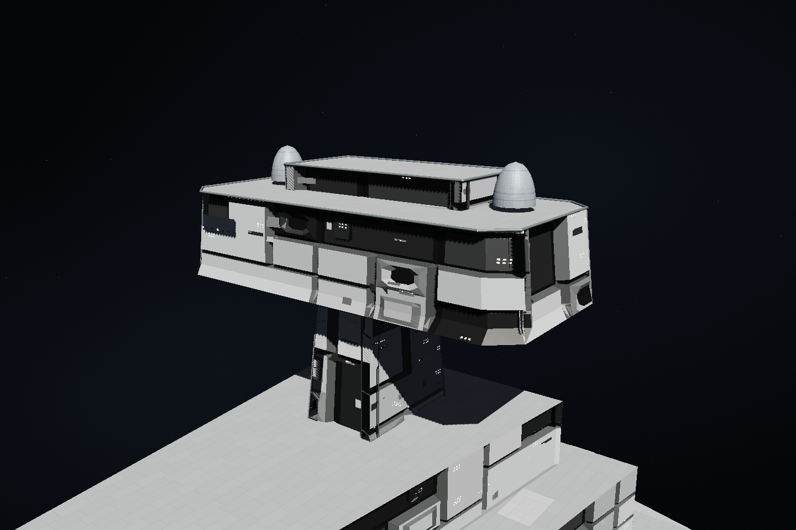
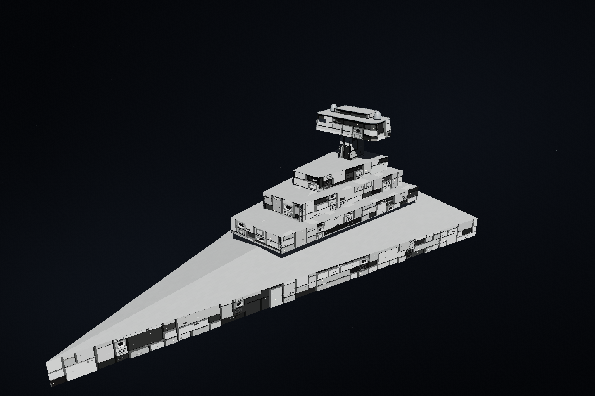

# Imperator Redux を参考にした機材構造面

外観の参考は Fractalsponge の [Imperator-class Star Destroyer Redux](https://fractalsponge.net/imperator-class-star-destroyer-redux/) です。ページ内の艦橋と側面トレンチの拡大画像を確認し、前版の長い横帯が繰り返される面を作り直しました。

具体的には、[艦橋の正面・側面](https://fractalsponge.net/wp/wp-content/uploads/2018/05/isd2_133.jpg)、[傾斜した構造物](https://fractalsponge.net/wp/wp-content/uploads/2018/05/isd2_137.jpg)、[段状の甲板とトレンチ](https://fractalsponge.net/wp/wp-content/uploads/2018/05/isd2_141.jpg)、[長い側面トレンチ](https://fractalsponge.net/wp/wp-content/uploads/2018/05/isd2_145.jpg) を参考にしています。

## 面として作る形

- 大小・縦横比の異なる機器状の面を、不規則な高さと配置で組み込みます。
- 機器の間に暗く奥まった空間を残し、短い桁や連結部、段差でつなぎます。
- 中サイズの面の中へ小さな段差やパネルを加え、複数の大きさの凹凸を混在させます。
- 発光点は機器面や暗部の縁にまとめ、窓列・作動表示として読み取れる配置にします。

機材構造面の一つの描画メッシュとして生成します。見た目の機器を編集用パーツへ増やしません。親の面に沿う向きと、内部に収まる凹凸の深さ、砲口・開口部の空き、親構造物の塗装を引き継ぎます。画像を観察した形状・配置の特徴を、手続き生成するローポリ面として実装しています。

## 操作と機能

描画予算に応じた粗さの調整、面分割前の基準とシードの共有、軽量ドラッグプレビュー、Workerでの詳細再計算を維持します。凹凸や発光点の見た目から設備数・能力を決めず、保存済みの機能容積・費用・質量・機器IDを保持します。

## 実画面

段状の甲板・塔・艦橋を持つ合成の検証モデルです。同じ9構造物・27機材面を、同じカメラ・外観設定で描画しています。器材の見た目は面内へ生成し、構造物数を増やしていません。

|変更前|変更後|
|---|---|
|||

## 検証

- 描画・境界・切削・分割・予算・外観の関連80テストが成功しました。
- Workerの面積・露出の4テスト、日本語・英語の遅延読み込みを含む8テストも成功しました。
- 実際の三角形から縦長・小型・横長の面、凹部、複数の大きさを検出する回帰テストを追加しました。このテストは前版の帯状描画では失敗します。
- 既存の低ポリゴン・低予算描画の上限試験を緩めず、分割前後の凹凸・容量・費用・IDを確認しました。

[実ブラウザーの記録](benchmarks/imperator-machinery-browser.json) に、実行されたソース・画像・設計のSHA256、カメラ、描画数と操作計測を記録しています。同一設計の機材面主描画（surfaceDevices）は99,579から93,770三角形へ約5.8%減少し、元の構造物は9個のまま、JavaScriptエラーは0件でした。艦全体・艦橋・トレンチ・斜面と、別の傾斜ブロックを確認しています。

32構造物・32機材面の操作確認では、入力処理の中央値はスライダー0.7ms、ドラッグ0.3msで、操作中の50ms超の停止はありませんでした。音声初回起動を事前に済ませた各1回の検証です。ChromiumとSwiftShaderでの計測であり、実機のFPSや表示までの遅延を保証する値ではありません。
