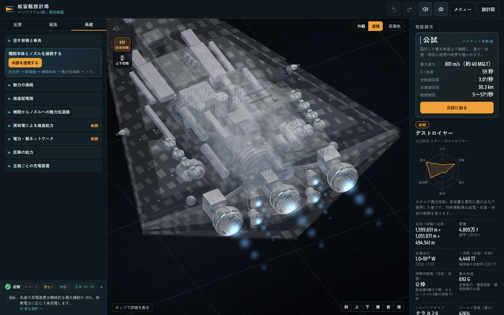

# 提供図面を基準にしたインペリアルI・II

ユーザー提供の [インペリアルII図面](../assets/source/imperial-ii-user-layout/imperial-ii-upload.json) を、両艦の船体・構造物・武装配置の基準にする。元ファイルは変更せず保存し、[来歴](../assets/source/imperial-ii-user-layout/manifest.json) と [配置一覧](../assets/source/imperial-ii-user-layout/layout-inventory.json) にSHAと比較対象を記録した。

`imperial` と `imperial2` は別々の作例として選択できる。どちらも通常の編集可能な船体と構造物26個、搭載物51個から構築し、元の図面の位置・向き・形状を使う。主砲の種類だけを次のように変える。

| 砲座 | インペリアルI | インペリアルII |
| --- | --- | --- |
| 後方の左右2基（107・108） | 175TT連装イオン | 40TT八連装 |
| 残りの左右6基（109～114） | 175TT連装ターボレーザー | 40TT八連装 |
| 三連装砲9基 | 40TT三連装 | 同左 |
| 舷側砲2基 | 70TT四連装 | 同左 |
| 点防御20基 | 100kt連装 | 同左 |

三連装砲は上面中央の3基と、添付図面の腹面6基を使う。舷側砲も添付の位置・面の向きを維持する。従来の砲座内縁にあった構造物10個は、添付図面に存在しないため採用しない。牽引ビーム10基と航空設備の配置も図面に従う。

I型は主砲のイオン砲を含め4,440TT、II型は4,200TTの砲撃合計になる（点防御の微小な加算を除く）。数値はいずれも1発あたりであり、砲身数を掛けて合計する。

## 機関と接続

添付図面は以前の機関構成で保存されており、機関本体7基と削除済みの砲への接続が残っている。作例の新規構築時にはこの接続を使わず、現在の設計モデルで電力・厳格排熱を再構築する。主機関本体1基で主ノズル3基、左右の副機関本体2基で同じ側の上下ノズルを受け持つ。伝達路は補強リング付きの実径の筒として描画する。

ノズルの開口・外観・位置、既存の反応炉とシールドを維持する。両艦の参照出力は `1e25 W`、シールド容量は `1e26 J`、ハイパードライブはクラス2。反応炉から機関までの配電損失と発熱を計算し、同時運転には実際の電力予算が作用する。

基本機関は [通常容積の定格](engine-density-thermal.md) で扱う。主機関は直径158 m・長さ90 m、左右の副機関は直径70 m・長さ20 mとし、主機関を主反応炉の後ろ、補機を主伝達路の間に置く。機関区画を空けるため慣性補償設備1基を別の船内位置へ移す。構造物・砲・ノズルの位置は維持する。参照表の加速度に合わせた高密度化は行わず、到達可能な加速を実質量と機関容積から算出する。

配電路は電力計算に残して表示・選択から除き、機関からノズルへの動力伝達路を表示する。

この再構築は作例の新規作成に適用する。通常の保存図面の読み込みでは、構造物・武装・機関をこの配置へ強制変更しない。

## 実生成と監査

[今回の監査](benchmarks/imperial-i-ii-layout-refit.json) は、航空機キャッシュを更新した最終Coreから両艦を各1回、新規構築して記録した。構造物26個・搭載物51個・船体開口・ノズル外観は、計算前後で元の添付図面と照合している。主機1基と副機2基、伝達路7本、全ノズルの正の動力供給、全39砲の蓄電、厳格排熱、機関・構造物の重なりがないことを確認した。

| 項目 | インペリアルI | インペリアルII |
| --- | ---: | ---: |
| 実装質量 | 約4,809万t | 約4,810万t |
| 機関定格による最大加速 | 約691.52G | 約691.39G |
| 反応炉出力 | 1e25 W | 1e25 W |

旧参照値3,300Gへ合わせる高密度化を取り除いたため、最大加速は低くなる。砲撃・シールドとの同時負荷で推進への電力が不足する場合は、その配分を運転値に反映する。最大性能の表示を満たすために、同時運転の電力を増やさない。

更新対象外の26艦のカタログ行と、既存の数値記録38件は生成元も含めて保持した。過去の記録を今回のモデルで生成した結果として扱わない。

実画面の検証は、通常のタイトル画面で作例を選び、ワーカーが新規構築した船を開いて実施する。保存図面や計算済みカタログを直接注入して成功扱いにしない。[I型の結果](benchmarks/imperial-user-layout-imperial-browser.json) と [II型の結果](benchmarks/imperial-user-layout-imperial2-browser.json) には、読み込んだ全ソースのSHA、索引付き砲塔メッシュ、描画する動力路と描画しない配電路、通常の砲選択、実際の自動保存と再読込を記録する。

## ワーカー起動

惑星画像データが読み込み一覧に追加された後も、ワーカーの入力を固定の配列番号で選んでいたため、必要な設計データが渡らずメイン画面上での計算に切り替わっていた。ワーカーへ渡す依存ファイルを名前で選択するよう修正した。実際の公開用の並びと、その逆順でも同じ設計データ・Core・描画コード・計算コードがワーカーへ渡ることを検証する。
