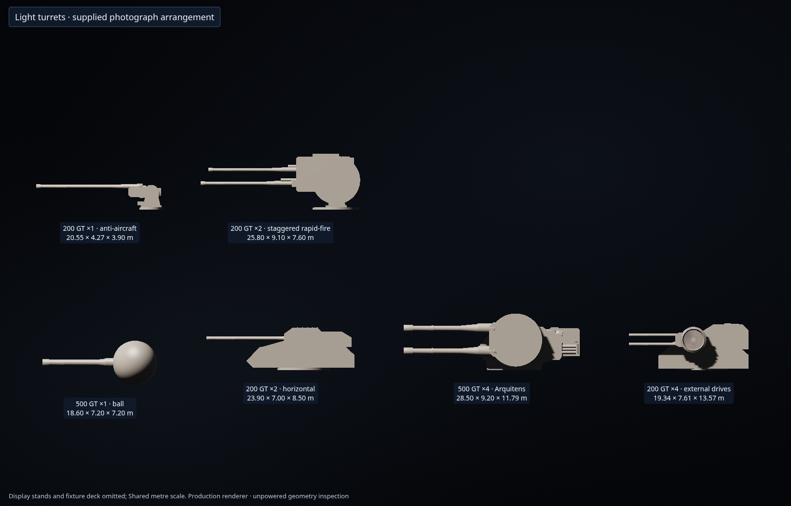
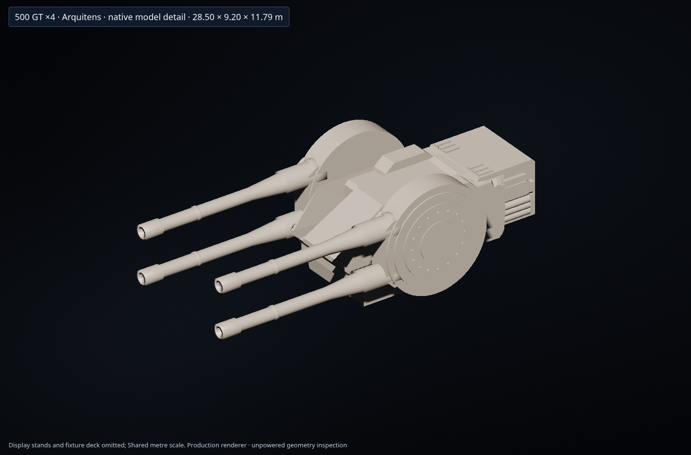
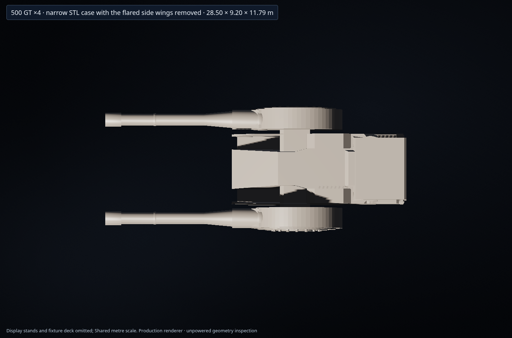

# 200GT・500GT砲塔系列

写真の下段にある40m級ISD主砲を寸法基準とし、上段の小型砲も同じ縮尺で再構成する。500GTは1門0.5 TT、200GTは1門0.2 TTを表す。形状を出力比の立方根で再縮小せず、写真から決めた寸法を通常カタログの規格として使う。

| 武装 | キー | 構造 | 一斉射 | 連射間隔 |
| --- | --- | --- | --- | --- |
| 500GT単装 | `single500` | 小型ボールターレット | 0.5 TT | 0.2秒 |
| 200GT左右二連装 | `twin200` | 高角砲型の低い装甲砲室 | 0.4 TT | 0.2秒 |
| 500GT四連装 | `quad500` | 添付STLの砲室と左右の大径円形基部、縦2門ずつ | 2 TT | 0.2秒 |
| 200GT四連装 | `quad200` | 縮小した40TT連装の外付け砲基部、各基部の中央に縦2門 | 0.8 TT | 0.2秒 |
| 200GT単装 | `single200` | 開放式の高射砲型揺架、長い砲身と駐退機 | 0.2 TT | 0.2秒 |
| 200GT上下二連装 | `twin200Fast` | 単装の機構を拡大、上下の砲身を前後にずらす速射型 | 0.4 TT | 0.1秒 |

連射間隔、対空値、質量、乗員、費用はゲーム用の設定。上下二連装は通常型の2倍の斉射頻度とし、射撃エネルギーと所要電力にも同じ間隔を使う。単装高射砲、左右二連装高角砲、上下二連装速射砲は両用砲として扱う。

| 武装 | 全長 × 全高 × 全幅（m） |
| --- | --- |
| 500GT単装 | 18.60 × 7.20 × 7.20 |
| 200GT左右二連装 | 23.90 × 7.00 × 8.50 |
| 500GT四連装 | 28.50 × 9.20 × 11.79 |
| 200GT四連装 | 19.34 × 7.61 × 13.57 |
| 200GT単装 | 20.55 × 4.27 × 3.90 |
| 200GT上下二連装 | 25.80 × 9.10 × 7.60 |

全高は埋設される部分も含む。500GT単装の球体直径は7.2mで、取付面より上に露出する高さは4.8mとなる。

## 写真とSTLの使い方

[写真の測定記録](../assets/source/light-turret-photo-measurements.json) に、提供画像のハッシュ、砲種の対応、画素範囲、縮尺と読み取り誤差を保存する。最初の写真は既存の40m級ISD八連装を基準にし、40TT単装の全長でも照合する。別の角度の写真には遠近差があるため、寸法を画素単位の厳密な一致とは扱わない。

500GT四連装は `assets/source/arquitens_turret.stl` の本体形状を使う。元の砲身と円形砲基部を分離し、最新の艦上写真に合わせた左右の大径円形基部と上下二連の揺架を作り、砲身の長さ・太さは最新の同縮尺一覧で決める。STLの単位・向き・本体の変換と使用した面を生成記録へ残す。アーキテンスの船体は引き続き通常部品から組み立てる作例であり、船体全体の外部メッシュは読み込まない。

500GT四連装はSTLを一様2.4倍にした中央部分を使い、指定された左右の張り出しを削除する。切断面には実際の側壁を作り、円形基部・揺架・砲身を同じ量だけ内側へ寄せる。前後位置・高さ・砲身寸法は保ち、全体を28.5m級に揃える。中央ケースの後端から円形基部の中心まで約10.4m、細い砲身部分は9.3m・直径1.0m、先端襟の外径は1.22m。4門の根元と砲口は同じ前後位置に揃える。

200GT四連装は、現行40TT箱型二連装のケースと左右へ完全に張り出した機構を一様に縮小する。各円形基部の上下中央に砲身を2本ずつ配置し、元の2本を残して本数を増やす方法は使わない。

砲身は太い根元・細い管・先端襟を分けて生成する。写真の輪郭点と直径の端点から長さ・太さを測り、実メッシュの管断面と照合する。輪郭の1画素程度の誤差と、ぼけた根元境界の読み取り誤差を区別して記録する。

## 取付・俯仰・材質

展示用の円筒支持台を追加せず、薄い旋回環や揺架など砲そのものの機構を取付面へ置く。500GT単装の球体は直径の下側約3分の1を構造物へ埋め、球体全体で照準する。

固定砲室と俯仰する機構を別のメッシュ範囲として記録し、実際の全砲口、描画、選択、艦隊表示に共通の座標変換を使う。新しい装甲と機構は既存ISD・DBY砲の参照材質を使い、通常部品用の明るい色へ切り替わらないようにする。

閉じた実際の砲室だけを外部の充電区画として計上する。砲身、歯車、開放式揺架の空気、円形機構の包絡箱や展示台は容量に加えない。砲室を船体へ埋め込んだ分は、従来と同じく船内の占有区画として扱う。

## 再生成と検証

```sh
python3 scripts/build-light-quad500.py --check
python3 scripts/build-light-turret-family.py --check
node --test tests/light-turret-family.cjs tests/arquitens-turret.cjs \
  tests/weapon-output-sizing.cjs tests/weapon-plain-metal-uv.cjs \
  tests/authored-turret-motion.cjs tests/turret-compartment-volume.cjs
```

ゲーム内カタログからの配置・選択、6種類の同縮尺比較、俯仰時の実砲口と描画、既存砲との材質、閉じた砲室の容積を確認する。







[実装ハッシュ付きブラウザ検証](benchmarks/light-turret-family-browser.json) と [5作例のプロフィール更新記録](benchmarks/light-turret-profile-refresh.json) に実行結果を記録する。アーキテンス、アクラメイター、ドレッドノート、ルクレハルクと、撤去武装の寸法を貨物室へ反映するLH-3210だけを再計算し、ほかの作例記録は保持する。

```sh
node scripts/update-craft-costs.cjs
node scripts/update-light-turret-profiles.cjs --apply
```

艦隊プロフィール版は8。古い保存プロフィールは既存の遅延更新で再計算する。
