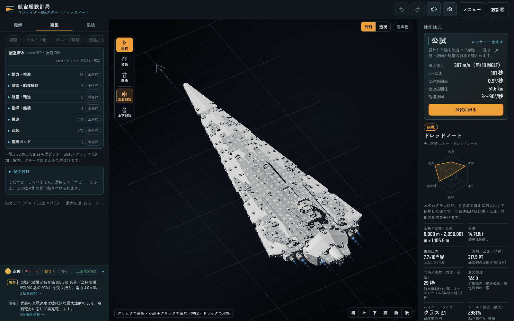
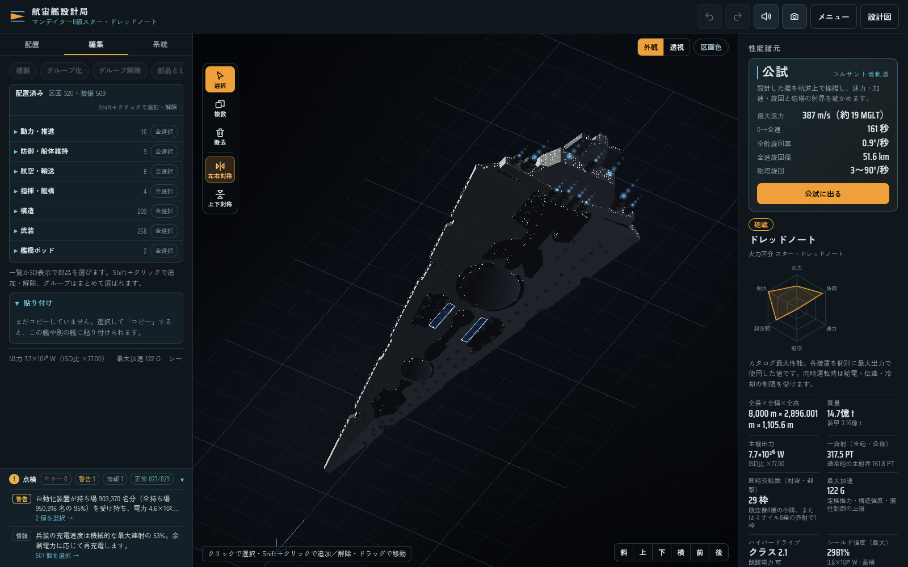
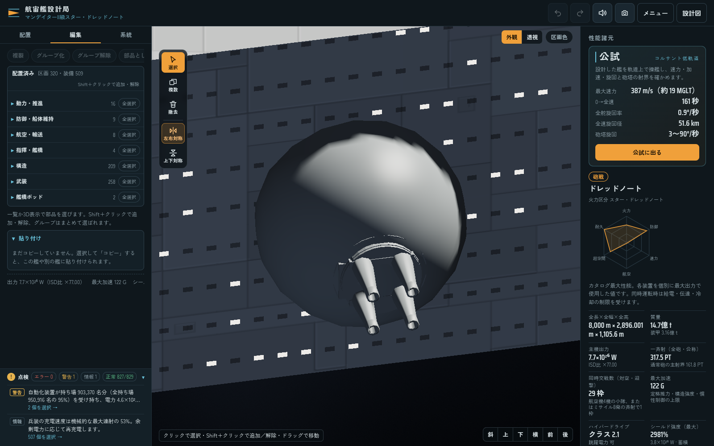

# マンデイターIIの指定性能

ユーザー指定の出力・シールド・武装を、編集可能な作例の実設備から計算する。発電量・シールド容量を艦隊用の数値だけで上書きしない。

| 項目 | 指定値 |
| --- | ---: |
| 発電出力 | 7.70 × 10²⁶ W |
| シールド蓄積容量 | 7.70 × 10²⁷ J |
| シールド散逸 | 184,034 W |
| 主砲・イオン砲の一斉射合計 | 317,520 TT |
| 100 kt PDの追加分を含む全砲合計 | 317,520.00005 TT |

| 砲 | 基数 | 1基の斉射 | 合計 |
| --- | ---: | ---: | ---: |
| 720 TT連装ターボレーザー | 163 | 1,440 TT | 234,720 TT |
| 720 TT単装球型ターボレーザー | 80 | 720 TT | 57,600 TT |
| 175 TT四連装ターボレーザー | 16 | 700 TT | 11,200 TT |
| 175 TT四連装球型ターボレーザー | 6 | 700 TT | 4,200 TT |
| 175 TT四連装球型イオン砲 | 14 | 700 TT | 9,800 TT |
| 100 kt連装PD | 160 | 0.0000002 TT | 0.000032 TT |
| 100 kt三連装球型PD | 60 | 0.0000003 TT | 0.000018 TT |
| **計** | **499** | | **317,520.00005 TT** |

PDを1門1発100 ktへ統一したため、720 TT砲と175 TT砲の基数を組み直し、主砲・イオン砲だけで指定の317,520 TTを満たす。連装PD160基と球型三連装PD60基の計500門が加える0.00005 TTは、指定値に対して約1.6×10⁻¹⁰の微小な追加分として扱う。PDの威力や反応炉出力を上げて合計を合わせない。

175TT通常砲は連装44基を四連装22基へ、イオン砲は連装28基を球型四連装14基へまとめる。175TT通常砲は角型16基と球型6基を使う。舷側の720TT砲は連装40基ぶんを球型単装80基へ、点防御は連装90基ぶんを球型三連装60基へ置き換える。砲塔は全体で525基から499基へ減り、1門1発あたりの威力・総砲身数・総斉射量は維持する。イオン砲は左右の舷側へ7基ずつ配置し、舷側の砲は球型を基本とする。

## 上面・下面・舷側への分散

| 配置面 | 720TT砲 | 175TT通常砲 | 175TTイオン砲 | 点防御 | 計 |
| --- | --- | --- | --- | --- | ---: |
| 上面 | 連装83基 | 四連装8基 | — | 連装80基 | 171基 |
| 下面 | 連装80基 | 四連装8基 | — | 連装80基 | 168基 |
| 左舷 | 球型単装40基 | 球型四連装3基 | 球型四連装7基 | 球型三連装30基 | 80基 |
| 右舷 | 球型単装40基 | 球型四連装3基 | 球型四連装7基 | 球型三連装30基 | 80基 |

旧配置では上面に449基が集中し、42の実砲口が船体内に入っていた。新規作例は各面の基数を先に割り当て、砲室・砲身・底面・射線が実船体と干渉しない場所へ配置する。元の八角形砲座は、寸法と射線が合う場所を再利用する。反応炉や他の実機器の上を搭載面として使わない。

旧配置の自動土台は最大134mあり、砲塔本体の高さの5倍を超えていた。新配置では平坦な面を優先し、土台高を砲塔本体高の75％以内に制限する。接地誤差を避ける小さな実土台も計上し、裏側に浮いた砲座や大きな柱で干渉を隠す配置を避ける。球型砲塔は球殻の一部を舷側へ埋め込み、砲口を外向きにする。

元の船体・構造物・機関外観、艦橋・航空設備・重魚雷サイロなど他10装備の配置を保つ。通常の保存図面を読み込む際は、利用者が配置した砲をこの作例配置へ強制変更しない。

元の反応炉IDを保ち、通常の出力密度を使って必要な実容積を確保する。主炉の外装を維持し、追加で必要な容積は既存の補助炉の船内区画へ収める。シールドの容量も実装置の容積から求める。メッシュ座標の丸めに伴う微小な差を許容する。

シールドの指定散逸値は、各装置の `shieldDissipationW` を合計した一時蓄積エネルギーの外部放出上限である。シールドへの実際の充電電力とは別に扱い、184,034 WをTT/秒へ読み替えない。装置の破損・給電状態を反映して散逸を制限し、充電には実際の配電量を使う。

`allGunVolleyTT` は、浮いていない実砲のレーザー・イオン・PDを合計した公称斉射量である。魚雷・ミサイルを含まず、射界や再充電で制限される持続射撃量とは別に表示する。推進・砲撃・シールドは有限の発電量を共有し、同時に最大出力を達成するよう反応炉を増強しない。

今回のカタログ再生成では、過去の機関計算も現行モデルの値へ更新する。旧行はプロフィール17の高密度機関 `advanced` による約1,065.85G、現行の通常密度 `standard` の実機関と完成質量では約122.44Gとなる。機関の計算処理は今回変更していない。この差には旧カタログから現行モデルへの更新が含まれる。

今回の検証は [マンデイターIIの生成・物理監査](benchmarks/mandator-battery-layout-refit.json)、[形状検証](../scripts/mandator-layout-evidence.cjs)、専用テスト `tests/mandator-example-refit.cjs` に記録する。[以前の全作例監査](benchmarks/ship-examples-after.json)は当時の生成来歴として保持する。

点防御の描画は[最低限モデル](render-geometry-budget.md)を使い、連装176面・球型三連装132面とする。物理区画や威力は維持する。

## 実画面での配置確認

現在の作例をタイトルの作例一覧から新規生成し、実際のWorkerで形状と性能の計算が完了した画面を記録した。上面・下面・左右舷側と、720TT主砲・四連装球型イオン砲の近景を確認する。

[新規生成のブラウザ記録](benchmarks/mandator-battery-native-browser.json)では、形状・性能・全509装備の配置と6画面の取得まで成功した。その後の検査コードが選択状態を `st.inspect` で待ったため、記録全体は `ERROR` のまま保存している。実装の選択状態は `st.sel` であり、[元の検査コード](benchmarks/mandator-battery-native-initial-harness.cjs.gz)も保持する。

同じ公開図面を「続きから」で開く[別のブラウザ検査](benchmarks/mandator-battery-native-continue-browser.json)は成功した。実Workerの形状・性能計算後、実際の操作で舷側イオン砲を選択し、情報表示と保存を確認した。検査用図面の投入後にアプリが新しく保存データを書いたことと、全509装備の種類・位置・向きが保存後も一致することを確認する。この追加検査を新規生成の成功として数えない。新規生成用の検査コードは選択条件を修正したが、修正版での新規生成は再実施していない。

