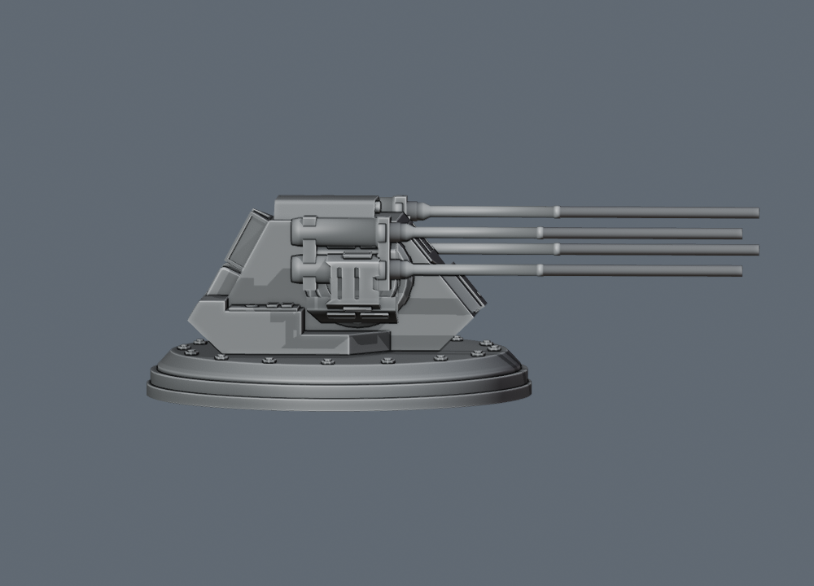

# 写真に基づく500GT四連装砲

アーキテンスの主砲は `quad500`、500GT 4連装中型ターボレーザー。ユーザー提供の主砲写真に合わせ、左右に縦2門ずつの長く細い砲身と揺架を持つ通常武装として実装する。作例には上面2基・下面2基、合計4基16門を配置する。船体は75個の通常構造物から組み立て、外部の艦体メッシュを使わない。

| 項目 | 値 |
| --- | --- |
| 武装キー | `quad500` |
| アセット | `arq_turret_quad500` |
| 1門・一斉射 | 500 GT（0.5 TT）×4門 = 2 TT |
| 全長 × 全高 × 全幅 | 17.8304 × 5.8065 × 14.1041 m |
| 俯仰軸の高さ | 約3.641 m |
| 砲身中心の高さ | 下段4.0 m・上段5.1 m |
| 連射間隔 | 0.2秒 |

高さは取付面から測る。この砲は添付STLの主砲寸法を保持する個別基準で、出力比による寸法換算を適用しない。




## 砲身と駆動部

元の小型両用砲 `pd_turret_small` の砲室・旋回機構・円形駆動部を保持する。左右に縦2門ずつ、外径0.34 mの平行な円筒砲身を配置し、段付きの根元と上下をつなぐ揺架を加える。砲口は内径0.23 m、くぼみ0.45 m。先端まで円形断面を保つ。

下段と上段を駆動部より上へ移し、砲身の根元を支持する枠をつなぐ。旧モデルの砲身を上下へ単純複製せず、写真に合わせた砲身・接続部を作る。標準寸法、1門500GT、4門合計2TT、質量2,250 t・乗員10名・基礎費用200,000を保持する。性能・費用・連射間隔はゲーム用仮定。

旋回中心と俯仰軸を別に定義する。砲室と駆動部の外側は水平旋回し、砲身と揺架だけが俯仰軸の周りを上下へ動く。俯仰範囲は−10〜+85度。`Core.authoredTurretGeometry` と `Core.aimAuthoredTurret` を、描画、実際の4砲口、発射、艦隊表示、Sフォイル、遮蔽判定で共有する。1本だけの射線に障害物がある場合も斉射を止める。

新規配置では砲座高さ・自動持上げ量を0にして甲板へ直接取り付ける。砲室内の閉領域は充電設備に使い、船体へ埋まった分は船内の占有区画として予約する。約104.064 m³の砲室領域は、実際の外殻内へ収まる保守的な24個の凸立体として記録する。包絡箱全体や旋回環の空気を容量に数えない。[砲室区画の仕様](turret-family-and-compartments.md) を参照。

## 40TT・70TT系列の更新

以前の比較では、DBY-827由来の砲身を駆動軸より高くした40TT連装を `twin40` として使っていた。新しいインペリアル級と兵装系列の参考画像に従い、現行の `twin40` は、完全なDBY型円形駆動部を左右の外側へ配置し、中央を幅広の角形上屋で閉じた箱型40TT連装へ更新する。写真中のドーム型40TT連装は別の `twin40Dome` とする。旧スキン `dby_twin40_raised` を指定した対象武装は保存読込み時に現行系列へ移行する。

DBY-827は `refVen` の70TT×2で元の `ven_turret` の形状を保持し、ISD主砲は従来の通常8連装の形状を保ち、一様に寸法調整した `oct40` の40TT×8。球形イオン4連装を含む9種類の形状、同じ縮尺での比較、舷側専用70TT×4、砲室による必要船内区画の差は [写真に基づく砲塔系列](turret-family-and-compartments.md) にまとめる。以前の2基だけの比較画像と記録は当時のモデルを示すもので、現行40TT系列の寸法根拠には使わない。

## 再生成と検証

```sh
python3 scripts/build-arquitens-turret.py --check
python3 scripts/build-turret-family.py --check
node --test tests/arquitens-turret.cjs tests/weapon-family-models.cjs \
  tests/authored-turret-motion.cjs tests/authored-turret-clearance.cjs \
  tests/turret-compartment-volume.cjs
```

生成器はPython標準ライブラリだけを使う。固定部と可動部の境界、実砲身の頂点範囲、駆動軸、砲口、量子化誤差、ハッシュをマニフェストへ記録し、`--check` で実行時登録との一致を確認する。通常設計図には武装キー、取付位置、対称関係、砲塔の向き、充電設定を保存する。砲塔の参照メッシュは再利用可能な通常装備で、アーキテンス船体を外部メッシュへ置き換えない。

旧 `scripts/build-twin40-turret.py` と旧マニフェストは旧アセットの再現資料として保持する。現行の箱型40TT連装と、元モデルの形状を保ったDBY-827の登録経路は `scripts/build-turret-family.py`。
