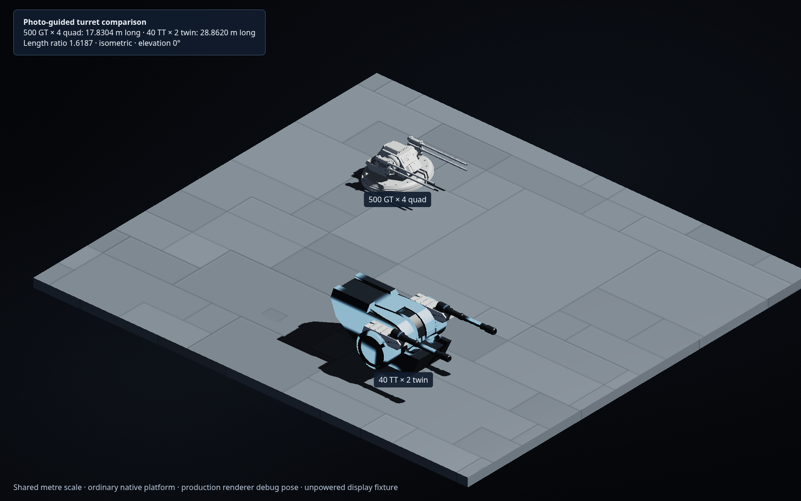
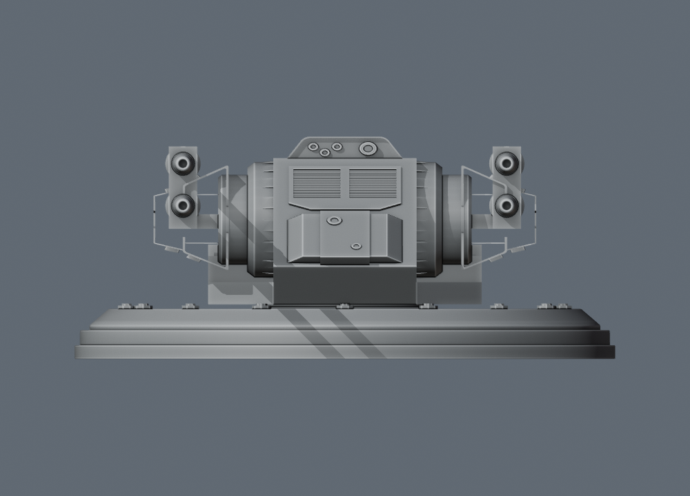
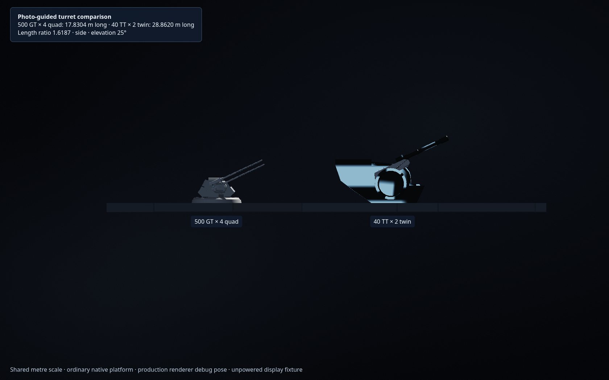

# 写真を基準にした四連装砲と40TT連装重砲

ユーザー提供の写真に合わせて、500GT四連装の砲身と揺架を調整し、DBY-827由来の40TT連装重ターボレーザーを通常の武装カタログへ追加した。アーキテンス作例の主砲は引き続き500GT四連装4基で、船体は24個の通常構造物から組み立てる。

| 項目 | 500GT四連装 | 40TT連装重砲 |
| --- | --- | --- |
| 武装キー | `quad500` | `twin40` |
| 名称 | 500GT 4連装中型ターボレーザー | 40TT 2連装重ターボレーザー |
| 1門・一斉射 | 0.5 TT × 4門 = 2 TT | 40 TT × 2門 = 80 TT |
| 全長 × 全高 × 全幅 | 17.8304 × 5.8065 × 14.1041 m | 約28.862 × 9.998 × 16.258 m |
| 俯仰軸の高さ | 約3.641 m | 約4.403 m |
| 砲身中心の高さ | 下段4.0 m・上段5.1 m | 8.409 m |
| 連射間隔 | 0.2秒 | 1秒 |

高さは取付面から測る。連装重砲の全長は四連装の約1.62倍。写真の透視による寸法誤差を考慮し、既存DBY-827の実形状寸法を基準に、比較写真の大きさの関係を再現した。この2基には各自の標準寸法を適用する。




## 500GT四連装

元の小型両用砲 `pd_turret_small` の砲室・旋回台・円形駆動部を保持する。左右に縦2門ずつ、外径0.34 mの平行な円筒砲身を配置し、段付きの根元と揺架を加える。砲口は内径0.23 m、くぼみ0.45 m。先端まで円形断面を保つ。

下段と上段を駆動部より上へ移し、砲身の根元を支持する枠をつなぐ。砲身を旧モデルの位置へ単純に上下複製する方式から、写真に合わせた砲身・接続部の形状へ変更した。標準寸法、1門500GT、4門合計2TT、質量2,250 t・乗員10名・基礎費用200,000を保持する。




## 40TT連装重ターボレーザー

新しい `twin40` は、DBY-827の砲室・旋回台・左右の円形駆動部を保ち、完全な砲身2本を駆動軸から約4.006 m上へ移す。装甲付きの支持部と上面のリブを加えて、砲身の根元と駆動部を接続する。砲口の円形開口と約1.283 mのくぼみも保持する。

既存DBY-827の `refVen`（2門×70 TT）と側面砲 `refSide`（2門×40 TT）はそのまま使用できる。新しい連装重砲は `dby_twin40_raised` の正規化済みモデルを使い、砲身+X・上+Y・取付原点0で配置する。標準寸法に対するモデル倍率は1、寸法基準は `user-reference-photo`。

同じDBY由来の砲室として質量6,000 t・乗員18名・基礎費用500,000を採用する。1秒ごとに合計80 TTを発射し、要求電力はその射撃エネルギーに従う。性能・費用・連射間隔はゲーム用仮定である。

## 駆動と射出位置

旋回台の水平旋回中心と、砲身の俯仰軸を別の位置として定義する。砲室・旋回台・駆動部の外側は水平旋回し、砲身と揺架だけが俯仰軸の周りを上下へ動く。

`Core.authoredTurretGeometry` は実際のメッシュと同じ変換から駆動軸・各砲口を求め、`Core.aimAuthoredTurret` で水平旋回と俯仰を合成する。描画、操縦時の発射、艦隊表示、Sフォイル上の装備、ワーカーの遮蔽判定はこの変換を共有する。四連装は上下左右4つ、連装砲は2つの実際の砲口から射出する。

上下の機械的制限は共通の−10〜+85度。射撃可能かどうかも同じ制限と全砲口の射線で判定する。1本だけの前に障害物がある場合も、その砲塔の斉射を止める。



## 再生成と保存

```sh
python3 scripts/build-arquitens-turret.py --check
python3 scripts/build-twin40-turret.py --check
```

生成器はPython標準ライブラリだけを使う。元のPD・DBYアセットは変更しない。マニフェストに固定部と可動部の境界、実砲身の頂点範囲、駆動軸、砲口、量子化誤差とハッシュを記録する。再生成した実行時登録が一致することを両方の `--check` で確認した。

通常の設計図は `quad500` / `twin40`、取付位置、対称関係、砲塔の向きなどを保存する。砲塔の参照モデルは再利用可能な通常装備で、アーキテンス船体を外部メッシュへ置き換えない。カタログ追加に伴い艦載機12機種の価格署名を `1ab8eam` へ更新し、署名以外の全フィールドが従来どおりであることを [比較記録](benchmarks/turret-photo-catalog-comparison.json) で確認する。

## 検証

```sh
node --test tests/arquitens-turret.cjs tests/twin40-turret.cjs \
  tests/weapon-output-sizing.cjs tests/authored-turret-motion.cjs \
  tests/authored-turret-clearance.cjs
```

形状・寸法・駆動・射線の32件が成功。実メッシュの4本/2本の接続した砲身、円形断面、くぼんだ砲口、駆動軸より高い砲身、6方向と傾斜面への配置、選択、保存、固定部と可動部の描画数、射出口、制限角、Sフォイルとの合成を検証する。従来の射出・可動翼・描画・ネイティブ船体・読み込みキャッシュも含め、計77件を分割実行で確認した。

実ブラウザの [比較記録](benchmarks/turret-comparison-browser.json) は、同じ台へ通常配置した2基、実際の選択・向きの変更とUndo、正面・側面・斜視、0度と25度の描画を確認する。俯仰比較は本番の艦隊描画と共通の駆動計算を使う、明示したデバッグ表示である。比較台は発電機を持たず、持続戦闘や自動の戦闘目標追尾を保証する試験ではない。
