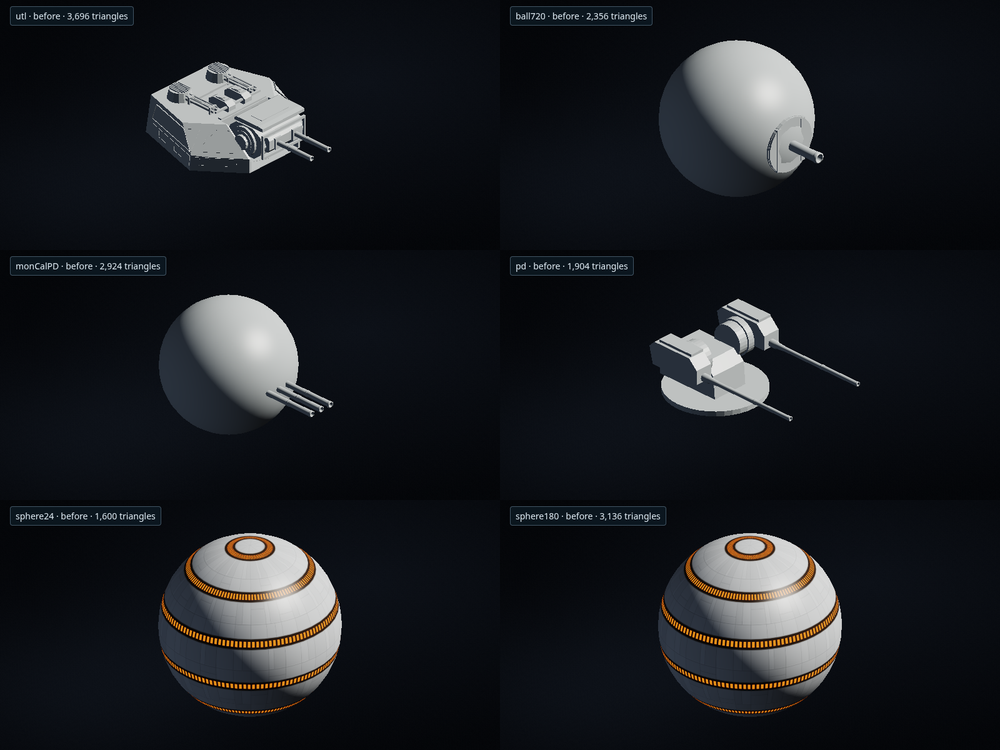
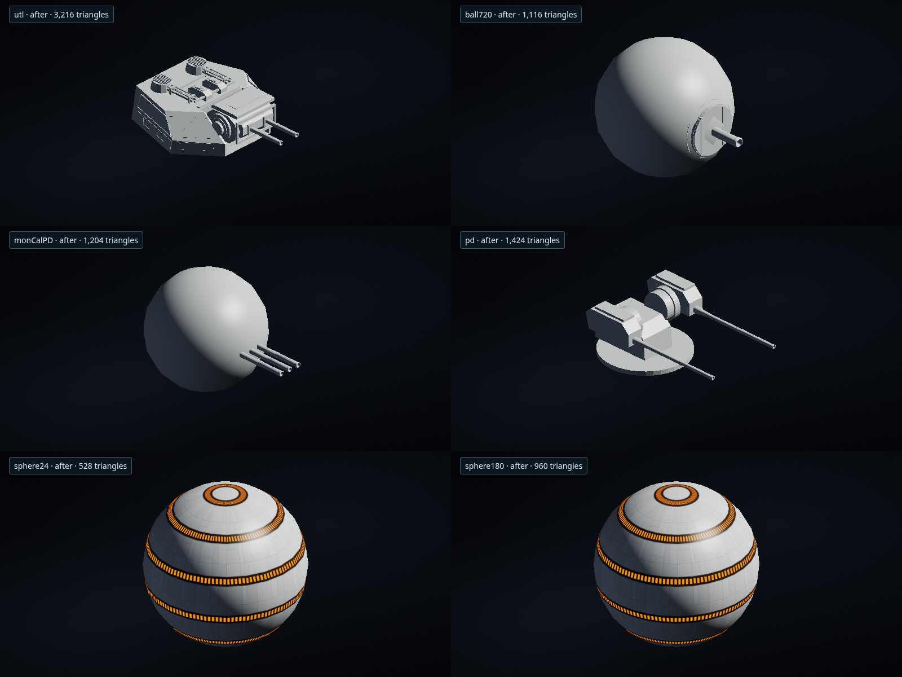

# 球体と砲身の描画軽量化

球体・円筒・砲身の円周分割を減らし、共有できる頂点をまとめる。丸い部分には滑らかな法線を使い、円筒の端面や砲身の段差は残す。球の極で面積がゼロになる三角形は生成しない。

| 一般球体 | 変更前の三角形 | 変更後の三角形 |
| --- | ---: | ---: |
| 小型・中型 | 1,600 | 528 |
| 大型 | 3,136 | 960 |

写真・図面から作った砲塔には、アセットごとに一度だけ軽い描画メッシュを作って共有する。球状砲塔は同じ中心・半径で張り直す。砲身は軸方向の断面、根元、段差、砲口の輪と内壁を保ち、円周方向の頂点を減らす。規則的な形として安全に処理できない部分は元の描画形状を使う。

球状砲塔の球殻は1,360面から360面になる。単装モン・カラマリ砲は1,964面から724面、三連装球状PDは2,924面から1,204面になる。小さな砲身で既に6～8分割のものは、その分割数を維持する。

描画用メッシュには部品範囲と固定部・俯仰部の境界を別に持たせる。設計画面、配置プレビュー、選択判定、戦闘時の旋回・俯仰に同じ描画形状を使う。元のモデル、物理区画、容積、砲口位置、射界、武装性能、保存図面は維持する。

## 計測範囲

[変更前](benchmarks/render-primitive-budget-before.json)と[変更後](benchmarks/render-primitive-budget-after.json)は、実際のGfxが生成した索引付きメッシュの三角形・頂点・バッファ量と準備時間を記録する。艦ごとの比較には保存済み作例の全武装を使用する。船体・内部設備・性能計算は含まず、艦全体のフレームレートを示す数値ではない。

| 作例の全武装 | 変更前の三角形 | 変更後の三角形 | 削減率 |
| --- | ---: | ---: | ---: |
| マンデイターII | 1,533,052 | 1,288,220 | 16.0% |
| MC80ホーム・ワン | 251,868 | 101,500 | 59.7% |
| インペリアルI | 103,289 | 90,105 | 12.8% |

ホーム・ワンの武装バッファの使用部分は12.67MBから3.06MBになる。初回には描画メッシュの生成・検査の負担も生じるため、初回準備とキャッシュ利用後の時間を分けて記録する。すべての場面のCPU時間が短くなることを示す比較ではない。

ブラウザ比較は同じ配置とカメラで実WebGLへ送り、描画された索引数と画面の読み戻しを確認する。ヘッドレスChromiumとSwiftShaderを使い、影を無効にした共通条件で測る。実機Safariの速度測定は含まない。

## 回帰検証

新規の形状テスト11件と、既存の描画関連88件を確認した。独立した検査でも32アセットを4姿勢で調べ、砲口の奥の面への選択、法線、キャッシュ再利用、元の位置・UV・索引の不変を確認する。

旧式の甲板上砲列と旧インペリアルの前方イオン砲配置を期待する物理仕様テスト2件は、変更前の描画器でも同じ失敗を確認した。これらのテスト本文は維持し、今回の描画回帰検証の対象から除いた。

```sh
node --test tests/procedural-render-budget.cjs tests/authored-render-budget.cjs
node scripts/benchmark-render-primitives.cjs --phase after
```




