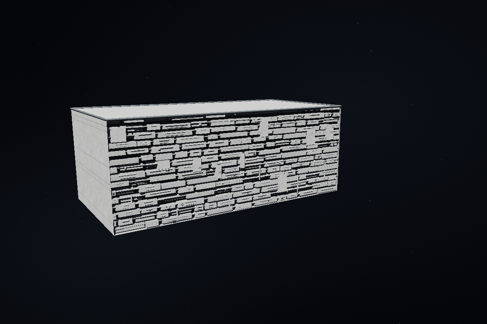
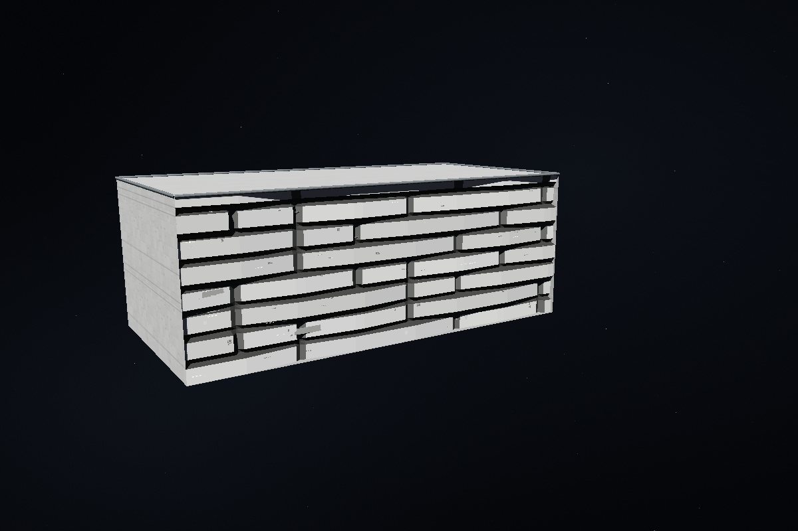
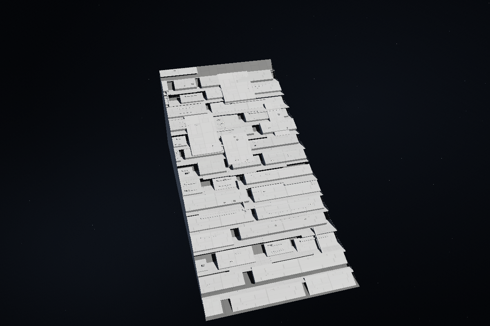
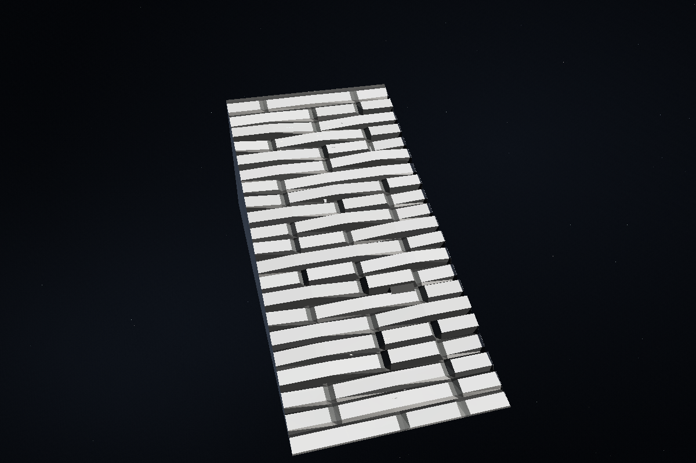

# 設計操作と機材構造面の修正

構造物・装備のドラッグと寸法スライダーは、操作中に簡易プレビューを更新し、指を離してから最新の設計を Worker へ渡します。プレビューと選択枠の更新は描画フレームごとにまとめます。操作途中の全設計の送信、面の露出判定、性能計算、古い完成メッシュの転送を避けます。

画面側の面選択と輪郭は Worker の完成済み面形状を使います。面の分割・結合では新しい面IDと面積を即時取得し、通常の移動・寸法変更では次の Worker 応答まで完成済み形状を保持します。古い応答の船体・ハッチ等の差分は最新の結果へ統合し、別設計の応答は持ち越しません。Worker を利用できない環境では従来のインライン実行へフォールバックします。

## 機材構造面

機材構造面は、露出面の範囲に合わせた粗い三角形メッシュで表現します。面に沿って横長の段差・溝を広げ、内部へ浅く後退した凹凸を作ります。傾斜面でも面に沿う向きを使い、深い棚板が面に垂直に張り出す外観を改めます。箱の背面や端蓋を大量に組み合わせる描画を減らし、散熱・センサー・居住の機能表示は面上の小さな表示として残します。

発光点は居住区の配分や細部密度から独立した面の外観です。細部密度0でも表示し、設備・兵装・要員を追加しません。面の分割、露出範囲、砲口の空き、親構造物の塗装を引き継ぎます。外観の変更は機能容積・費用・質量を変えません。

## 検証

操作・保存・Undoを含むUI関連74件、表示・翻訳関連33件、描画関連76件が成功しました。各実行群には一部重複があります。Workerの更新待ちの中断、面形状の転送、面積方式、露出判定、分割・結合のクライアント試験も通過しています。複数面・低い描画予算で分割しても凹凸が変わらず、設備容積・費用・IDを保持する追加試験も成功しました。

既存の `surface-aggregate-editor-ui.cjs` には `trialProfile()` の旧形式を期待する失敗が1件あり、変更前のコピーでも同じ失敗を確認しました。全テスト一括実行は高負荷の既存機体生成群で打ち切り、今回の変更に関係する上記の試験群を個別に完了しています。

[ブラウザー計測の詳細](benchmarks/responsive-design-browser.json) は、32構造物・32機材面、スライダー12入力・実ポインタ20移動の同一モデルを、変更前後でそれぞれ実行した記録です。音声の初回起動を事前に済ませ、他のテストを止めた状態で測定しました。

|操作|入力処理の中央値：変更前 → 変更後|操作中の50ms超の停止：変更前 → 変更後|
|---|---:|---|
|スライダー|19.55 → 0.75ms|最大422ms → なし|
|ドラッグ|17.7 → 0.4ms|最大511ms → なし|

最終座標は一致し、JavaScriptエラーは0件、計算はWorkerで動作しています。ChromiumとSwiftShaderのソフトウェア描画で各条件1回の比較です。入力処理時間は画面表示までの遅延と同じ値ではなく、実機のFPSを保証する測定でもありません。入力列、停止時間、ソースSHA256は詳細JSONに残しています。

## 実画面の比較

160×80×60mの構造物に外観深さ4m・密度0.25を指定した検証モデルです。計測用の32構造物のモデルとは別です。

|変更前|変更後|
|---|---|
|||
|||

参考モデルの作者Daniel、出典、CC BY 4.0の帰属は [機材面の参考モデルと帰属](surface-equipment-allocation.md#参考モデルと帰属) およびアプリの参考資料欄に維持します。添付されたインペリアル級の画像は外観の方向性を確認するために参照しています。
