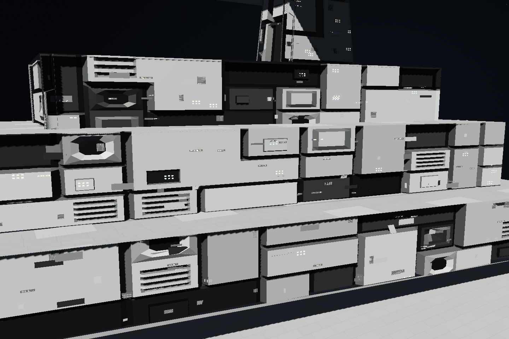
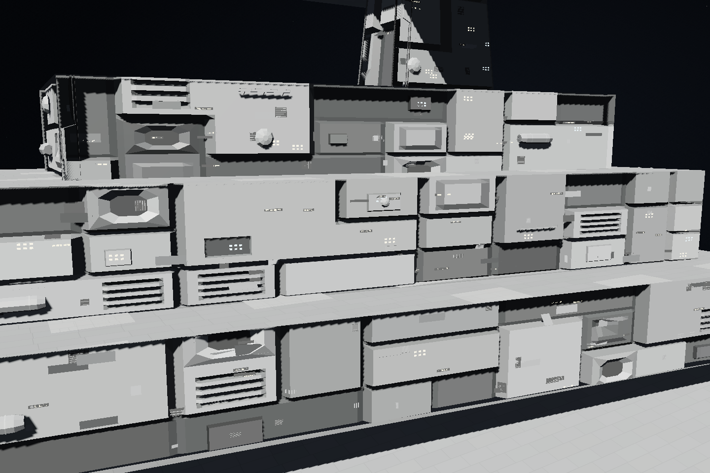
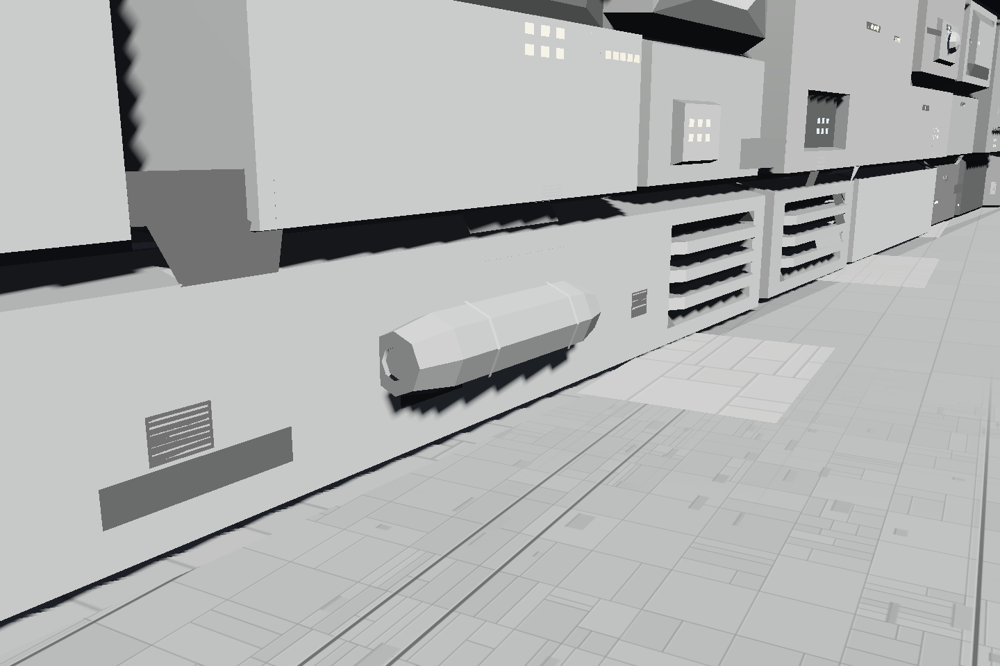
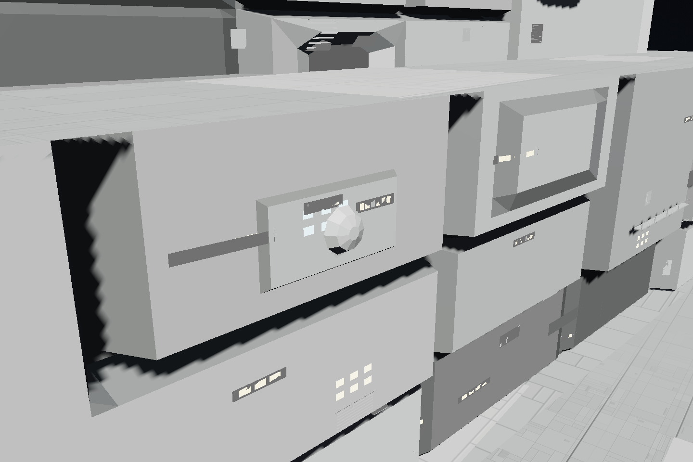
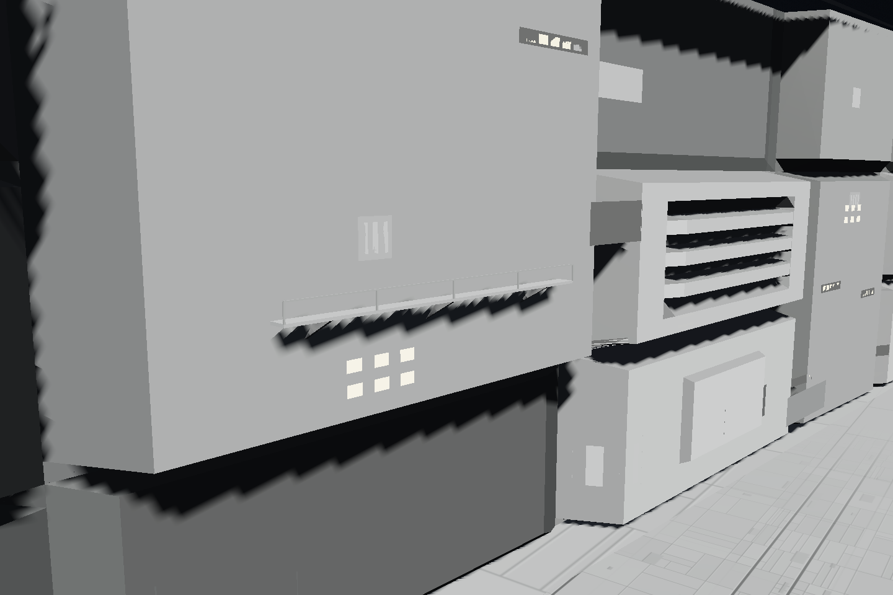
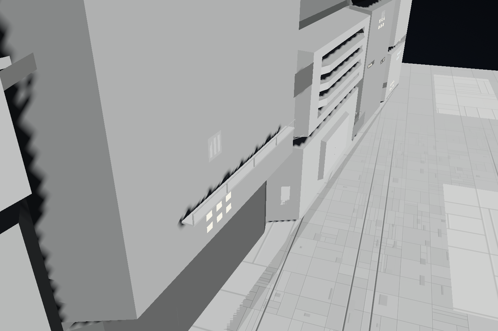

# 丸い機器とキャットウォーク、暗部の修正

機材構造面の暗部は、凹部を強調するために母材色を大きく暗くしていました。照明による陰影も掛かるため、広い面が黒い塗り分けに見えていました。母材の色を残すグレーへ調整し、形の奥行きと照明で陰影を出す扱いへ改めます。

器材の外観には、四角い面や平面的な開口だけでなく、次の立体形状を加えます。

- 面に沿って横倒しに置いた、低ポリゴンのタービン状円筒。側面の曲がり、端面、リブを持ちます。
- 円形・丸みのある筐体。面から立ち上がる曲面を粗い多角形で表します。
- 短いキャットウォーク状の張り出し。床、支え、手すりを持たせ、適した側面へ局所的に生成します。

面全体の描画として生成し、編集用の器材パーツは増やしません。基礎となる凹凸面は構造物の内側に保持し、今回加えた機器と通路の張り出しは、別に定めた小さな範囲で許可します。開口部・砲口の空きを維持し、親構造物の塗装と変形に追従させます。見た目の形から設備の能力・質量・費用を増やしません。

## 実画面

同じ検証用の艦・カメラで、固定暗色の調整と機器形状の追加を比較しています。

|変更前|変更後|
|---|---|
|||

横置きの円筒。側面・端面・リブも実際の三角形です。

凸状の丸い筐体。

水平な床と手すり、三角形の支えを持つ通路。

## 検証

- 関連描画62件と追加の互換描画25件、Worker・操作の11件が成功しました。
- 基礎面の従来の面積・内包・三角形上限の試験を維持しています。新しい張り出しは実際の描画範囲を個別に識別し、許可した範囲内であることを検証します。
- 円筒の横軸と曲面法線、凸機器の立体形状、通路の水平な床・裏面・手すり・支えを実三角形から確認しました。
- 船体・部品の両方で開口回避と面分割の安定性を確認しました。深い凹部で支持材が長く伸びることを防ぎ、多数の基準面へ少ない描画枠を分配する場合も形の種類を偏らせません。

[実ブラウザーの記録](benchmarks/rounded-machinery-browser.json) に、実行ソース・設計・画像のSHA256と機構の範囲、描画数、操作確認を残しています。同一設計の9構造物・27機材面は変わらず、器材面の主描画は93,770から99,716三角形です。追加された54機構に張り出し上限の違反はなく、JavaScriptエラーも0件でした。

32構造物・32機材面で、スライダー12入力と実ポインタによるドラッグ20移動を確認しました。入力処理の中央値はスライダー0.75ms、ドラッグ0.4msで、操作中の50ms超の停止はありませんでした。音声初回起動を事前に済ませ、他のテストを止めた各1回の計測です。ChromiumとSwiftShaderでの結果であり、実機FPSや表示までの遅延を保証する値ではありません。
