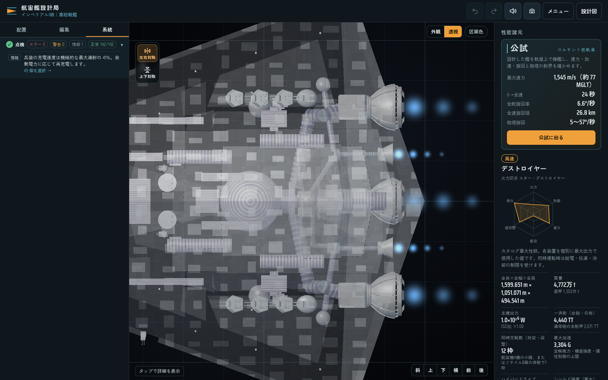
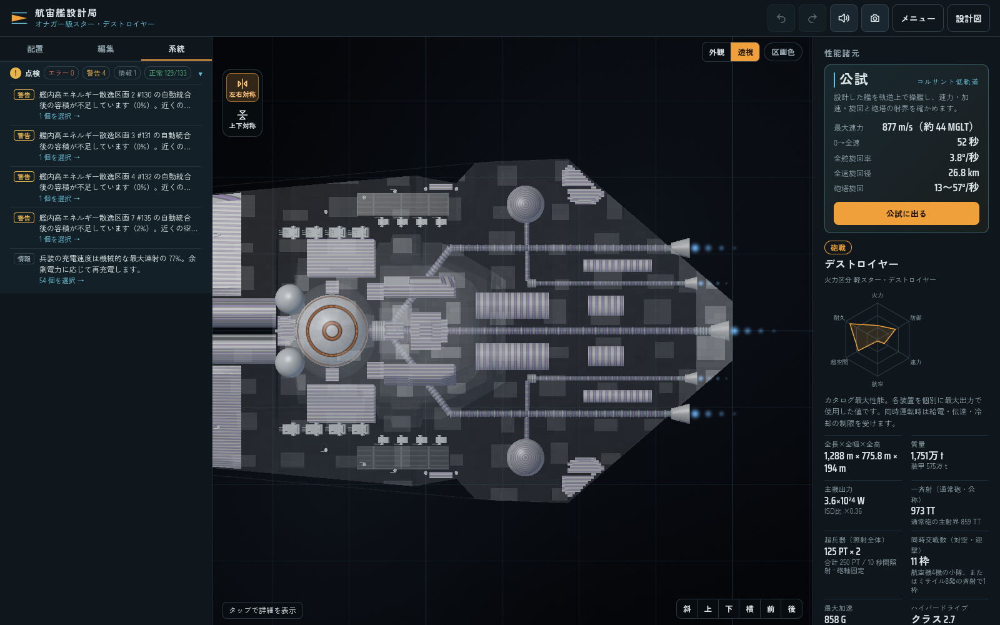

# ISD・オナガーの共有機関

この記録は共有機関を導入した時点の生成元と監査を保持する。インペリアルIの現在の構造物・武装配置と、追加されたインペリアルIIについては [提供図面を基準にしたI・II](imperial-i-ii-user-layout.md) を参照。

新規作例の内部機関を、実在する機関本体とノズルへの個別伝達路で構成する。

| 作例キー | 主機本体 | 補機本体 | ノズルへの分担 |
| --- | --- | --- | --- |
| `imperial` | 主反応炉直後に1基 | 主伝達路の間に左右1基ずつ | 主機3、左補機2、右補機2 |
| `onager` | 主反応炉直後に1基 | 主伝達路の間に左右1基ずつ | 主機3、左補機1、右補機1 |

各本体へ反応炉から有限容量の配電路を接続し、各ノズルへ独立した実断面の伝達路を引く。オナガーの外側主伝達路は主機本体の近くから早く左右へ広がり、左右の補機本体は中央と外側の実際の伝達路の間に収まる。補機の両端と経路の全曲がり位置で、筒の径を含めた隙間を検証する。同じ本体を共有するノズルは、その本体の入力を一度だけ要求する。入力容量、占有容積、配電損失・発熱、個別の伝達路損傷を引き続き計算する。通常表示の経路は補強リング付きの機械筒と別の電線として描画する。

ノズルの開口位置・径・向きは元の作例を保つ。ISDの発電量は `1e25 W`、シールド容量は `1e26 J`。オナガーは `3.6e24 W` と `3.6e25 J`、超兵器は各125 PT・10秒照射の2門を維持する。主機と補機の出力は受け持つノズルの定格を合算し、同時運転の不足を埋める発電設備は追加しない。最終質量に基づく既存の機関校正と、実容積による容量上限、厳格排熱、砲の充電設備も維持する。

## 更新範囲と来歴

[今回の監査](benchmarks/shared-engine-core-refit.json) は `imperial` と `onager` の2作例に限定する。他の25作例のカタログ行と数値ダイジェストは行全体のSHAで変更がないことを検証し、それぞれ元の生成コードのSHAを保持する。カタログに現在の完全な戦闘表面メッシュは保存せず、出撃時にはワーカーが完全なプロファイルを構築する。

各作例は現在の `C.buildDesign` を実際に1回だけ実行する。返った直後の編集可能な図面を先に保存し、同じ実オブジェクトを最後まで計算・監査する。初期図面は配置確認用であり、工学計算完了の証拠とは扱わない。最終図面、統計、艦隊プロファイル、監査、数値ダイジェストには同じ構築結果を使う。

最終図面を [ISDの新規構築アーカイブ](../assets/source/imperial-shared-core-factory-blueprints/manifest.json) と [オナガーの新規構築アーカイブ](../assets/source/onager-shared-core-factory-blueprints/manifest.json) に保存する。過去の全作例アーカイブや監査は履歴として保持し、新しい生成元へ付け替えない。公開時には実行スクリプト、監査スクリプト、生成前後のモデルコード、初期・最終図面、各数値ダイジェストのSHAも記録する。

```sh
node scripts/refresh-shared-propulsion.cjs --key imperial --out /tmp/shared-imperial
node scripts/refresh-shared-propulsion.cjs --key onager --out /tmp/shared-onager
node scripts/refresh-shared-propulsion.cjs --publish-from /tmp/shared-imperial /tmp/shared-onager
```

公開は両方の監査に合格した場合に限る。本体数とノズルへの分担、全枝の要求容量・制限状態・正の実推力、反応炉出力、厳格排熱・電力保存、実装置の重なり、経路の障害物・外部逸脱・端子接触・交差を検証する。実部品の `engineCore` も有限円柱として検査し、表面接触と正の体積の重複を区別する。

## 実画面と保存の検証

[ISDのブラウザ記録](benchmarks/shared-main-engine-imperial-browser.json) と [オナガーのブラウザ記録](benchmarks/shared-main-engine-onager-browser.json) は、最終図面を通常の「続きから」で開き、実ワーカーの形状・性能計算を採用した結果である。両艦とも機関本体と伝達路を実際にクリックして選択し、通常の自動保存から再読み込みして全機関・ノズル・接続の公開データが一致することを確認した。描画された補強リングの頂点、GPUの実インデックス範囲、ノズル根元、全機関の接地と経路容量も検査する。読み込まれたソースのSHAと実行前後のディスクSHAを記録している。

| 作例 | 機関本体 | 電力供給経路 | ノズル伝達路 | 実画面・保存 |
| --- | --- | --- | --- | --- |
| ISD | 3基 | 5本（副機には予備炉からも給電） | 7本 | 合格 |
| オナガー | 3基 | 3本 | 5本 | 合格 |

定格はカタログ上の性能であり、実運転では配電損失と有限の反応炉出力が作用する。ISDの主配電路は定格入力に対して約0.0199%の電送損失があり、推進のみの運転では定格3,304.439 Gに対し実加速3,303.875 Gとなる。画面の実入力0 Wは全砲充電などを含む初期の同時負荷条件の結果で、経路の断線を意味しない。同時全力運転を可能にする発電量の上積みは行っていない。

配置・名称変更の専用テスト5件、カタログ・限定更新・装置交差の検証28件、描画とプレビューの検証22件が合格した。機関経路・保存・砲配置・固定軸超兵器の回帰検証も実行し、生成プロファイルの3件は今回の最終アーカイブで再確認した。既存の `engine-bell-appearance.cjs` の旧ノズル根元位置を前提とする2件は、変更前のコードでも同じ失敗を再現する。

ISDの上面とオナガーの機関配置：




