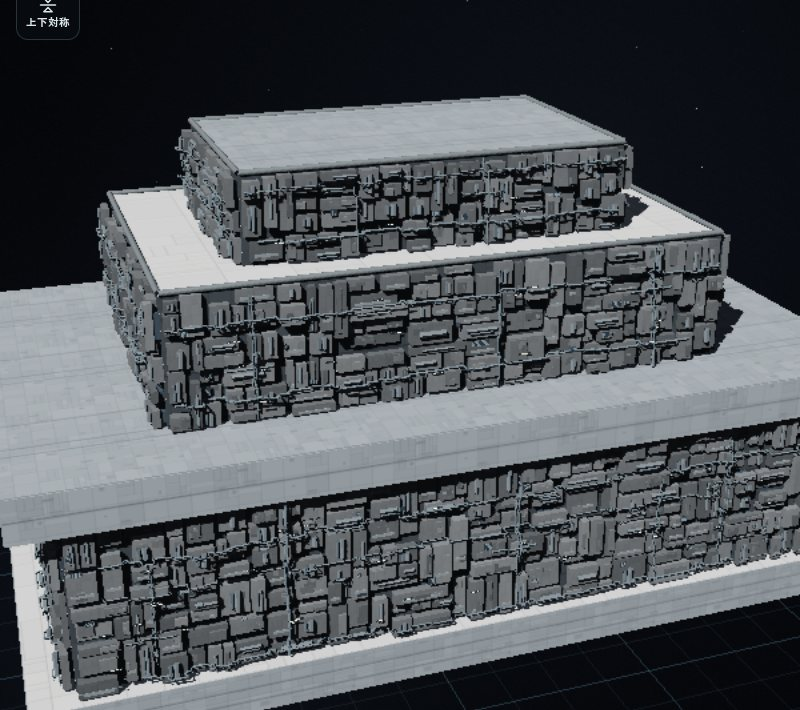
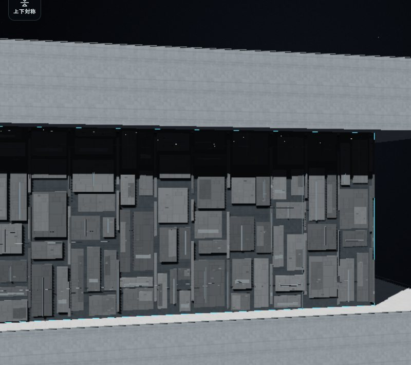

# 埋込砲列と機材面の奥行き

モン・カラマリ球状砲塔、2連装PD、CIS速射砲と旧砲列区画・小型イオン砲の廃止については、[最新の武装更新](moncal-weapons.md) を参照。以下は従来系列と旧表面装備の記録を含む。

機材の配分と収まりを、[構造体に組み込む機材面](surface-integrated-equipment.md) で更新しました。砲列は明示した基数、散熱・センサー・居住区は3種類で100%を配分します。機材は構造体の外形より内側へ収めます。この文書の外へ張り出す機材の画像と807項目のブラウザ記録は、埋込砲口を導入した時点の履歴です。

面の配分から生成した砲列を、壁から突き出す個別砲塔から、構造物に埋め込まれたケースメイト状の砲口へ変更します。周囲の機材は大きくし、各筐体の壁面からの距離と厚みを変えて、連続する機材帯に前後の凹凸を付けます。ここでの「前後」は、艦の前後方向ではなく、選択した壁面の法線方向です。

砲列・散熱・センサー・居住区で100%を分ける操作、装置の実設置数、給電・熱・要員の集計は [機材配分の報告](surface-equipment-allocation.md) に記載した方式を使います。今回、兵器性能や価格を外観に合わせて増減させる調整は行いません。

## 埋込砲口と共通の兵装処理

`Core.isSurfaceBattery(f)` は、表面パッチに属する生成兵装を識別します。手で置いた同じ種類の砲塔は対象にせず、個別配置の形と処理を維持します。

`Core.surfaceBatteryGeometry(f)` が、生成兵装の壁面位置、外向き法線、面内の2軸、砲口の幅・高さ・奥行き、薄い縁、発射位置、表示・命中用の境界をまとめて求めます。`surfacePoint` は元の面位置として保持し、砲口の開口面を `mouth` として共有します。

|接続先|今回の扱い|
|---|---|
|設計画面・艦隊描画|`meshFits` は浅い暗い開口、内側の砲口面、薄い縁を描きます。表面生成兵装に従来の砲塔・参照素材・台座を重ねず、旋回する別メッシュも作りません。|
|配置と性能集計|`surfaceFootprint` と内部の設置・充電用容積は従来の予約を使います。見える開口が小さくなっても、必要面積・設備容積・質量を無料にしません。|
|射線と射界|`turretOrigin`、`fireArcs`、`turretClear` が共通の開口面を使います。以前の砲塔半径を使って射線の始点を壁の前方へ飛ばしません。|
|艦隊戦|`surfaceWeaponGeometry` と `surfaceProfile` が同じ発射位置・方向を渡し、`surfaceMountArc` が射界を確認します。既存の蓄電、給電、要員、熱、局所損傷の経路を使います。|
|公試の射撃|`trialShotGeometry` は開口面から弾を出します。複数砲身の横方向の発射間隔は砲口の固定した面内軸を使い、照準を振っても発射点が壁の裏へ移動しないようにします。|
|被弾|`fitAABB` と表面の兵装命中範囲を、表示する小さい砲口に合わせます。砲口から離れた壁への命中を、以前の大きな砲塔の見えない当たり判定で受けません。|

薄い縁より外へ長い砲身を出しません。ミサイル装備を表面生成した場合も、表示側の発射位置と軸は共通の砲口位置・法線から求めます。独立に配置した同種兵装には、この埋込化を適用しません。

Sフォイルのワーカー射線照会では、`foilPose` が兵装の位置と法線に加え、砲口の基準になる `surfacePoint` も変換します。表示だけが動いて射線の始点が格納時の位置へ残らないようにします。面内の向きは既存の `trialRayPose` が元の兵装フレームを回転して求める処理を使います。

砲身数、1発の威力、発射周期、充電量、給電、要員、質量、価格は元の兵器定義を使います。描画モデルの削除によって砲数を減らしたり、壁の細部を増やして実砲数を増やしたりしません。

### 射界

固定兵装は固定方向を維持します。通常の表面生成砲は面の外側半球を使い、元の兵器定義に `casemate` があるものは、その制約を砲口のローカル座標へ移します。現在の制約は、法線から65度以内、面内の上下軸に対する成分が上下20度以内です。これは単純な矩形の射界とは異なり、斜め隅では両条件を満たす必要があります。

公試でも、固定兵装、通常の表面生成砲、元からケースメイト指定の兵装を区別します。屋根や回転した構造物の砲口でも、艦全体のY軸ではなく各面の向きを基準にします。

## 大きく、前後にずれる機材

`surfaceEquipmentField` は、面全体を連続して埋める不規則な筐体・支持材・棚・配管を生成します。主要な機材を分割する目安を従来の約2倍の長さへ変更し、8mの内部計算区画が小箱の列として見えないようにします。面積と描画枠によって分割するため、すべての機材が一律の寸法になるわけではありません。

各筐体には異なる背面位置と厚みを与えます。壁に近いもの、奥へ下がるもの、支持材で手前へ出るものを混在させ、配管も奥行きの異なる層へ接続します。散熱のグリル、センサーの作動面、居住区の窓は、その場所の筐体前面に合わせます。大きくした共通筐体で実装置の作動面を埋め隠す方式にはしません。

砲口周囲は、新しい小さい開口に必要な範囲を空けます。以前の大きな砲塔のための空白を残して、機材帯の途中に砲塔用の島を並べる形はやめます。面全体の連続配置、面ごとの描画枠、固定シード、開口部を避ける処理は引き続き使います。

中立の筐体・支持材・配管は `role: null` の外観です。大きさ、凹凸、描画品質を変えても、兵装数、散熱能力、センサー能力、居住容量を増やしません。機能は実際に設置した装置のIDと共通集計を正本にします。

## 保存と旧設計

設計保存v3、`surfaces.version = 2`、`COST_MODEL.version = 9` を維持します。新しい兵器定義や価格表への一括移行はありません。

互換形式で装甲と砲列を同じ面に持つ場合には、`surfaceSync` が実効装甲厚を生成兵装の任意の派生値 `surfaceArmorOffset` へ記録します。砲口の位置は、元の `surfacePoint` に法線方向の厚みを加えた装甲外面から求めます。厚い旧装甲の内部へ砲口を埋めないための位置情報であり、装甲の厚み・質量・防御を追加する値ではありません。

この値は保存・コピーの共通マーカー処理で保持し、再同期時には面の実効装甲から求め直します。値のないデータも読み込めます。新しい比率式の機材面は実効装甲0なので、装甲用の追加オフセットを持ちません。兵装IDや内部の設置予約を描画のたびに作り替えません。

## 検証の記録

今回の変更後の自動試験と実ブラウザ確認を、以下に分けて記録します。[従来の機材配分・連続外観の試験](surface-equipment-allocation.md#実装検証の記録) は導入時の履歴であり、今回の埋込砲口を検証した件数には含めません。



160mの検証用構造物を実際の設計画面で描画しました。砲列5%・散熱35%・センサー15%・居住区45%から、兵装8基と設備230区画を実設置しています。[機材の凹凸の近景](images/surface-embedded-detail.jpg)、[砲口周辺の近景](images/surface-embedded-port-close.jpg)、[タッチ模擬環境の操作画面](images/surface-embedded-mobile.jpg) も同じ描画経路の画像です。



2200mを想定して新しく組んだ三段構造物の、1枚の機材壁面です。兵装10基、散熱91区画、センサー39区画、居住設備116区画を設置し、既存の1面256装置の上限を維持しています。ユーザー画像の既存Allegiance設計を読み込んだ結果ではありません。[全体の画像](images/surface-embedded-large-wide.jpg) も参照できます。

### 自動試験

検証対象は、通常砲と参照素材を使う砲の埋込化、手配置砲の維持、回転した6面での砲口・発射位置・命中範囲の一致、局所被害、旧装甲外面への配置、保存・ミラー・Sフォイル、凹凸の分布、外観品質に対する性能不変です。公試では、実際の `trialShotGeometry` にCoreと描画側の位置情報を渡し、開口面上の発射点と固定・可動の扱いを確認します。

- 最終ソースで、面・機材・個別砲塔の回転・可動Sフォイル・公試の関連240件がすべて成功しました（241.43秒、失敗0件）。埋込砲口の追加試験と、既存の互換試験を含む件数です。
- 航空機コストカタログの `--check` は12設計すべて成功し、コストモデル9を維持しています。
- 変更したCore・描画・AppのJavaScript構文確認と差分の空白確認が成功しました。

関連試験の実行コマンド：

```sh
node --test tests/surface*.cjs tests/equipment*.cjs \
  tests/turret-rotation-core.cjs tests/turret-rotation-transform.cjs tests/turret-rotation-ui.cjs \
  tests/runtime-foils-core.cjs tests/runtime-foils-renderer.cjs \
  tests/runtime-foils-rays.cjs tests/runtime-foils-copy.cjs tests/trial-foils.cjs
```

表面砲列が外部の旋回砲塔メッシュを持つという旧前提の描画試験は、埋込砲口の位置と `mesh: null` を確認する内容へ更新しています。同じ試験で、独立に配置した砲塔の回転・Sフォイル追従・遠距離表示の確認も維持します。これらのNode試験はCPU上のデータ・生成メッシュ・実関数の検査です。

### 実ブラウザ確認

[実ブラウザの記録](benchmarks/surface-embedded-browser.json) は、ChromiumのソフトウェアWebGLで807項目が成功しました。内訳は、初回の描画・操作等655項目と、Sフォイルの基準点修正後に新しく起動して実施した152項目です。

初回は、埋込砲口の描画、手配置砲の維持、参照素材兵装の埋込化、旧装甲外面、上記の大型壁面を確認しました。PCと390×844のタッチ模擬環境で外観設定を操作し、装置ID・数・性能集計が変わらないこと、各機能を0%にすると対応する実装置と作動面がなくなることを確認しました。公開保存APIでの再読込は、共通の `surfaceSync` で派生情報を再構築してから比較し、IDと集計の一致を確認しています。画質を変えた生成でも機能値は一致しました。

追加の最終ソース確認では、実際のブラウザWorkerへ射線照会を送り、通常砲と参照素材砲をSフォイル展開率0・25・50・100%で比較しました。保存した17度の向きを含め、砲口位置・法線・面内2軸と射線の可否が一致しました。内部のフレームを検査するために既存の `trialRayPose` をそのまま取り出して比較し、Workerのコードや応答は差し替えていません。公試の `trialShotGeometry` と艦隊側の `spaceShotEmitter` も、側面・上面・回転面・可動面・元からケースメイトの兵装・固定兵装の6条件で再確認しました。

両段階のソースハッシュを記録し、それぞれの実行前後で一致しています。掲載画像は初回の描画確認時のもので、後の変更はSフォイル射線用の基準点の受け渡しに限定され、静止外観は変わりません。ページ・コンソール・WebGLのエラーはありませんでした。タッチ環境はアプリの既存の横向き表示で844×390として動作します。

これらは実アプリの描画・操作と、実際の発射位置・Worker射線処理の確認です。飛行を続ける公試や一連の艦隊戦、物理スマホ・ゲームパッドの確認ではありません。限られたCPU生成時間はJSONへ記録していますが、GPU性能やFPS、大規模戦闘の性能を測定した結果ではありません。

## 残る制約

砲口の実位置とコンパクトな命中範囲を、既存の表面装甲・局所被害へ接続しています。装甲は共通の面と厚みの近似を使い、全装甲を立体化して砲眼をCSGで切り抜く実装ではありません。描画した暗い凹部の奥行き全体を、独立した内部通路や別の兵装シミュレーションとして再現するものでもありません。

機材の奥行きは外観の凹凸です。物理的な内部設備の深さや占有容積は、共通の設置予約・性能計算から求めます。深さを変えた装飾から、新しい部屋や無料の兵装を作りません。非常に小さい面や狭い場所は、従来どおり実設置・描画枠・干渉の制約を受けます。

参考にしたインペリアルII級モデルの作者Daniel、出典、CC-BY-4.0の帰属は [参考モデルと帰属](surface-equipment-allocation.md#参考モデルと帰属) に維持しています。今回の機材・砲口は手続き生成で組み立て、新しい参考モデルのメッシュやテクスチャは追加していません。見た目から公式の装置配置や性能を確定した説明にはしません。
