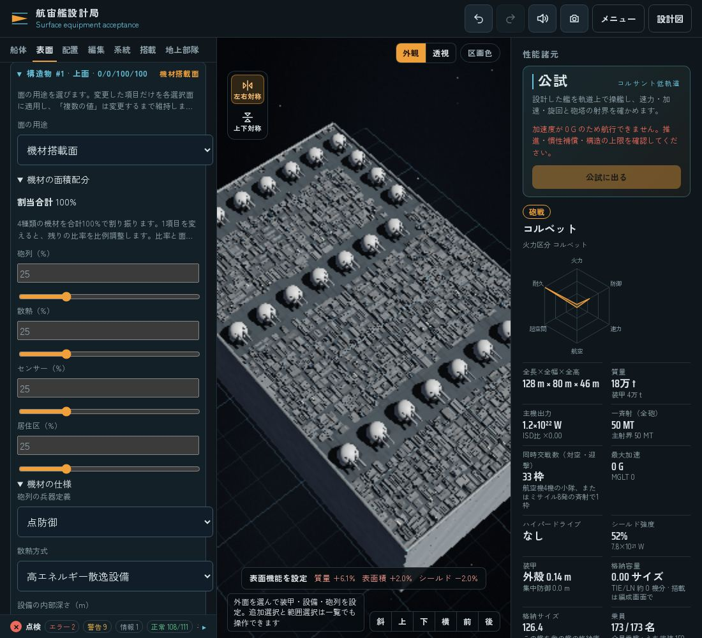
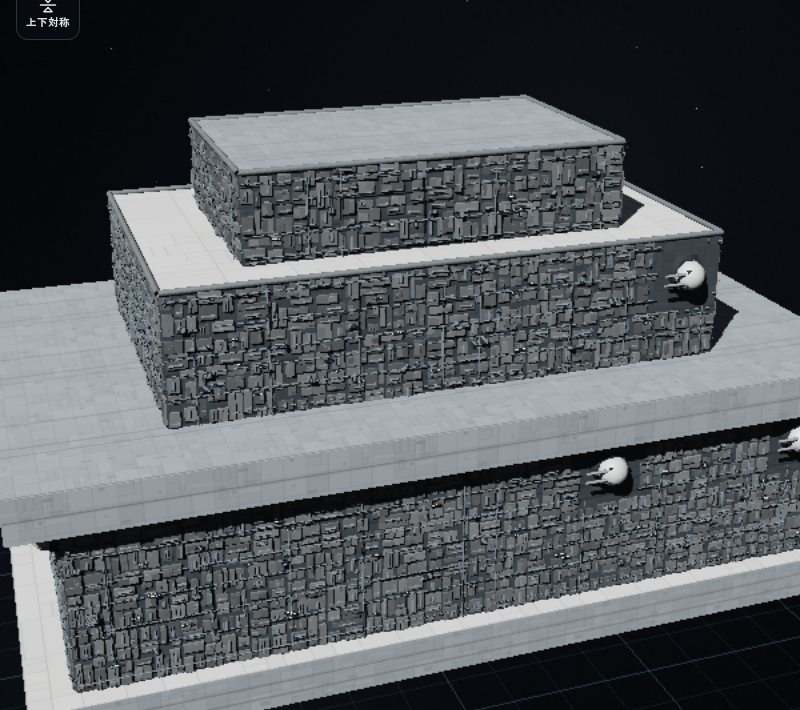
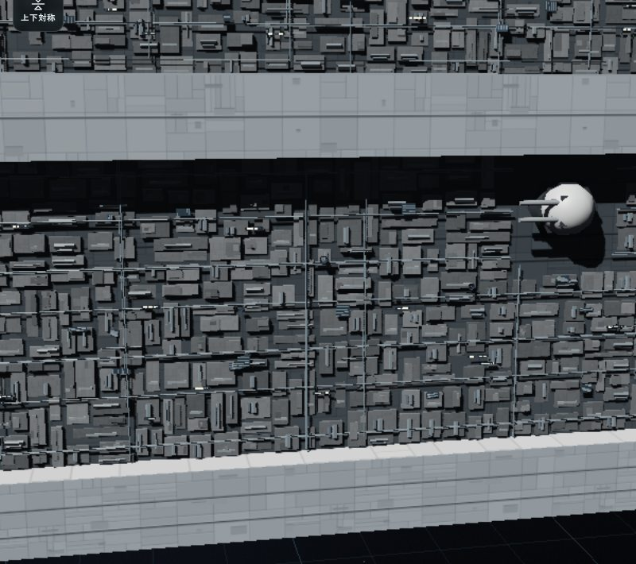

# 装甲面・機材搭載面と100%の機材配分

最新の方式は、散熱・センサー・居住区だけで100%を配分し、砲列は基数を別に指定します。自動設定、面の対称選択、構造物の内側へ収める機材の外観は [構造体に組み込む機材面](surface-integrated-equipment.md) を参照してください。埋込砲口の導入経緯は [埋込砲列と機材面の奥行き](surface-embedded-batteries.md) に残します。この文書の4種類の配分、画像、試験記録は、各節に記した導入時点の履歴です。

導入時点では、面の主用途を「装甲面」か「機材搭載面」から選び、機材搭載面で砲列・散熱・センサー・居住区へ同じ100%の面積予算を割り振りました。4種類をそれぞれ100%ずつ積む意味ではありません。

トレンチ内壁、構造物の側面・正面・後面に密集した機器を、機能と対応する形で自動生成する設計です。砲塔や散逸装置の個数を描画用のグリーブル数から決めず、実際に置けた装置の位置・占有面積・深さから、通常の部品・兵装と同じ集計へつなぎます。装甲と機材を別レイヤーとして同一面に自由に重ねる旧方式は、新規設定の主操作から外します。

機材の外観は、面全体に連続する不規則な筐体・配管として生成します。8mの物理区画は内部の配置・性能計算に使う単位であり、外観上の正方形パネルや区画境界として表示しません。

この文書は4種類の配分方式を導入した際の開発報告です。共通の電力・熱・シールド・局所被害を導入した経緯と旧v1の形式は [表面機能の導入報告](surface-systems.md) に残します。ゲーム内の装置性能、設備密度、容量・質量・価格の係数は調整用の仮定です。公式設定の確定した装置構成や、実在の散逸技術の数式として説明しません。

## 操作

1. 設計画面の「編集」→「表面」で、外面をタップするか一覧から選びます。
2. 「面の用途」で「装甲面」または「機材搭載面」を選びます。
3. 機材搭載面では、砲列・散熱・センサー・居住区の比率を数値またはゲージで調整します。1項目を変えると残りを比例調整し、合計100%を保ちます。
4. 兵器、散熱方式、内部深さ、間隔、外観の細部を設定して「選択面へ適用」を押します。適用前の変更は設計データへ書き込みません。
5. 面積配分と実設置数の報告で、未配置や給電・熱輸送の不足を確認します。

複数面を選択したときの「複数の値」は、編集するまで各面の設定を保持します。旧形式は警告と折りたたまれた互換設定を表示し、「装甲面へ切り替える」または「比率式の機材面へ切り替える」を選んで適用すると変換します。



実際の日本語UIで、砲列・散熱・センサー・居住区を各25%にした検証用構造物です。数値入力とゲージ、合計100%、面全体で連続する機材の外観を表示しています。

## 参考モデルと帰属

ユーザーが添付した `star_wars_imperial_ii_star_destroyer.zip` を形状参考として調べました。ZIP内の `scene.gltf`、`scene.bin`、`license.txt` を参照し、トレンチや外面の機器の組み方を確認しています。外見から、その箱や配管が公式にどの装置であるかを断定しません。砲列・散熱・センサー・居住区という機能分類は、ユーザーが選んだゲーム内の設計モデルです。

実データは27メッシュ、43ノード、239,917三角形です。モデル座標の大きさは約880×448×1603で、艦首は+Z、機関は−Zに向いています。これは作者のモデルの実測値で、公式寸法や装置定数を確定するものではありません。`MainGreebles2_9` は船体の張り出しに挟まれた狭い機材帯、`MainGreebles_0` は段状構造物の壁面で、灰色の機材、暗い凹部、暖色の発光部を分けて持ちます。

観察した特徴は、横方向の棚・縁、少数の大きな筐体と多数の浅い箱、縦の肋材、横断する配管、細いグリルや窓列の組み合わせです。箱を離して散らすだけでなく、暗い下地と細いサービス隙間を含む連続した機材面にします。機関の青色発光は別の素材で、すべての機材を青く発光させる根拠にはしません。メッシュの連結成分や細かい断片の数を、そのまま機能装置数や能力へ変換しません。

- 作品名：**Star Wars: Imperial II Star Destroyer**
- 作者：[Daniel](https://sketchfab.com/DanielAndersson)
- 出典：[Sketchfabのモデルページ](https://sketchfab.com/3d-models/star-wars-imperial-ii-star-destroyer-b8bd2d35f7604670ab85242c06c6d280)
- ライセンス：[Creative Commons Attribution 4.0 International](https://creativecommons.org/licenses/by/4.0/)

提供されたライセンスの帰属文：

> This work is based on "Star Wars: Imperial II Star Destroyer" (https://sketchfab.com/3d-models/star-wars-imperial-ii-star-destroyer-b8bd2d35f7604670ab85242c06c6d280) by Daniel (https://sketchfab.com/DanielAndersson) licensed under CC-BY-4.0 (http://creativecommons.org/licenses/by/4.0/)

この機能の表面機材は、新しく組み立てる手続き生成の形状です。参考モデルの艦全体のメッシュやテクスチャを、機材面としてそのまま貼り付ける方式ではありません。既存のゲームにある同モデル由来の砲塔・ケースメイト素材の利用は、従来のクレジットと区別して維持します。参考モデルの作者・出典・ライセンスと、この機能での参照方法を、ゲームの「使用素材とライセンス」にも表示します。

## 実装・検証の記録

### 保存と編集の契約

外側の設計保存は既存のv3を維持し、その中の `surfaces.version` を2へ更新します。パッチには、従来の安定ID・形状範囲・向き・接続情報に加えて、主用途と配分を保存します。

```js
surfaces: {
  version: 2,
  mode: 'strict', // 熱管理は全設計で厳格運転。旧compat指定は読み込み時に正規化
  patches: [{
    id,
    functionMode: 'armor' | 'equipment' | 'legacy',
    allocation: {weapons, cooling, sensors, habitation}, // 合計100%
    armor: {material, thickness},
    equipment: {kind, depth, count},
    battery: {weapon, spacing, angle, reversed, count},
    style: {kind, depth, density, seed},
    powerDomain,
    layout
  }],
  partitions
}
```

`armor` は装甲面、`equipment` は比率から配置を生成する機材搭載面です。`legacy` は、旧方式で装甲・個数指定の設備・砲列を同じ面に持つ設計を失わずに扱うための明示的な互換状態です。旧データの読み込みだけで、個別砲塔や面設備を無断で消去したり、新方式の比率へ勝手に置き換えたりしません。新しい用途へ切り替える操作と、熱管理の互換／厳格運転を混同しません。

配分の初期値は各25%です。比率変更は共通の `surfaceAllocation(currentAllocation, key, value)` で残る種類へ比例再配分し、合計100%を維持します。変更した比率・面の用途・必要深さ等は、既存の複数選択、適用、コピー・対称、Undo/Redo、設計保存の経路を使います。旧形式の `battery.count` と `equipment.count` は互換用の個数入力として残し、比率方式の主要入力にはしません。

機材面へ切り替える前の装甲設定は、戻すために保存しますが、機材面の装甲厚・質量・防御へ加算しません。実効装甲は `surfaceArmor` を通して求めます。装甲面では面生成の機材を稼働させません。独立に配置した大型砲塔は、この切り替えで除去しません。

### 実際の装置と面積予算

4種類は同じ面の予算を分け合います。面積予算は、パッチ面積を上限とする外部露出面積から求めます。各分類の報告は、比率 `share`、予約面積 `budgetArea`、要求数 `requested`、実設置数 `installed`、占有面積 `occupiedArea`、容積 `volume`、未使用面積 `unusedArea` を分けます。比率を指定したことと、開口・狭さ・内部深さ・既設機器の干渉を避けて実際に設置できたことは同じではありません。

反対側や隣接する面の機材も、共通の内部容積を予約します。薄板の表裏や角で、同じ空間へ二重に部屋を置けません。手配置した既設機器とは共通の `overlapParts` で区画の実体を比較し、端だけが重なる場合も検出します。翼や傾斜面では区画を必要に応じて内側へ後退させ、区画の箱全体が実際の船体・構造物の内側へ収まる位置に限定します。適合しない機材は見えない容積で補わず、未配置と理由を報告します。細い面・薄い主翼では、面積の比率に余裕があっても設置数が少なくなります。

砲列は既存兵器、散熱は既存の高エネルギー散逸／通常放熱、センサーは通常の `sensor` 部品として登録します。居住区は新しい `habitat`（居住設備区画）として共通の機器質量・ホテル負荷・費用・損傷へ接続します。`habitationSpace` 内で既存の居住容積から明示的な区画分を予約し、その分を一般居住区から差し引きます。部屋を置いて船体の総容積や乗員枠を二重に増やす扱いではありません。`physicalHabitationVolume` は設置した部屋の幾何容積、`habitationVolume` は既存予算から実際に予約した居住容積です。架空の乗員・陸戦隊は生成せず、要員需要、実際の乗員割当、居住可能人数を分けます。

比率方式の生成上限は、1面で分類を合計して256装置、設計全体で既存の部品1400個／装備2400基を使います。装飾密度、描画LOD、カメラ距離から上限や能力を決めません。初期のサービスピッチ8mやホテル負荷係数は、テスト可能なゲーム用の仮定です。新部品を含むコスト定義は `COST_MODEL.version = 9` として価格キャッシュの旧定義と区別します。小さな機器の見た目が多数あっても、装置の質量・給電・熱輸送を無料で増殖させる扱いにはしません。

内部の収まりと総居住容積は、共通基盤の船体包絡・ボクセル近似を使います。表面機材専用の別の船内容積シミュレーションは追加していません。薄い居住区がボクセルの間へ落ちて容積を失うことは、予約する部屋の実容積を使って防ぎます。

### 外観と実体の対応

`surfaceEquipmentField` が面全体の形を生成し、`surfaceVisualPlan` が中立の機材面 `row.field`、追加の細部 `row.boxes`、実設置装置の作動面 `row.devices` に分けて扱います。筐体は高さも幅も異なる不規則なまとまりとして再帰的に配置し、縦材・円筒状部品を組み合わせ、配管・分岐・棚を内部の区画境界をまたいで通します。

`row.field` の筐体・接続箱・支持材・棚・配管は、面を連続して見せるための共通サービス部分です。機能分類は `role: null` とし、この形の数から砲、散熱、センサー、居住容量を増やしません。未配置部分にも中立のサービス部分が続く場合がありますが、追加の機能装置を設置した意味にはなりません。要求数・設置数・未使用面積の診断は実体の配置から求めます。

分類を示す部分は、実際の `surfaceReport().patches[].cells` に対応する位置・IDを持つものだけを描きます。機能装置を大きな正方形の箱で囲まず、小さい作動面を周囲の機材面の奥行きに合わせて組み込みます。

- 砲列：面が生成した兵装は、構造物に埋め込まれた浅い砲口として描きます。独立した砲塔や長い砲身を機材面から生やしません。手配置した個別砲塔は従来のモデルを使います。
- 散熱：実設置した散熱装置にグリルやマニホールドを対応させます。
- センサー：実設置したセンサーに走査面・電子機器・皿状機器を対応させます。
- 居住区：実設置した居住設備に窓等を対応させます。発光は艦の照明設定に従います。

0%の分類や未設置の装置に、その分類の作動面を描き足しません。面ID・装置IDと配置シードから同じ形を復元し、カメラ位置を生成シードに使いません。1設計の機材面全体で、中立の基本形状の既定上限は12,000個、追加の小筐体等は1800個です。`surfaceVisualShares` が最低枠と面積に応じて各面の描画枠を先に配分し、分割の細かさも枠に合わせます。未分割の大きい領域を優先して細かくするため、先の面だけで上限を使い切って後面が空白になったり、面の片側だけが巨大な一枚板になったりすることを防ぎます。細部密度・描画品質は追加の細部と可視性に作用し、機能装置の数・能力は変えません。

外装の形は実際の面の範囲に収め、埋込砲口、手配置砲塔の旋回領域、開口部、ノズルを空けます。`surfaceEquipmentField` の領域照合は、候補の矩形と面を構成する三角形の交差面積を使い、四隅だけでは見落とす小さい内部開口も避けます。内部の実体は既存の透視・区画描画に残し、Sフォイルでは面全体に属する形と装置に属する形の可動範囲を分けます。埋込砲口の描画・発射位置・命中範囲の共通化と、互換装甲の外面位置は、上記の最新報告に記載します。

これは参照モデルを踏まえた手続き生成の抽象表現です。8mは内部の計算上の区分に残りますが、外装面を8mの見える箱へ区切りません。中立の筐体や配管、さらに小さい細部にも個別の追加能力を与えません。



連続外観を導入した時点の描画結果です。検証用の段状構造物の12壁面に、砲列5%・散熱35%・センサー15%・居住区45%を指定しました。実設置は全体で砲8基と設備230区画です。面全体で連続する筐体や配管を、その物理区画とは独立した外観として生成しています。最新の埋込砲口と大型化した機材の画像は、上記の最新報告を参照してください。



[前面](images/surface-equipment-fore.jpg)・[後面](images/surface-equipment-aft.jpg)・[スマホ幅の操作画面](images/surface-equipment-mobile.jpg)も、同じ描画処理の確認画像です。

### 連続した機材面への外観修正の検証

- 連続外観への変更後、`node --test tests/surface*.cjs tests/equipment*.cjs`：関連160件がすべて成功しました（251.40秒、スキップ0件）。
- さらに面ごとの描画枠と分割順を修正した最終ソースで、`node --test tests/surface-continuous-field.cjs tests/equipment-surface-renderer.cjs tests/surface-renderer.cjs`：27件がすべて成功しました（52.59秒、スキップ0件）。
- 独立した連続面テスト9件は、8m区分をまたぐ不均等な形、0%分類の作動面除去、通常砲の維持、シード・品質・保存後の機能とIDの不変、小さい内部開口との交差、回転した3面、砲塔・格納庫開口・ノズルの空き領域、描画範囲の所有とSフォイルの二重描画防止を確認します。240個の小さな描画枠を12面へ配分する試験では、後の面や各面の離れた領域にも形が残り、機能値を変えないことを検証しました。別の制限試験では、96個と240個の枠で面全体を分割し、未処理の広い領域が一枚の巨大な筐体として残らないことも確認しました。

Core・UI・英語カタログ・保存データの定義は、外観修正前と同一です。これらの自動試験はCPU上の描画計画と生成メッシュ等を検査した結果です。GPU性能や元のインペリアル級モデルとの外見の完全な一致を測定した結果ではありません。

[連続機材面のブラウザ検証](benchmarks/surface-continuous-browser.json) は、最終ソースで69項目が成功しました。日本語の実画面で、12の機材面すべてに中立形状が残ること、前面・側面・後面の描画、PCと390×844のタッチ模擬環境での外観設定、カメラ・生成処理による設計の非変更を確認しました。アプリの既存の横向き表示では844×390として動作します。各分類を0%へ変更した実体と描画の確認も含みます。ページ・コンソール・描画エラーはなく、検証の開始・終了でソースハッシュが一致しました。物理端末や実戦の検証ではありません。

公開保存APIで読み込んだ後は、共通の `surfaceSync` で生成区画・露出等の派生情報を再構築してから設計を比較しています。初期値や派生情報がまだ補完されていない読み込み直後のJSONとの単純な文字列一致を、描画の不変性と混同しません。外観の生成・カメラ操作は、同じ実体化済み設計の保存内容を変えないことも検証しました。

この作例の中立形状は全12面で7570個、追加細部は最大1800個でした。各面には210～1325個の中立形状があり、後の面が描画枠を失わないことを確認しました。追加細部なし／中間／通常／高品質の4回のCPU生成では、基本機材面のインデックス数424,620と実装置数は同一で、追加細部だけが0～64,800へ変化しました。計画生成は約240～418ms、内部の計画生成を含むメッシュ生成は約368～595msでした。ソフトウェアWebGL、並行テストを含む共有環境での限定的なCPU計測であり、GPU負荷やFPSの指標ではありません。

### 機能導入時の検証記録

実行結果は、ソースの確認、NodeのVM内で共通処理を動かす自動テスト、実ブラウザの操作を分けて記録します。以下は配分方式と実機能を導入した時点の記録です。今回の連続した機材面への外観修正を検証した結果とは区別します。VM内で端末入力を模擬した結果は、スマートフォンや物理ゲームパッドでの実機確認と同一視しません。

- 全体回帰の `node --test tests/*.cjs` は676件中674件成功、2件失敗、スキップ0件でした（990.02秒、共有CPU環境）。失敗は回転面・ミラー複合部品の区画が浮動小数点の境界誤差で未配置になる問題で、共通の内包判定を修正しました。下記の最終関連試験と、別途記録したブラウザの追加確認で修正後の挙動を検証しています。全体回帰を修正後に全件再実行してすべて成功したとは報告しません。
- 機能導入時の確定ソースで `node --test tests/surface*.cjs tests/equipment*.cjs`：関連153件がすべて成功し、スキップ0件でした（共有CPU環境で149.36秒）。
- 翻訳テスト：`node --test tests/surface-allocation-localization.cjs` は6件、`node --test tests/surface-systems-localization.cjs` は7件成功。実際の編集関数と共通Coreから生成した装甲面・4分類の機材面・異なる値／用途の複数選択・旧式面の警告・設置上限・別面との容積衝突・曲面背後の容積不足の診断・戦闘HUDを英訳し、日本語が残らないことを確認しました。未適用の編集と翻訳で保存データが変わらないことも確認しました。
- `node --test tests/equipment-allocation-review.cjs`：最終Coreで14件成功。旧式面と手配置砲の保持、機材面の実効装甲0と復元、6方向の回転面の区画形状、4分類の共有予算、対称・保存時のID、居住容積の二重計上防止、局所損傷、設計全体の上限、面同士の内部容積衝突、既設機器との部分的な衝突、分割、1回の適用での予約解放を確認しました。
- `node --test tests/equipment-surface-renderer.cjs tests/surface-renderer.cjs`：18件成功。実際の共通Coreと描画生成関数を使い、機材分類との対応、シードの再現性、表示品質と機能の分離、局所的な描画範囲、旧式面の描画を確認しました。
- `node scripts/update-craft-costs.cjs --check`：12設計・費用モデル9で成功。カタログのモデル署名を更新し、既存12機の数値・項目は署名以外に変更がないことを照合しました。
- Core・UI・描画・英語カタログと追加テストファイルの構文確認、`git diff --check`：成功。

ブラウザでの見た目と操作、実戦での長時間負荷、物理端末での操作は、上の翻訳テストだけでは確認できません。100隻超の戦闘性能や実機の操作性を、この結果から完了扱いにしません。

### 機能導入時の実ブラウザ確認

ヘッドレスChromiumとソフトウェアWebGLで、日本語・英語のPC表示（1100×800）とタッチを模擬した390×844表示を確認しました。[ブラウザ受入結果](benchmarks/surface-equipment-browser.json) は通常の検証用構造物で117件成功です（日本語55件＋実行時3件、英語56件＋実行時3件）。実際のキャンバス上の面選択と適用、4比率の合計100%、66.666…を含む小数入力、装甲面／機材面の切り替え、0%の分類の機能・外観消去、密度変更による能力不変、Undo/Redo、公開保存APIの往復を確認しました。旧形式の砲3基・散熱2区画は、明示的に変換するまで保持され、Undoでも復元しました。英語の編集欄に日本語が残らないことも確認しました。

128×80×40の構造物で4種類を各25%にした実ブラウザの確認例では、砲25基と設備81区画、センサー容積5184m³、居住設備容積5184m³、面の居住定員51名となりました。この51名は共通の明示居住区集計 `S.explicitCrewCapacity` と一致し、船全体の一般居住区を含めた定員を51名とする意味ではありません。この数値は検証用の構造物と装置定義による例で、実際のインペリアル級の装置数ではありません。

境界の丸め誤差の修正後には、回転・平行移動した構造物とそのミラー複合部品を対象に31件の追加確認が成功しました。各部位で4種類が5基ずつ設置され、ミラーの向きと実描画を維持しました。通常の117件を修正後に全件再実行した意味ではなく、保存された結果にそれぞれのソースハッシュと検証範囲を記録しています。有限な容積による要求数と設置数の差は、そのまま警告として残しています。

通常確認と追加確認のいずれも、ページ・コンソール・描画のエラーがありませんでした。これは、実機のスマートフォン、物理または仮想ゲームパッド、実際の艦隊戦、インペリアル級全体の再現、100隻のGPU描画を検証した結果ではありません。

### 機能導入時の110隻CPU計測

[計測結果](benchmarks/equipment-allocation-v2-110.json) は、[計測スクリプト](../scripts/benchmark-equipment-allocation.cjs) で実際に生成したv2設計1種類を110隻の論理インスタンスで共有した結果です。各艦は砲10基、散熱29区画、センサー28区画、居住27区画を持ち、戦闘状態は艦ごとに独立しています。0.25秒刻み8回の更新で880回発射し、シールドが受け取った合計は約119.72 TTでした。

この計測は、連続した機材面への外観修正より前のものです。以下のメッシュ数や描画選択時間を、現在の連続面レンダラーの計測値として扱いません。

時間計測時のCoreソースのSHA-256は `74cc721b…` です。その後の既設設備との部分衝突の修正を含む最終Core `54f0d251…` でも同じ設計を生成し、装置数・部品数・装備数が変わらないことを照合しました。後者では110隻の時間計測を再実行していません。結果ファイルに、計測時と計測後の設計照合を分けて記録しています。

3論理CPUのXeon Platinum 8370C環境で、設計生成約13.01秒、性能・戦闘プロファイル生成約5.75秒、同一設計のキャッシュ済み報告110回約6.61秒、戦闘更新の中央値約0.72秒を記録しました。全体テストと表面機材の最終テストが並行していたため、専有CPUの計測値ではありません。0.25秒相当の更新が中央値約0.72秒だったこの測定から、リアルタイム性能の達成は主張しません。

通常密度と密度0で機材メッシュのインデックス数は72,468のままで、近距離／遠距離の描画選択でも機能データは不変でした。ただし描画呼び出しは処理をしないGLスタブで計測しています。GPU負荷、ブラウザのFPS、110種類の異なる設計、艦同士の衝突、長時間のAI戦闘やメモリ増加は測定していません。
