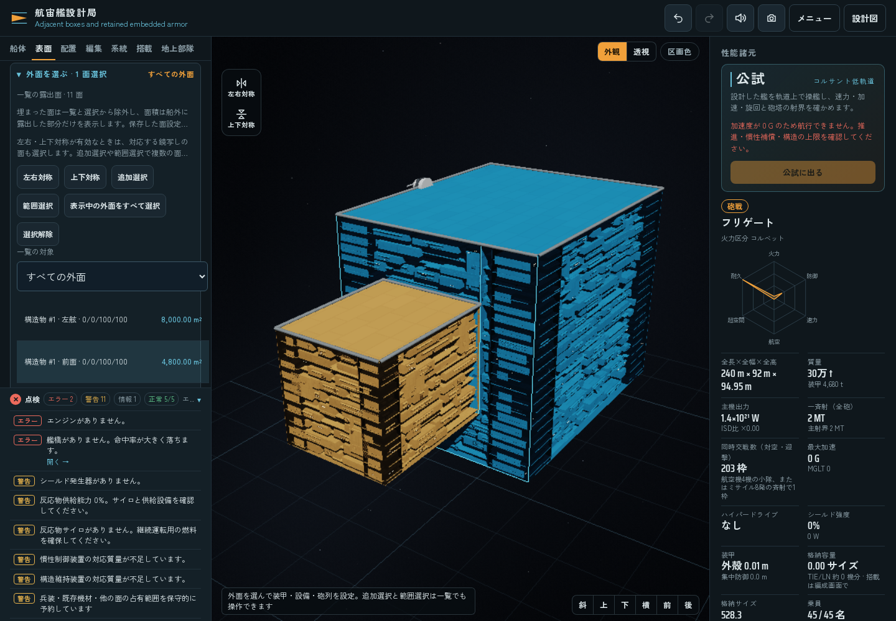

# 船外へ露出した面だけを選択・運用する

船体や構造物の内部へ埋もれた面を、設計画面の面数・一覧・選択・自動設定の対象から外します。透視表示やカメラから見えているかではなく、形状から求めた船外への露出を使います。

## 物理面と露出面

面の `triangles` と `area` は、元の物理的な表皮と面積として残します。別に `exposedTriangles`・`exposedArea`・`exposed` を持ち、実際に露出した範囲を、面の機能や外観に使います。隠れたことを理由に、船体・構造物そのものや装甲の質量を消しません。

`surfaceReport` の集計では `totals.area`・`totals.exposedArea` を露出面積、`totals.physicalArea` を元の物理面積として区別します。`totals.faces` は露出面数、`totals.physicalFaces`・`totals.hiddenFaces` は内部の診断用です。隠れた保存面の行も報告には残します。

露出範囲は形状を切り分けて求め、少数の代表点の投票で面積を推定しません。面を分割した子面も、それぞれの形状から求めます。親面の露出率を子面へ比例配分する方式は使いません。

船体・構造物・区画の閉じたメッシュと、共通部品の球・円筒等の形を使い、実際の面の位置で判定します。数値誤差のための小さな許容差を使います。同じ向きで重なった外面を一つに統合する処理は含めず、埋没した面や内部の接触面を除く変更です。

## 編集・運用・保存

UIの面数、面一覧、一括選択、自動設定、対称選択は露出面を対象にします。形状変更で選択面が完全に隠れた場合は選択から外します。新しく内部へ埋もれた面に、自動で設備を配置しません。

既に保存した面設定や在庫は、完全に隠れても削除しません。稼働対象から外し、所有する質量・費用や物理的に残る装甲は保持します。再び露出すれば復帰し、在庫を二重登録しません。ユーザー向けの露出面数と、内部に保持する物理面・保存設定の件数は別です。既存の保存設定の件数制限をなくす変更ではありません。

一部だけ露出する面の `area-v1` は、使える露出領域に合わせて既存の形状編集時の処理で再計画します。切り出した領域をそのまま有効面積として扱い、露出率を二重に掛けません。機能容積・能力・質量・費用が変わる場合があります。これは形状変更への反映であり、外観の色・密度等だけを変える操作とは区別します。

## 描画と通信

描画も露出範囲を使い、機材の配置、奥の下地、装甲表示、元の表皮の切り抜き、選択ハイライトへ同じマスクを適用します。埋もれた面や部分的に隠れた領域へ、機材や装甲の表示を重ねません。床の高さと自動の描画深さを揃える基準には、元の面全体を使います。

Workerの編集・統計用の軽量パケットでは、露出三角形の配列を重複して運びません。物理面を保つ処理、露出範囲の計算、描画用の形状転送を分けます。

## 検証

Coreの露出判定・子面・在庫の停止と復帰、描画マスク、UI選択、実Workerの関連試験群は、それぞれ成功しました。実行が重なるため、総件数として合算しません。価格カタログ12件・モデル9、変更したJavaScript5ファイルの構文・差分確認も成功しました。

[実ブラウザ記録](benchmarks/surface-exposure-browser.json) は109項目・12群が成功しました。隣接・内包した箱の検証形状で、遮蔽物の移動と復帰により露出面数が11→12→11、自動設定対象が7→8→7、露出総面積が52,800→56,000→52,800m²となることを確認しました。部分面は物理面積6400m²のうち4800m²を表示・使用します。カメラ・透視表示による不変、隠れた装甲と元の部品の保持、自動設定、選択解除を、実アプリの変更操作からWorker更新まで確認しています。6つのソースハッシュは実行前後で一致し、ブラウザは終了しています。

確認は静的・Node試験と上記の実ブラウザ操作です。ポインターでのドラッグ操作や一連の戦闘を検証した報告ではなく、新しい読み込み速度・FPS・ハードウェア性能の比較も行っていません。
