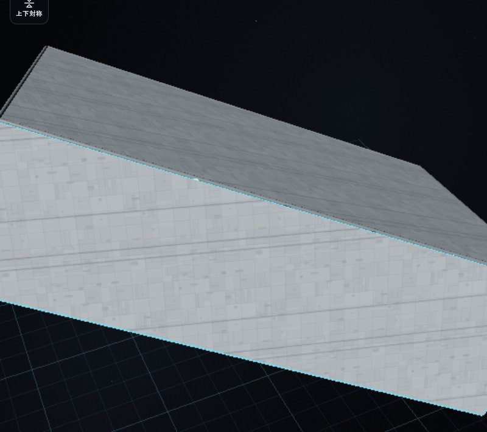
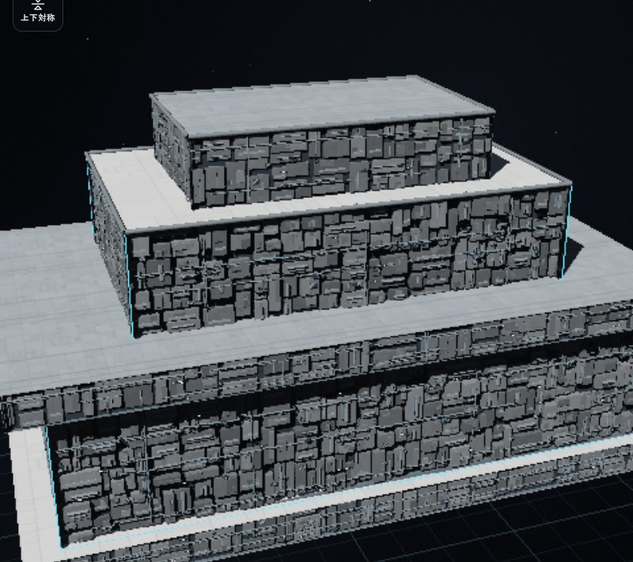

# 構造体に組み込む機材面

面設備の保存・計算単位と、装甲線・機材色・読み込み負荷を [面単位の集約機材](surface-aggregate-machinery.md) で更新しました。本報告の表面v3、個別の生成パーツ、画像、段階別の試験記録は、その方式を導入した時点の履歴です。

機材面の100%は、散熱・センサー・居住区の3種類で配分します。砲列は兵器と砲座基数を別に指定します。機材の見た目は、構造物の外へ貼り足す箱から、外形の内側に収まる連続した筐体・配管へ変更します。装甲面はその外形を覆う面、機材面は構造物内部の機器が露出する面として描き分けます。

従来の [4種類の配分](surface-equipment-allocation.md) と [埋込砲口の導入](surface-embedded-batteries.md) は、画像・試験を含めて履歴に残します。今回の新しい描画・操作は、本報告の検証記録と画像で区別します。

## 操作

1. 設計画面の「表面」で外面を選び、面の用途を「機材搭載面」にします。追加選択や範囲選択で複数面を指定できます。「左右対称」「上下対称」を有効にすると、対応する露出面も選択します。
2. 散熱・センサー・居住区の比率を数値かゲージで変えます。残る2種類を比例調整して、合計100%を保ちます。
3. 砲列の欄で兵器、砲座基数、間隔、向きを設定します。砲座基数0なら、その面に砲列を生成しません。1基当たりの砲身数は兵器定義を使い、基数と砲身総数を分けて報告します。
4. 「選択面へ適用」で確定します。複数面の異なる設定は、該当項目を編集するまで各面の値を保持します。適用、コピー、Undo/Redo、保存は共通の編集経路を使います。

自動設定は、船外に露出した側面・急斜面を候補として確認してから実行できます。水平から45度以上傾いた面を対象とし、水平な上面・下面や内部に隠れた面は対象から外します。既定では、手で設定した装甲や既存の面設定を保護します。「装甲や既存の面設定を置き換える」を選んだ場合だけ、それらも候補へ含めます。

自動設定は、砲座基数0、3種類の等しい配分、内蔵散逸設備を使う機材面を作ります。自動で砲数を決める機能ではありません。1回の操作としてUndoできます。候補の選択と、実際の適用は別の操作です。

「対象を機材面に一括設定」は既存Workerで計算し、「機材面を生成中…」を表示してから結果を反映します。`surfaceAutoRemote` は重複実行を防ぎ、待機中に設計が変わった場合の古い結果を適用しません。返された報告を表示に再利用し、画面側で同じ重い配置計算を繰り返さないようにします。

## 配置・編集・保存の契約

### 3種類の配分と明示した砲数

`surfaceAllocation` は、`cooling`・`sensors`・`habitation` の3値だけを合計100%に正規化します。`surfaceAllocationPlan` は、明示した `battery.count` の砲座に必要な面積を先に予約し、残る面積を3種類へ配分します。砲数は、機材の比率や装飾密度から増減しません。

砲座と設備は、面の範囲、開口、間隔、背後の容積、既設装置との干渉を満たす位置に限って実設置します。指定数と実設置数は別です。狭い場所で余った要求を、見えない無料設備で補いません。新方式では兵装の内部設備についても、対象面の背後へ収まることを確認します。

1面256装置、設計全体の部品1400個・装備2400基という共通上限を使います。`equipment.limit` は任意の非兵装設備数の上限で、砲座基数とは別です。0なら、その面の機能設備は砲座だけにできます。中立の筐体・支持材・配管の数を、実装置数として数えません。

### 自動設定と対称選択

`surfaceAutoCandidates(ship, options)` が、露出、傾斜、既存設定の保護から候補を返します。`autoConfigureSurfaces` は、その候補へ設定を適用し、適用した面ID、設備を置けなかった面、未配置数と共通の報告を返します。設計全体に残る部品枠を候補面へ配り、最初の面だけで上限を使い切らないように `equipment.limit` を設定します。面積や内部深さによって、実設置数はさらに少なくなる場合があります。

`authored: false` は、表面モードを有効にした際の未編集の既定面です。手動適用と自動設定は `authored: true` として記録します。これにより、未編集の既定面は自動設定でき、明示して設定した面は上書き指定なしで保護できます。値のない旧設計の面は、設定済みとして保護します。

`surfaceSymmetryIds` は、左右・上下に反射した位置、法線、面積、対応する構造物から、実際に存在する露出面を探します。面を新造したり、近いだけの別面へ設定を渡したりしません。対応面がない場合は、その面を選択へ追加しません。

### 保存と旧設計

外側の設計保存はv3を維持し、内部の `surfaces.version` は3へ更新します。主な追加・変更点は次のとおりです。

```js
surfaces: {
  version: 3,
  patches: [{
    id,
    authored,
    functionMode,
    allocation: {cooling, sensors, habitation}, // 合計100%
    battery: {weapon, count, spacing, angle, reversed},
    equipment: {kind, count, depth, limit}, // limitは任意
    legacyAllocation // 旧4種類の配分を保持する場合のみ
  }]
}
```

旧v2の4種類の配分は `legacyAllocation` に保持し、読み込むだけで砲数や配置を新方式へ置き換えません。旧配置の計画・ID・費用を引き継ぐ互換状態として扱います。この状態の砲座基数は、未配置も含めてその面が実際に所有する兵装を表示・保存します。UIに「旧版の密度配分による配置を保持しています」と表示し、機材の比率か砲座基数を変更して適用したときに、新しい配置方式へ更新します。外観だけを変える操作と、この移行を混同しません。

`surfaceCopyIdentity` は、生成区画の検証済みの `room` 寸法、`surfaceNormal`、`surfaceExposure`、`surfaceUnplaced` も引き継ぎます。未配置のセンサー区画を再読込すると通常の機器形状へ戻り、容積・質量・費用が変わる不具合を修正しました。未配置で稼働能力が0でも、所有する区画の物理寸法と費用は保持します。

コストモデルは9を維持します。表面形式v3を含む定義署名に合わせ、航空機の価格キャッシュ12件の署名を再生成しました。12件の金額・システム・熱の数値は変更していません。

## 構造物の内側へ収める描画

`equipmentSkinTriangles` は、選択した機材面に対応する船体・構造物の表皮だけを描画から取り除きます。隣の装甲面、上面、下面、分割したパッチの残りを保ち、機材面の奥に下地と機器、縁に内壁を描きます。参照素材では、切り分けた頂点の既存UVを補間し、作者のアトラスを張り直しません。

YardEngineの船体描画キャッシュにも、面の用途・分割・構造物の変更を反映します。適用、Undo/Redo、遮蔽物の移動後も、機材の前へ古い不透明な船体表皮が残らないように更新します。

Coreの面・配置キャッシュは、クライアントで形状を待っている状態と、Workerから形状が届いた状態を区別します。非保存のWeakMapで形状バッファの同一性も識別し、頂点数が同じ更新でも面と兵装の基準点を更新します。表面タブを早く開いた場合の空の面一覧が、再読込まで残る問題を修正しました。

`surfaceRecess` とCoreの `surfaceInwardDepth` が、各位置から対象の船体・構造物の内側へ入れる深さを調べます。`surfaceVisualPlan` は、機材面に外観上の奥行き `recessDepth` と下地の `backingTriangles` を返します。外観上の奥行きは、設定した設備深さ、対象面の厚み、上限4.5mで制限します。新しい形を保存するのではなく、既存の面と設定から再生成します。

内向きの深さ照会は、元の三角形データごとにBVHをキャッシュして再利用します。形状編集後は更新した形状から再構築し、古い形を参照し続けないようにします。

`surfaceEquipmentField` は、その外面と内側の下地の間に主要筐体、小機材、支持材、配管、機能装置の作動面を収めます。前後に異なる位置や厚みを持つ形は維持しつつ、構造体の外へ積み上げる方式をやめます。薄い形状や角では深さを制限し、収まらない装飾は省きます。機材本体は元の外面から0.012m内側までに収めます。既存の埋込砲口の薄い縁は、最大0.12mの張り出しを維持します。

機材面に指定した構造体の中立な筐体・配管は、8mの機能区画が収まらない場所や設備数0の面にも続きます。これらは構造物に属する `role: null` の外観で、能力は持ちません。散熱グリル、センサー、窓等の作動面は、実際に設置した装置の位置とIDに対応するものだけを描きます。

埋込砲口、実装置のID、給電・熱・要員・損傷は既存の共通処理を使います。機材面の露出した外観と、実際に予約した内部設備の容積を区別し、装飾から能力や居住容積を追加しません。機材面への切り替えで、独立に配置した大型砲塔を削除しません。

### 傾斜面の装甲線

手続き生成の装甲線は、面ごとの三角形の向きではなく艦の共通座標から求めます。上面系では絶対X/Z座標を使い、艦の中心線とそれに直交する方向へ揃えます。側面系では、艦の上方向と面法線から求めた水平軸、および絶対Y座標を使います。傾斜面でも線の流れを揃え、3種類を選ぶ新しい設定欄は追加しません。カメラや描画品質で線の方向を変えません。



上面と側面の両方が傾いた検証形状です。上面の中心線方向と、側面の水平・高さ方向を共通の艦座標から求めています。



新しい描画方式を実際の設計画面で撮影した、段状の検証用構造物です。上下面の装甲を残し、選択した壁面を機材の露出面として描いています。[機材面の近景](images/surface-integrated-detail.jpg) では、共通の外形の内側にある筐体の凹凸と配管を確認できます。[タッチ模擬環境の表面編集画面](images/surface-integrated-mobile.jpg) も撮影しています。組み込みの作例艦を撮影した画像ではありません。

## 検証

今回の変更後の自動試験と実ブラウザの記録を分けて扱います。従来の報告にある807項目のブラウザ確認を、今回の配分・自動設定・内側への描画の検証件数には含めません。

### 自動試験

- 最終のクライアントキャッシュ修正後、関連7ファイルの24件がすべて成功しました（103.23秒、失敗0件）。形状待機からの面一覧更新、同じ頂点数の形状置換、Worker結果の採用、非同期自動設定、保存・再読込を確認しました。
- 未配置区画の保存修正後、クライアントの形状到着時のキャッシュを修正する前の確認では、14ファイルの90件がすべて成功しました（384.36秒、失敗0件）。追加した保存回帰試験は、稼働中・未配置のセンサー区画を公開APIで2回再読込し、容積・質量・費用が一致することを確認します。
- 未配置区画の保存属性を修正する前の統合確認では、面・機材・個別砲塔の回転・可動Sフォイル・公試の関連275件がすべて成功しました（414.01秒、失敗0件）。最終ソースで全275件を再実行したという意味ではありません。
- 実際のYardEngineを使う3件も、最終24件に含みます。面の適用・Undo/Redo、遮蔽物の移動後の船体表皮、Workerの自動設定を確認しました。
- 保存修正後の航空機コストカタログの `--check` は12設計すべて成功しました。最終キャッシュ修正後も、Coreを直接読み込んだ確認で全12件の署名一致とモデル9を確認しました。金額等のデータは維持しています。
- 変更したJavaScript5ファイルの構文と、差分の空白確認が成功しました。

配分と明示砲数の独立性、旧v2の配置・ID・費用と未配置砲の保持、45度境界、複数面・対称選択、傾斜面の装甲UV、切削・回転形状の機材収容、設備0の中立外観も検証しています。既存の描画試験は、新しい内側の配置と3種類の配分に合わせて更新しました。

最終キャッシュ修正後の24件のコマンド：

```sh
node --test tests/surface-client-cache-core.cjs tests/surface-proxy-adoption-ui.cjs \
  tests/surface-auto-async-ui.cjs tests/surface-auto-selection-ui.cjs tests/surface-engine-geometry.cjs \
  tests/surface-unplaced-save-core.cjs tests/surface-explicit-count-core.cjs
```

保存修正後・クライアントキャッシュ修正前の90件のコマンド：

```sh
node --test tests/surface-unplaced-save-core.cjs tests/surface-explicit-count-core.cjs \
  tests/surface-compat.cjs tests/surface-revision-review.cjs tests/surface-y-mirror.cjs \
  tests/surface-copy-ui.cjs tests/equipment-allocation-review.cjs tests/surface-allocation-core.cjs \
  tests/surface-auto-async-ui.cjs tests/surface-auto-selection-ui.cjs tests/surface-allocation-ui.cjs \
  tests/surface-allocation-localization.cjs tests/surface-engine-geometry.cjs tests/surface-embedded-core.cjs
```

保存修正前の275件のコマンド：

```sh
node --test tests/surface*.cjs tests/equipment*.cjs \
  tests/turret-rotation-core.cjs tests/turret-rotation-transform.cjs tests/turret-rotation-ui.cjs \
  tests/runtime-foils-core.cjs tests/runtime-foils-renderer.cjs \
  tests/runtime-foils-rays.cjs tests/runtime-foils-copy.cjs tests/trial-foils.cjs
```

### 作例データを使ったNode確認

[組み込みインペリアルI級の自動設定記録](benchmarks/surface-integrated-stock-auto.json) は、実際の1600mの作例データをCoreで実行した結果です。116面を設定し、設備472区画を実設置しました。既存の個別兵装170基は維持し、新しい砲列は0基です。58面は機能設備を設置できず、要求3491区画が未配置として残りました。中立の構造物の外観で、未設置の機能を補ってはいません。

実行時のソースハッシュと上限・深さ・干渉の制約を記録しています。この配置記録は、後の未配置区画の保存修正前のものです。保存修正後の再読込確認とは分けて扱います。これはNodeでの配置・集計の確認で、ブラウザ描画、航行・戦闘、GPUやFPSの測定ではありません。記録したCPU所要時間も、ほかの検証と並行した限られた観察です。

### 実ブラウザ確認

[実ブラウザの記録](benchmarks/surface-integrated-browser.json) は、ChromiumのソフトウェアWebGLで435項目が成功しました。内訳は、保存修正後のUI・機材収容・タッチ・保存・装甲UVの368項目と、クライアントキャッシュ修正後の最終ソースで確認した67項目です。初回は、形状待機中の面一覧が残って自動設定ボタンを使えない問題で中断しました。修正後の最終段階で、その実際の操作を確認しています。

初回の完了項目には、PCと390×844のタッチ模擬環境での3種類の配分、明示した砲数、複数面・対称選択、自動設定と一括Undo/Redoを含みます。元の表皮が除かれ、筐体・配管・作動面が外形の内側に収まることと、傾斜した上面・側面の実際のFloat32頂点UVも確認しました。

最終段階は、表面タブを開いたまま通常の船体形状がWorkerから届くのを待ち、再読込や手動更新なしで15面と自動設定候補8面が使えることを確認しました。Workerでの自動設定・Undo/Redo後の表示メッシュを新しい描画結果と比較し、選択面の古い表皮が残らないことも確認しています。さらに初回の全設計データを読み込み、稼働中の装置ID・数・位置、保持した未配置35区画すべての形状・容積、質量・費用・電力・要員、公開保存JSONの一致を確認しました。

両段階のソースハッシュを記録し、それぞれの実行前後で一致しています。掲載した4枚の画像は、保存修正後・クライアントキャッシュ修正前の368項目の段階で撮影しました。後の修正は形状到着時のキャッシュ更新で、描画コードのハッシュと静止形状は同じです。最終段階のページ・コンソール・WebGLのエラーはありませんでした。

タッチ環境は、アプリの既存の横向き表示で844×390として動作します。物理スマホやゲームパッド、航行を続ける公試、一連の艦隊戦、GPU性能やFPSの検証ではありません。

## 残る制約

機材面の表皮の除去と内側の機器は描画処理で、船全体の固体を機器ごとにCSGで作り直す処理ではありません。防御・貫通・局所被害は、共通の面装甲と区画の近似を使います。自動設定も、深さ・配置・全体上限を満たすことを保証して全要求数を埋める機能ではなく、未配置と理由を確認する設計補助です。

参考モデルの作者Daniel、出典、CC-BY-4.0の帰属は [参考モデルと帰属](surface-equipment-allocation.md#参考モデルと帰属) に維持しています。今回の形は手続き生成です。新しい参考素材の購入・追加や、公式の装置性能・配置の断定は行いません。
