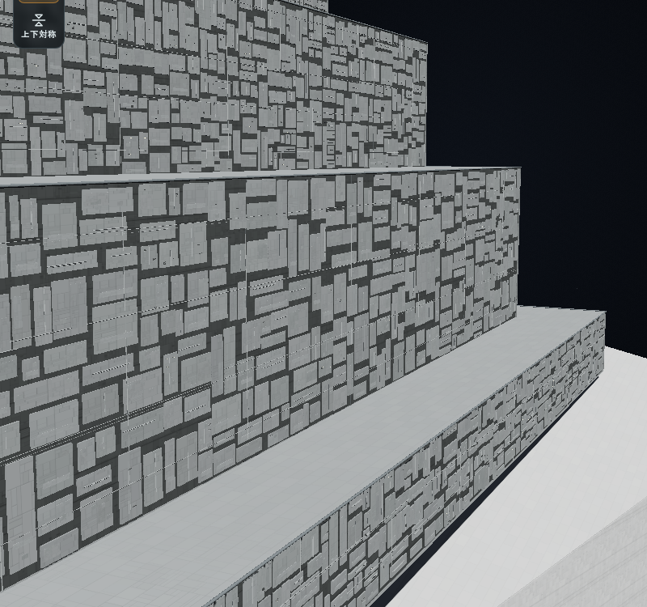
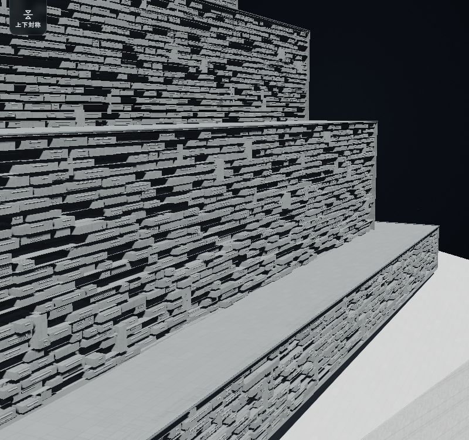

# 薄い階層と機材で構成する構造体

操作時の遅延と、機材面の密度・向き・ローポリ表現の修正は [設計操作と機材構造面の修正](responsive-design-and-low-poly-surfaces.md) を参照してください。以下は以前の階層描画を導入した段階の記録です。

埋もれた面を面数・選択・機能の対象から外し、部分的に露出した範囲だけを使う修正を加えました。物理面と保存済み在庫を保持する扱いを含め、最新の変更は [船外へ露出した面だけを選択・運用する](surface-exposed-faces.md) を参照してください。本報告は階層描画・面積方式を導入した段階の記録です。

「機材構造面」を、薄い床板が連続して積み重なり、その間に機械・支持材・配管が入り組む構造へ変更しました。構造物自体を機材の集合として描き、外面へ筐体を貼り付けた平面的な模様を改めます。インペリアル級の参考画像にある、階層と機材が続く外観を手続き生成で表します。

## 外観の確認項目

- 同じ段に属する薄い床板が続き、機材の一つ一つを囲む箱の枠にならないこと。
- 床板の間に奥行きのある隙間、大小の機械、支持材、配管があり、斜めからも階層が読めること。
- 床板、機材、接続部が、設定した構造体の寸法内に収まること。
- 隣接する面の階層が不自然に途切れず、角や開口部では実際の形に合わせること。
- 親の塗装と面機能の表示を引き継ぎ、装飾密度やカメラから装備量を決めないこと。

正面と斜視の実画面で、薄い階層と機材の奥行きを確認します。生成メッシュの範囲確認は、画像の目視確認と分けます。

## 生成する形と操作

`surfaceEquipmentField` は、薄い床板と縁、床の間を占める機械、2～3層をまたぐ大きな機械、少数の縦材・配管を、一つの連続した構造として生成します。側面の床板は、設計の基準姿勢で実際に水平な立体です。手動で水平面へ適用した場合は面内の帯構造へ切り替えます。`surfaceLayerFrame` と `surfaceLayerBases` が艦の高さ方向と分割前の範囲を使い、面を分割しても床の高さや生成の基準を揃えます。

床の間隔は艦の大きさから約3.2～6.3m、床板の厚みはその約6%とする描画用の初期値です。公式の階高ではありません。各位置の船体・構造物の内側の深さを確認して収め、開口部や砲口を空けます。同じ深さの機材構造面が接する境界には、面を囲む内壁を重ねません。

「外観」の「構造の凹凸の奥行き」は `style.depth` で、0は自動、明示値は最大30mです。自動値も元の面の高さと構造体の深さで制限します。「設備の内部深さ」の `equipment.depth` は機能容積を決める別の値です。外観の奥行きや細部密度だけを変えても、機能容積や能力は増えません。細部密度は追加の細部に使い、同じ設計・設定・シードから同じ形を復元します。

描画計画は `frame`・`strata`・`layerPitch`・`visualDepth`・`functionalDepth` を返し、共有境界を除いた内壁は `revealBoundary` で扱います。床板・機械本体は構造物に属する中立の外観で、機能を示す作動面だけが共通の機能IDに対応します。塗装は親の船体・構造物から引き継ぎます。

## 外観の比較

1600mの楔と段状構造物を組んだ検証モデルの斜視比較です。

|変更前（2736808）|薄い階層と機材の構造|
|---|---|
|||

同じ保存設計・塗装・配分40/20/40・シード37・内部深さ1m・外観深さ0と、同じカメラ・描画倍率1で撮影しました。旧容量台帳を保持し、外観だけを比較しています。[1600mの正面](images/surface-layered-1600m-front.png)、[200mの正面](images/surface-layered-200m-front.png)・[斜視](images/surface-layered-200m-grazing.png)（[変更前](images/surface-layered-before-200m-grazing.png)）も通常の実行状態で撮影した検証モデルです。

## 描画する構造と機能データ

床板や機材の描画数と、散熱・センサー・居住等の能力は別です。薄い床板を増やしただけで、乗員枠、発電、散熱能力、兵装数を追加しません。実際の描画形状、既存の面集約データ・共通シミュレーションへの接続、残る配置上限を、それぞれ区別して報告します。

旧v4のセル台帳は、面の集約方式にも1面256件の配置予算を残しています。非兵装設備は8×8mを基準に予約し、明示した砲座と同じ件数枠を使います。`equipment.limit` や自動設定の配分で、さらに少なくなる場合があります。面ごとの計算用アダプターへの集約だけでは、この機能上の配置予算はなくなりません。

新しい面積方式は、非兵装設備を件数から切り離し、実際に使える面積・内部深さ・機能の比率から求めます。`surfaceAreaCompile` が、砲座、手配置機器、対向面の設備、隠れた範囲等を除いて領域を予約します。領域の機能容積は面積×内部深さです。`surfaceAreaResource` は旧設備の8×8mを基準に単位面積当たりの費用・開口・能力等へ換算し、細かく分割しただけで能力や取付費が増えないようにします。コストモデル9と共通の部品定義を使います。

保存形式は `surfaces.version = 4` のまま、面の `equipment.capacityModel: 'area-v1'` で選び、面積台帳は `aggregate.version = 2` として保持します。新規の機材構造面と自動設定はこの方式です。`equipment.limit` は面積方式の容量を制限せず、0が保存されていても件数枠として使いません。共通シミュレーションには面ごとの機能アダプターを渡し、床板や機械片を個別の編集パーツへ戻しません。

旧台帳は、通常読込、外観変更、砲列だけの編集で、非兵装設備を面積方式へ勝手に変えません。旧台帳をコピーした場合も方式を保持し、失敗した編集は元の保存値を保ちます。「面積方式へ更新」は変更を下書きし、「選択面へ適用」で確定します。機能の配分・内部深さ・散熱方式を変更して適用した場合も切り替わり、能力・質量・費用を再計算します。Undoで前の台帳と設定へ戻せます。装甲と機材を重ねた旧式面は、この更新ボタンでは変換せず、既存の「比率式の機材構造面へ切り替える」操作を使います。

更新時は旧台帳の稼働設備を面積方式へ作り直し、既に未配置だった在庫は寸法・質量・費用と占有空間を保持します。その在庫を稼働能力へ加えません。元の接続先の別名、センサー帯域や通信専用分も引き継ぎます。

面積方式の設定をコピーした場合は方式と設定を渡し、領域は貼付先の形状から新しいIDで計画します。元の領域座標や接続の別名をそのまま複製せず、容量は貼付先の使える面積・深さに応じた値になります。

### 残る上限と近似

面積方式も形状処理は有限です。1面あたり最大256の連続領域、分割探索は最大4096回で、旧未配置在庫は別に最大256件を保持します。これは設備の個数枠ではなく、領域形状と計算負荷の上限です。複雑な切削・衝突等は保守的に使える範囲を減らし、警告します。明示する砲座は引き続き1面256基までです。

給電・熱・要員・損傷は既存の共通基盤を使います。機能は面の群単位で扱い、未配置在庫も含め最大3稼働群・3未配置群へ集約します。床板は実際の描画形状ですが、各階の通路・部屋・構造強度を個別にシミュレーションする変更ではありません。

## 検証記録

Coreの面積方式・旧台帳互換・分割結合・コピー・鏡像、描画形状、UIの更新・Undo、実Workerの関連試験群は、それぞれ成功しました。旧容量の保持、件数枠に依存しない容量、領域の境界、失敗時の保存値の保持も確認しています。実行群には重複があるため総件数として合算しません。価格カタログ12件の確認も成功し、コストモデル9と既存の数値を維持しています。

[最終ブラウザ記録](benchmarks/surface-layered-browser.json) は97項目・13群が成功しました。新規の面積方式で18,432m²・18,432m³を3機能の数値領域として保持し、設計は手配置2パーツ・兵装0のままで、旧256件枠の警告が出ないことを確認しました。旧設計の外観編集と砲列の保持、明示更新・Undo・公開再読込、面分割後の容積・床高さ・余分な境界内壁の除去、Workerプロファイルの再利用も確認しています。6つのソースハッシュは実行前後で一致し、ブラウザは終了しています。

記録中の待機完了観察は、同条件の速度比較ではありません。今回は新しい描画の高速化やFPSの改善を主張せず、物理端末や一連の公試・戦闘の検証とも区別します。

[面単位の集約機材](surface-aggregate-machinery.md) の保存方式と計測は、その報告の段階の記録です。以前の読み込み時間を、今回の階層描画の測定値として使いません。

参考モデルの作者Daniel、出典、CC-BY-4.0の帰属は [参考モデルと帰属](surface-equipment-allocation.md#参考モデルと帰属) に維持します。見た目から公式の階数・装置配置・性能を確定した説明にはしません。
