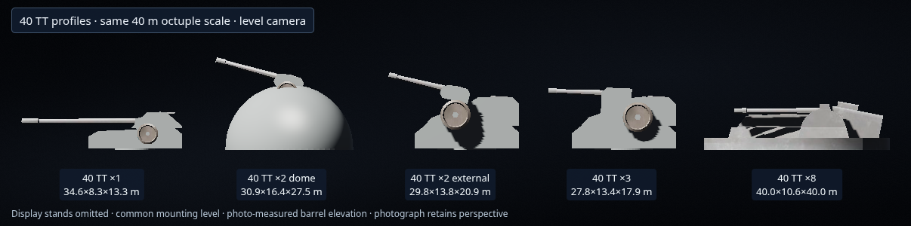
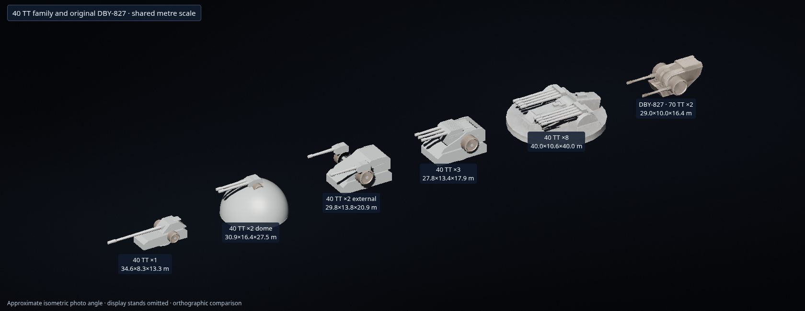
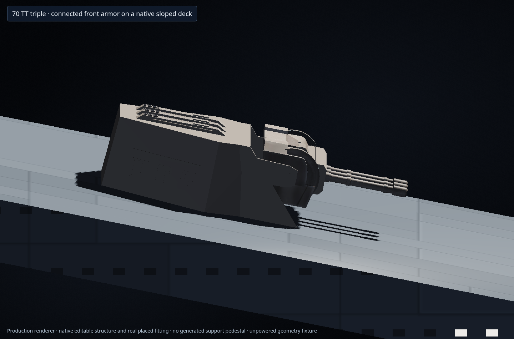
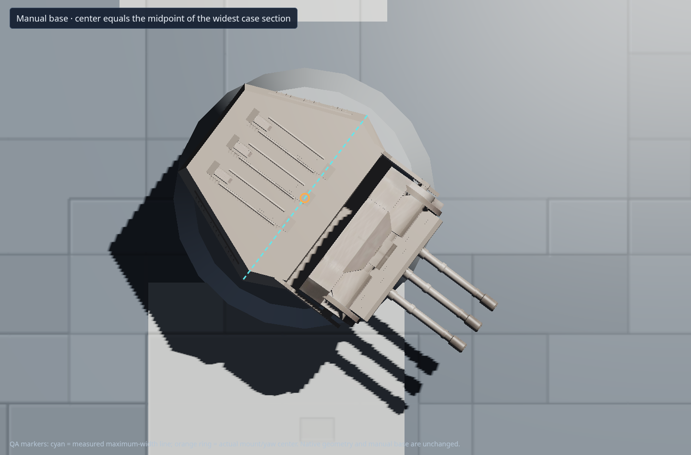
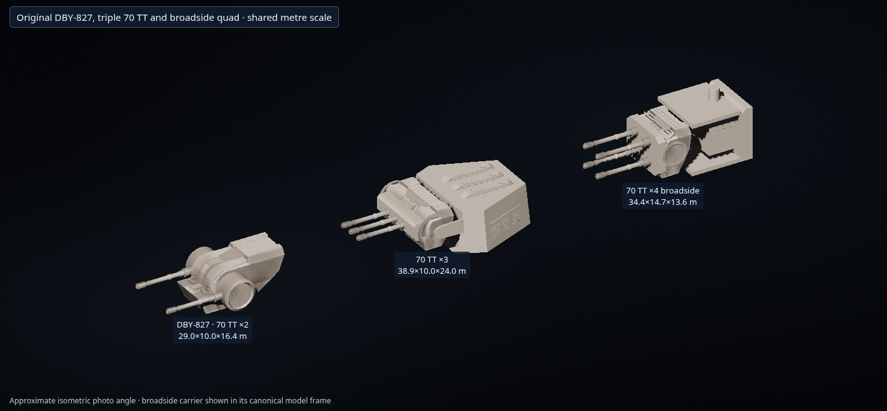
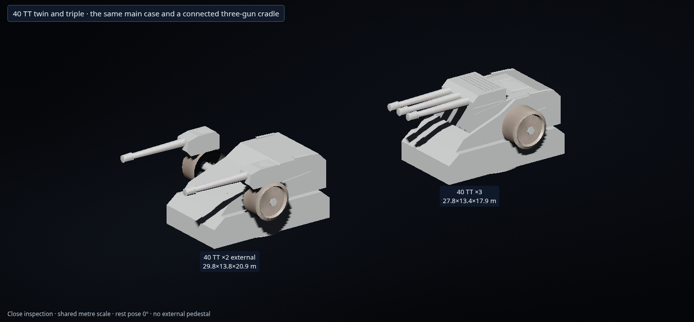
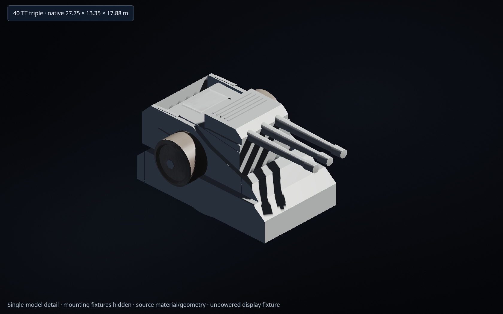
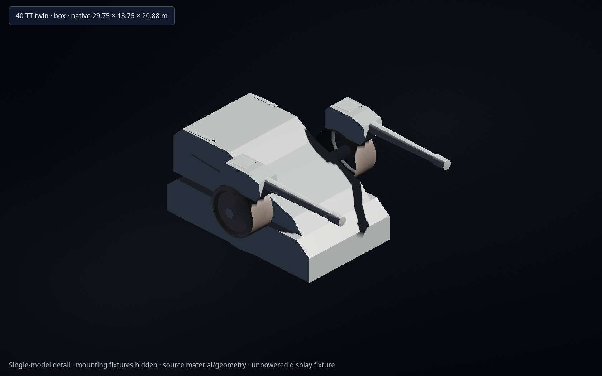

# 写真に基づく砲塔系列と砲室区画

ユーザー提供のインペリアル級の全体写真と兵装比較写真に従い、通常武装を9種類へ整理する。球形砲室のイオン4連装と半球形砲室のターボレーザー連装を区別し、既存の通常ISD 8連装とDBY-827は元のモデル形状を保つ。

| 武装キー | 種類・一斉射 | 形状・駆動 |
| --- | --- | --- |
| `single40` | 40TT単装ターボレーザー、40 TT | 写真の長い砲身と、高さを持つ角形砲室・後方の円形砲基部を組み合わせる |
| `quad40Ion` | 40TT 4連装イオン砲、イオン160 TT | 球の高さの約1/3を取付面へ埋め込み、球体と4門が一体で照準する |
| `twin40Dome` | 40TT 2連装ターボレーザー、80 TT | 広い半球形の砲室の中央へ、円形砲基部と2門の砲身をまとめる |
| `twin40` | 40TT 2連装重ターボレーザー、80 TT | 3連装と共通の固定砲室に中央機器カバーを合わせ、完全なDBY型円形駆動部と各1門を左右の外側へ配置 |
| `triple40` | 40TT 3連装ターボレーザー、120 TT | 連装と共通の固定砲室で、軸につながる幅広の可動装甲フードと揺架が3門を支える |
| `oct40` | ISD 40TT 8連装ターボレーザー、320 TT | 従来の通常8連装 `isd_heavy_octuple` の形状・細部を保持し、一様に寸法調整 |
| `refVen` | DBY-827 70TT 2連装重ターボレーザー、140 TT | 既存 `ven_turret` の形状を保持し、取付姿勢と寸法を正規化 |
| `triple70` | 70TT 3連装重ターボレーザー、210 TT | DBY-827と同じ全高。前方が幅広の六角砲室から、独立した大きな3門ポッド全体が前へ張り出す |
| `quad70Side` | 70TT 4連装舷側重ターボレーザー、280 TT | 上下の桁と後部隔壁を持つC字形固定砲架の前に、正方形2×2配置のDBY型砲機構 |

ISDの8連装は全長1,600 mの艦体との比率を参考に40 m級へ調整する。透視と写真の読み取りによる約±10%の不確かさがある。基準は従来の通常8連装（1,436頂点・1,104面）で、[元アセット](../assets/source/isd-heavy-octuple-original.json) を固定している。縦横比、低い丸形の砲室、8本の砲身、細部、UVと接続関係を保ち、寸法だけを一様に約1.348倍へ調整する。DBY-827も元の `ven_turret` を基準とし、全長約28.862 mの寸法を保持する。

各系列は個別の標準寸法を使い、出力比の立方根で再縮小しない。現行の標準寸法、メッシュ、駆動軸、砲口、砲室領域は [生成マニフェスト](../assets/source/turret-family-manifest.json) に記録する。次表はカタログの順序。全高には取付面より下の部分も含む。

砲室の長さ・高さ、円形砲基部の直径、砲身の長さを、それぞれ写真から読み取る。[写真の測定記録](../assets/source/turret-photo-measurements.json) は生成形状とは独立に、元写真のSHA-256、画素座標と読み取り幅を記録する。写真1では8連装の円盤直径246画素を40 mの基準とする。展示用の円筒台や台座を砲室に含めず、40TT系は約13%の読み取り許容差を持つ。写真3の投影幅比には透視による不確かさがあり、三次元の寸法比そのものとは扱わない。

| 武装キー | 全長 × 全高 × 全幅（m） | 閉じた砲室領域（m³） |
| --- | --- | ---: |
| `single40` | 34.600 × 8.250 × 13.258 | 757.386 |
| `quad40Ion` | 23.907 × 17.359 × 17.359 | 2,706.780 |
| `twin40Dome` | 30.850 × 16.350 × 27.500 | 5,430.048 |
| `twin40` | 29.750 × 13.750 × 20.880 | 2,360.400 |
| `triple40` | 27.750 × 13.350 × 17.880 | 884.709 |
| `oct40` | 40.000 × 10.569 × 40.000 | 534.643 |
| `refVen` | 28.862 × 9.998 × 16.258 | 954.412 |
| `triple70` | 38.880 × 9.998 × 24.000 | 3,465.582 |
| `quad70Side` | 34.380 × 14.700 × 13.600 | 1,602.890 |


比較列は本番描画を使い、寸法を見やすくするため検証用の取付構造物を隠す。0度と25度を比較し、舷側専用砲は機械的制限の20度まで動かす。独立した検証用の表示姿勢で、戦闘中の自動追尾を示す画像ではない。





写真1に対応する比較は左向きの側面正投影で、5種類を共通の取付面と縮尺へ置く。写真2・3に対応する斜視は近い角度の正投影を使う。元写真には透視と砲身の仰角があるため、これらは形状と大きさを見比べるための画像であり、画素単位の一致率を示さない。写真の展示台は再現しない。

70TT 3連装の全高は元のDBY-827と同じ約9.9977 m。長さ19.5 m・最大幅24 mの六角砲室は、後端から約69%の位置で最も広くなり、後部へ絞る。装甲帯、側面の点検パネル、屋根上の3列の機構を持つ。幅18 m・奥行7.5 mの共通3門ポッド全体が前面へ張り出し、砲身根元を中央と左右3 mへ集める。70TT系列の砲身はすべて元DBY-827の全長約12.87965 mを保持する。

前部の左右には、本体から取付面まで連続する傾斜装甲を設ける。固定軸を円形砲基部へ重ねて接続し、前部ポッドと本体の間に見えていた隙間を塞ぐ。この装甲は構造部分として扱い、充電設備の容積へ加えない。

取付・旋回中心は、最大幅断面の左右端を結ぶ線の中央へ合わせる。モデル座標では左右端が `[3.8, 0, −12]` と `[3.8, 0, 12]`、取付点が `[3.8, 0, 0]` となる。保存済みの配置座標は取付点として維持し、その位置へケースの最大幅部分を揃える。斜面や手動の砲座でも同じ変換を使う。[接続・取付中心のブラウザ検証](benchmarks/triple70-mount-browser.json) には実装ハッシュと実画面を記録する。







40TT単装は砲室の高さと長さを増やし、長い砲身との比率を整える。半球型連装は広い砲室の中央上部に機構をまとめる。箱型連装と3連装の固定外殻は、長さ22.5 m・幅13 m、下端Y0.4 mから上端Y11.4 mまでの同じ形状を使う。固定フレーム部分の形状と閉領域を共通にし、その中の機構を砲数に合わせて変える。



3連装は固定の横軸から幅広の揺架を立ち上げ、装甲フード、受筒、3門の砲身へ実形状でつなぐ。0度では可動フードが中央の開口を埋め、揺架と3門が一体で俯仰する。機構の旋回・俯仰に必要な空間は充電設備の容積へ加えない。



40TT連装は共通外殻の中央へ固定機器カバーを合わせ、前面を下部へ傾斜させる。円形部と砲身はケースの左右の外側へ完全に露出する。両形式とも側面の装甲帯と屋根上の点検パネルを持ち、砲室内の実容積を区画へ反映する。



## 既存モデルに揃える材質

現行の砲塔はすべて40TT×8のISD塗装へ揃える。DBY-827やイオン砲も含め、塗装の処理では描画用の色・UVを統一し、元アセットへ色を書き戻さない。全体の照明と40TT×8自身の塗装は変えない。[共通塗装の仕様](capital-turret-family.md#共通塗装)を参照。[材質の測定記録](benchmarks/turret-material-reference.json) は統一前の材質単独検証を残した履歴資料である。

半球型砲室と球形イオン砲には中心からの方向に沿う滑らかな法線を使う。角形砲室の稜線、半球の平らな底面、元モデルから流用した部品の法線は保持する。この表示上の調整によって球体の寸法や埋設量、砲室容積は変わらない。

## 支持台と配置

比較写真にある無地の円筒台や展示用の台座はモデルに含めない。新規配置時の砲座高さ・自動持上げ量は0で、砲塔本体を甲板へ直接取り付ける。元の砲塔に固有の旋回環・外殻・機構部は保持する。ISDの8連装は、写真の展示台を取り除くために別の装甲皿や輪郭線だけのリングへ作り直さない。既存設計の明示的な砲座高さと、必要時に指定する手動の砲座は引き続き使用できる。

`quad70Side` は左右の舷側面専用。甲板・艦底・艦首・艦尾への配置や置換は、設計を変更する前に拒否する。C字形砲架の上下桁と後部隔壁を舷側へ固定し、その前の正方形4門ユニットが左右±65度・上下±20度に動く。70TT 3連装を含む通常砲塔の俯仰範囲は−10〜+85度、水平旋回は全周。70TT 3連装は砲基部・揺架を含む実メッシュで−10度・0度・20度・55度・85度の非干渉を検証する。

球形イオン砲は球体全体と4門が一体で水平旋回・俯仰する。球体を固定したまま砲身だけを上下させない。半径をRとすると、球中心は取付面からR/3、球の底は−2R/3で、高さの約1/3が構造物へ埋まる。これは球の容積の1/3ではなく、理想的な球では容積の7/27に当たる。実際の船内占有は閉じたメッシュと構造物の交差で求め、支持台を自動追加して球を甲板上へ持ち上げない。

航空機と共通の震盪ミサイル発射管は、上下の発射角に合わせて支持部を出す従来の仕様を保持する。砲塔の台座を省く設定を、発射管の角度調節へ適用しない。

## 砲室に収める充電設備

砲塔の実際に閉じた外殻内を武装区画として使う。各アセットに、見えている外殻に対応する閉じた領域を定義する。元メッシュの砲室には、その内側へ収まる保守的な凸立体を使う。包絡箱、砲身、揺架、歯車、旋回環の内側の空気、展示台の空間には容量を与えない。複数の立体は和集合として数え、重なりを二重計上しない。

充電設備の密度は0.05 TT/m³。標準の1斉射分なら、必要容積は一斉射出力を0.05で割った値になる。先に砲室内へ設備を収め、残りだけを船体内に追加する。

標準寸法、備蓄1斉射、充電容積倍率1で有効に取り付けた場合は次の量になる。イオン砲はイオンの一斉射出力だけを使い、ターボレーザー出力を重ねて加算しない。

| 砲塔 | 1斉射の必要容積（m³） | 船内へ追加する設備（m³） |
| --- | ---: | ---: |
| 40TT単装 | 800 | 42.614 |
| 40TT 4連装イオン砲 | 3,200 | 493.220 |
| 40TT半球型2連装 | 1,600 | 0.000 |
| 40TT箱型2連装 | 1,600 | 0.000 |
| 40TT 3連装 | 2,400 | 1,515.291 |
| ISD 40TT 8連装 | 6,400 | 5,865.357 |
| DBY-827 70TT 2連装 | 2,800 | 1,845.588 |
| 70TT 3連装 | 4,200 | 734.418 |
| 70TT 4連装舷側砲 | 5,600 | 3,997.110 |

箱型連装と3連装は同じ固定外殻を持つが、内部機構が必要とする空間は異なる。充電に使える閉領域は連装約2,360.400 m³、3連装約884.709 m³で、標準1斉射の船内追加設備はそれぞれ0 m³と約1,515.291 m³となる。

備蓄斉射数や充電容積倍率を変更すれば必要量も変わる。標準1斉射分を砲室内へ収められる場合は追加設備が0になる。舷側70TT 4連装のC字形ケースでは、上下の桁と後部隔壁などの閉領域を使い、桁の間の空隙は容量へ加えない。

船体へ埋まった砲室部分は、実際の船体・構造物との交差形状で船内占有を求める。船外の砲室と船内に埋まる砲室を合わせて一度だけ充電設備に使い、埋まる砲室そのものも予約区画として他の設備から除外する。船内占有は「埋まった砲室全体＋追加設備」であり、「追加設備」だけではない。砲室に十分な容量があって追加設備が0でも、埋まった砲室を空き区画として再利用しない。

充電設備の質量・費用・電力は設備全体に一度だけ計上する。船外へ移しただけで設備が無償にならず、砲室の形状を予約するために重複した設備を加算しない。砲塔破壊時には砲室内の設備も失われる。追加設備の配置が未計算の間は保留状態を表示し、予定容積を確保済み容量として表示しない。

選択した砲塔の「砲室・充電装置」には、必要容積、砲室全体、船外・船内の内訳、砲室内に収めた設備、船内へ追加する量と確保済み量、船内総占有、合計容量を表示する。

## 生成・互換性・検証

```sh
python3 scripts/build-turret-family.py --check
node --test tests/turret-photo-proportions.cjs tests/weapon-plain-metal-uv.cjs \
  tests/weapon-family-models.cjs tests/weapon-family-ui.cjs \
  tests/turret-compartment-volume.cjs tests/authored-turret-motion.cjs tests/triple70-mount.cjs
```

形状・寸法・移行・読込み・翻訳に加え、写真の測定値と実形状の比率、元部品の材質、曲面の法線を検証する。本番ブラウザで9種の選択、俯仰、砲室表示、球の埋設と写真に対応する比較画面を確認する。[実装ハッシュ付きの検証記録と画像一覧](benchmarks/weapon-family-browser.json) を同梱する。

mainとの統合では39作例の実計算を回帰データと照合し、代表作例と編集キャッシュの12テストも成功した。[数値の照合記録](benchmarks/weapon-family-figures-integration.json) に変更理由と維持した項目を記録する。MC30cとミュニフィセントは充電設備を収められる既存船体上へ砲座を調整し、船体形状を変えず、計48基の両用砲が実際に接地して必要容量を確保できることを4テストで確認した。

生成器はPython標準ライブラリだけを使う。9種類で合計29門を持つ。通常ISD 8連装は元の頂点・面の接続関係を保持し、DBY-827は本体・駆動部と砲身の全断面を残して円周分割を減らす。現行の全砲塔を5,000三角形以下に収める工程は[面数制限](turret-polygon-budgets.md)に記録する。通常40TTターボレーザーは元の閉じた先端（`source-cap`）を保持する。40TTイオン4連装は[共通イオン意匠](capital-turret-family.md)に合わせ、太い根元から細い先端へ絞る砲身と凹んだ砲口へ更新する。70TT系列9門はDBY由来のくぼんだ砲口を持つ。固定部と可動部を定義し、描画・砲口位置・射線・選択判定で同じ変換を使う。球形イオン砲は全体を可動部として扱う。舷側専用砲の固定砲室と可動揺架もこの経路で扱う。

旧設計の武装ID、配置、対称関係、充電設定を保持する。旧DBY由来の40TT連装スキンと旧系列の固定ポーズ指定は、対応する現行砲塔へ移行する。既存の汎用70TT連装 `htl` はIDを保ってDBY-827の砲室を使い、カタログでの重複を避ける。旧ヴェネター側面砲 `refSide` と旧XX-9 `xx9` は現行の `twin40` へ、旧NK-7 `nk7` は球形4連装イオン砲 `quad40Ion` へ移行する。旧カタログ項目を重複して残さない。`xx9` は80 TT・4秒間隔から80 TT・1秒間隔へ、`nk7` はイオン40 TT・4秒間隔からイオン160 TT・1秒間隔へ変わる。今回の系列に含まれない通常砲の寸法換算と350TT連装重砲は [寸法換算](weapon-output-sizing.md) を参照。

[500GT四連装](photo-reference-turrets.md) の既存メッシュにも（小型両用砲の元メッシュは v27 で削除）、実際の砲室内に収まる保守的な閉領域を定義する。この容量は [既存砲室マニフェスト](../assets/source/turret-legacy-compartments.json) と変換元メッシュのハッシュで管理する。
