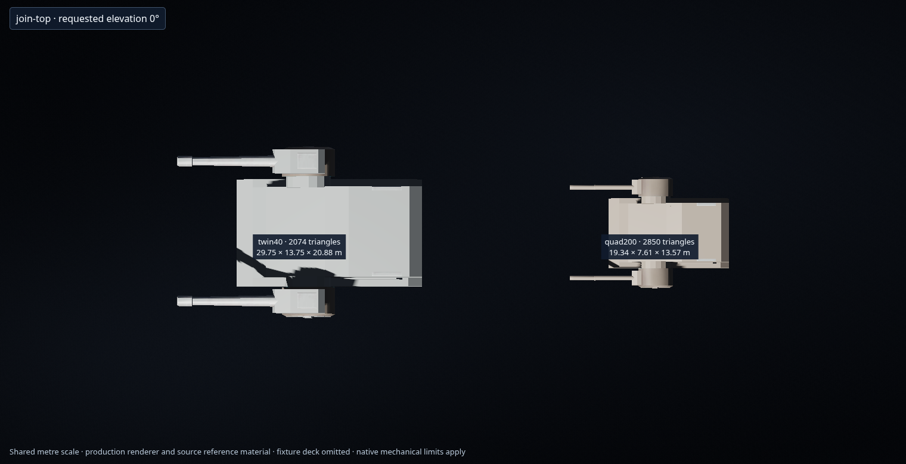
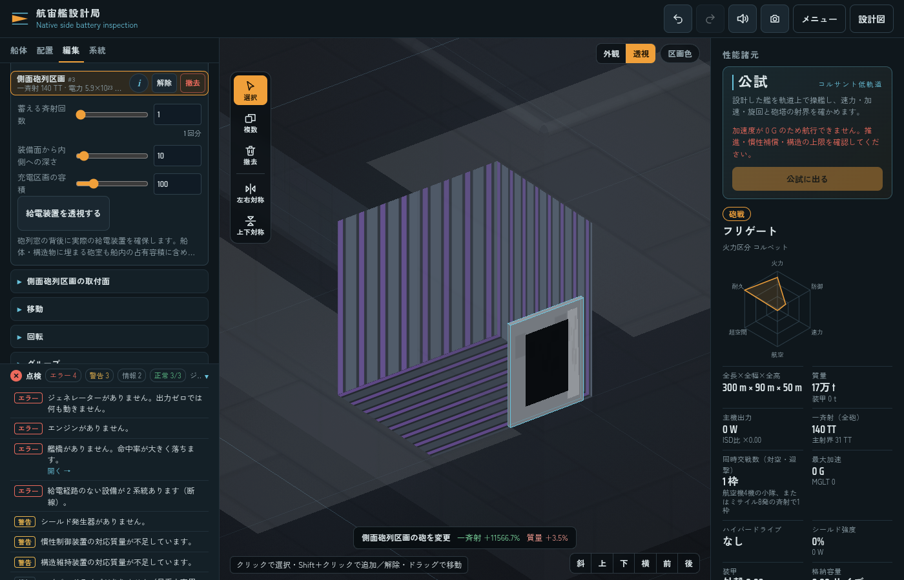

# 砲塔の面数制限と側面砲列区画

面数は描画される三角形で数える。固定部・可動部・内蔵リングを合計し、40TT/70TT系列は5,000面以下、200GT/500GT系列は3,000面以下とする。生成器と実際の描画バッファの両方で上限を検証する。

以下の表は減面時点の比較記録。現行の40TT×4イオン砲身と追加175TT・720TT系列の形状・面数は [新系列の仕様](capital-turret-family.md) を参照。現行モデルにも同じ上限を適用する。

| 砲塔 | 変更前 | 変更後 |
| --- | ---: | ---: |
| 40TT×1 | 1,452 | 1,452 |
| 40TT×2 半球型 | 4,558 | 4,558 |
| 40TT×2 外装型 | 2,210 | 2,074 |
| 40TT×3 | 2,218 | 1,962 |
| ISD 40TT×8 | 1,104 | 1,104 |
| DBY-827 70TT×2 | 5,572 | 4,388 |
| 70TT×3 | 16,712 | 4,995 |
| 70TT×4 舷側型 | 8,712 | 4,479 |
| 40TT×4 イオン | 1,696 | 1,696 |
| 500GT×1 | 2,748 | 2,204 |
| 200GT×1 | 3,384 | 2,232 |
| 200GT×2 左右型 | 4,328 | 2,760 |
| 200GT×2 上下速射型 | 4,608 | 2,976 |
| 200GT×4 | 6,394 | 2,850 |
| 500GT×4 | 10,442 | 2,966 |
| 合計 | 76,138 | 42,696 |

砲身の長さ・径・段差・砲口の奥行きは保持し、円周分割や小さな重複部を減らした。ISDの8連装は元の描画データを保持する。DBYの本体と駆動部を保持し、砲身は全19断面を残して円周分割を減らす。70TT×3の前部機構は元の頂点とUVを使う縮約、上部の小部品は輪郭に沿う形で軽量化した。500GT×4は中央STLケースと側面の閉鎖面を保持し、小さな後部円形部品・砲身・同心円の駆動部を減面した。

40TT×2外装型と200GT×4は、中央構造から左右の円形駆動部へ固定の円形肩部を張り出させて接続する。この機械部分に充電設備用の空き容積は与えない。肩部は俯仰する砲身から分離し、取付面に対する固定部として描画する。



[物理形状の比較](benchmarks/turret-polygon-geometry.json) では、15種類の砲室頂点・面・容積が変更前と一致することを検証した。DBYの全長差は約3.25µmで、位置の符号化精度より小さい。元資料を含む対象外65アセットは変更していない。以下の武装統合による出力変更は、この形状比較とは別に扱う。

## 武装の統合

| 旧武装 | 統合先 |
| --- | --- |
| 中ターボレーザー三連砲塔 `mtl` | 200GT×4 `quad200` |
| 重ターボレーザー連装砲塔 `htl` | DBY-827 70TT×2 `refVen` |
| 軽ターボレーザー `ltl` | 点防御兼用20GT×2 `pd` |
| ケースメイト各種 | 側面砲列区画 `broadsideBattery` |

点防御は1門20GT（0.02TT）、連装で一斉射0.04TT、0.2秒間隔とする。既存の手続き生成連装モデルを使い、通常の出力による寸法換算で約1.82mの全長になる。旧設計・テンプレート・搭載艦も同じ規則で読み込み、武装ID・配置・対称関係を保持する。

## 側面砲列区画

構造物の側壁に、ケースメイト由来の装甲枠・黒い砲門・庇を貼り付ける。砲身を船外へ出さず、窓面に実際の門数ぶんの射撃位置を持つ。外装は9m×7m、船外への張り出しは最大0.365m、36三角形。口径・門数を変えても窓を大型砲塔へ置き換えない。

配置前と選択後の両方で、口径と門数を変更できる。70TT/40TTは2門、500GT/200GTは6門を上限とし、保存の読み込みやコピーでも上限を適用する。

| 口径 | 最大門数 | 一斉射 | 一斉射1回分の給電・充電設備 |
| --- | ---: | ---: | ---: |
| 70TT | 2 | 140TT | 2,800m³ |
| 40TT | 2 | 80TT | 1,600m³ |
| 500GT | 6 | 3TT | 60m³ |
| 200GT | 6 | 1.2TT | 24m³ |

設備は窓の背後に実際の船内区画として配置し、ほかの設備・砲列との空間競合を計算する。空間不足や閉塞があれば有効容量も減る。窓の見た目や包絡体積だけで容量を加算しない。「給電装置を透視する」で実配置を確認できる。対称配置・構造物の移動・コピー・Undo/Redo・保存で設定を保持し、手動射撃と艦隊射撃は同じ窓面の砲口座標を使う。



画像は構造物と砲列のみの配置試験で、反応炉・推進機関などを置いていない。実際の再充電には反応炉からの給電が必要であり、専用テストでは反応炉の追加前後で再充電率が0から1へ変わることも確認する。

新規配置は構造物の側壁に限定する。旧ケースメイトが船体側面に付いている保存設計には移行用の互換設定を保持し、勝手に武装を消さない。甲板への配置は互換設定でも認めない。

既存の計算済み戦闘データは新しい出力と区画設定へ再計算するため、プロフィール版を9に更新した。艦載機12種類の価格・電力カタログも実設計から再生成する。

## 再生成と検証

```sh
python3 scripts/build-turret-family.py --check
python3 scripts/build-light-turret-family.py --check
python3 scripts/build-light-quad500.py --check
node scripts/update-craft-costs.cjs --check
node --test --test-concurrency=2 tests/turret-polygon-budgets.cjs \
  tests/turret-reduced-source-normals.cjs \
  tests/weapon-family-models.cjs tests/light-turret-family.cjs \
  tests/arquitens-turret.cjs tests/broadside-battery-core.cjs \
  tests/broadside-battery-ui.cjs tests/broadside-battery-gfx.cjs
```

元モデルの未加工データは資料として保持する。面数上限は実際に装備される現行モデルに適用し、元資料の面数を書き換えて上限を満たしたことにはしない。

[実ブラウザの検証記録](benchmarks/turret-polygon-budgets-browser.json) は、実装9ファイルのハッシュ、15モデルの選択と砲口、各口径の給電装置、門数制限、黒い窓と透視表示を確認する。減面した70TTの機構は位置の符号化後にも潰れた面が増えないことを検証し、6方向・傾斜面の実GPU法線も確認する。
