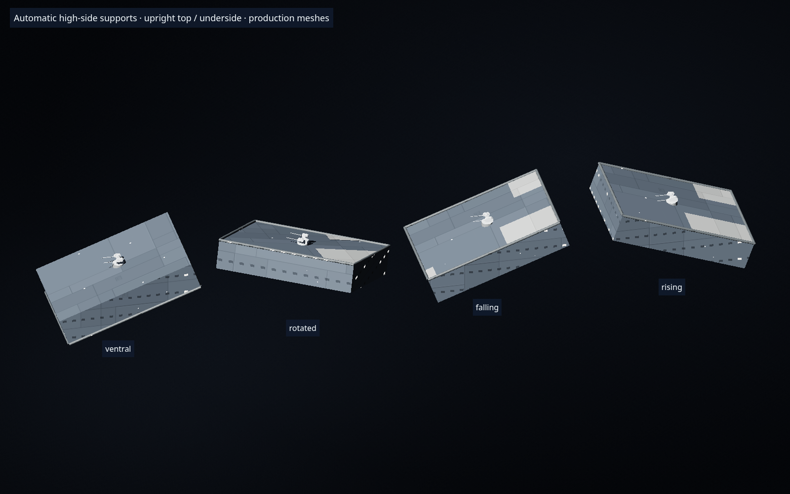

# 斜面へ垂直配置する砲塔の自動土台

「上面に配置」で斜面に置く砲塔は、砲座範囲の高い側に取付高さを合わせ、斜面との間を埋める土台を自動生成する。中心の高さだけに置いて低い側が浮き、高い側が砲塔へ食い込む状態を修正した。

船体と構造物の実際の三角形を砲座の範囲へ切り取り、上側の面を求める。斜面の傾斜・回転、範囲の途中にある段差も反映する。砲塔は水平のまま、土台の上面は最高点、下面は実際の船体表面に一致する。「下面に配置」は取付方向を反転して同じ計算を行う。「面に合わせる」は従来どおり面の法線へ傾け、平らな面や固定砲・発射管に不要な土台を追加しない。

手動の砲座高は自動土台の上へ加える。球状砲塔は取付面から下側を埋め込む設計を維持する。描画・プレビュー・選択・砲口・照準・試射は共通の取付原点を使い、土台の実体積を既存の密度0.3 t/m³で質量へ計上する。

`mountMode` は配置の向き、`mountSupport` は土台を構成する面の局所座標と上面高さを保持する。保存・再読込・複製・対称配置へ引き継ぎ、船体の変形や砲塔の移動・砲座サイズ・向きの編集では再計算する。旧設計の垂直配置も再配置時に生成する。配置テンプレートには元の場所の土台形状を持ち込まない。



[ブラウザ検証記録](benchmarks/slope-fighter-browser.json) は実際のパレット、上面／下面の選択、キャンバスへの配置、JSON書き出し・読み込みと描画を確認する。数値テストは実船体、段差、回転構造物、手動砲座、球状砲塔、保存、対称配置、旧設計の倍率と質量を対象にする。

```sh
node --test tests/turret-slope-support-*.cjs tests/weapon-pedestal-ui.cjs \
  tests/weapon-flush-bounds-core.cjs tests/ball-turret-placement-ui.cjs
node scripts/browser-slope-fighter.cjs
```
